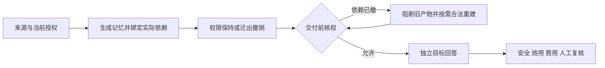

# Agent 记忆安全迁移与权限保持研究原型

研究问题：来源的迁出许可发生变化后，怎样阻止旧派生记忆交给未获授权的接收者，并保留仍合法的信息完成任务。

当前采用可信宿主核权、实际生成输入的依赖闭包、来源和正文绑定、交付前再次检查。模型可以生成记忆与回答，授权依据来自宿主。

## 当前结果（2026-11-04）

两个新合成开发故事完成四方法、三权限状态对照：16次源生成、20次目标回答，另4个位置被系统阻断。独立SDK资格和HY3→Harness资格另行记录；本轮合计40个成功Harness SDK请求、2个真实HY3原生任务。

| 方法 | 应可答合法题完成数 | 完整源端＋目标端费用上界 |
|---|---:|---:|
| B0 旧混合记忆整块阻断 | 6/16 | 0.015392元 |
| B1 当前合法完整原文 | 16/16 | 0.010852元 |
| B2 交付时合法重建 | 16/16 | 0.041752元 |
| B3 独立单源缓存 | 16/16，含一项措辞待审 | 0.028236元 |

实际送达的54道合法题AI复核均正确，6道缺证题均UNKNOWN；B3争议题暂不计通过时为53/54。仅两个独立故事，人工gold仍为空。系统阻断不计作模型拒答。当前结果支持简单强基线，D1新算法尚未参测，尚无方法优势结论。

[阶段成果与流程](docs/阶段收尾_记忆撤权安全交付_2026-11-04.md) · [本轮公开复核包](benchmarks/revocation_rebuild_controlled_20261104/README.md) · [下一阶段唯一研究计划](docs/新算法优势停滞原因与七天验证计划_2026-11-04.md) · [文档索引与合并说明](docs/文档索引与清理说明_2026-11-04.md)

## 流程



WorkBuddy HY3→Harness SDK已完成一例独立真实资格：旧M在撤销S01后拒绝，新R仅来自S02—S04，目标保留两道合法答案，S01预算题UNKNOWN。该结果不增加正式故事数。静态文件和SDK交付的范围，与产品原生在线ACL、模型遗忘和任意Agent互通分别看待。

## 离线运行与复核

标准库核心检查和本轮公开证据复算不调用模型，不需要API密钥：

```powershell
python -B -X utf8 -S -m unittest tests.test_controlled_revocation_release
python -I -B -S benchmarks/revocation_rebuild_controlled_20261104/reproduce.py
```

[本轮核心代码说明](experiments/revocation_rebuild_controlled_20261104/README.md)。公开证据是经白名单导出的实验材料，支持所声明指标的离线复核，不包含本机账户、原生日志和运行时。原生付费执行器依赖本机Harness/WorkBuddy，不属于公共一键重跑入口。

全仓库离线检查：

```powershell
python -m pip install -r requirements-dev.txt
python -B -X utf8 -m unittest discover -s tests -v
```

[GitHub Actions](https://github.com/Caixianseng/memory-migration-permission-pilot/actions) 同时检查Ubuntu与Windows；请按具体提交查看结果。

## 项目结构

| 路径 | 用途 |
|---|---|
| `memory_migration_study/` | 身份、策略、迁移、隐私表示和原生交接等核心组件 |
| `experiments/revocation_rebuild_controlled_20261104/` | 本轮受控撤权、依赖闭包与四方法调度 |
| `benchmarks/` | 按批次声明范围的公开材料和离线复算入口 |
| `tests/` | 全仓库离线回归 |
| `docs/` | 当前方案、阶段结果与必要历史依据 |

历史敏感检测、假名化、Qoder↔Harness及后端迁移仍保留在相应代码和结果文档中，各批数据与分母不合并成整体成功率。

## 下一步

聚焦“权限变化与语义关联共同决定初始分组”：固定相同授权、模型与重建机制，比较合法原文、普通检索、单源缓存、权限/风险/语义分组的完整成本—效用。先进行有限真实小试，优势成立后扩大独立检查材料；普通方案足够时保留负结果。

人工参考与争议裁定、独立新故事、正式方法对照和外部复核仍待完成。项目目前是研究原型与开发证据，不以工程测试数作为论文创新证明。
