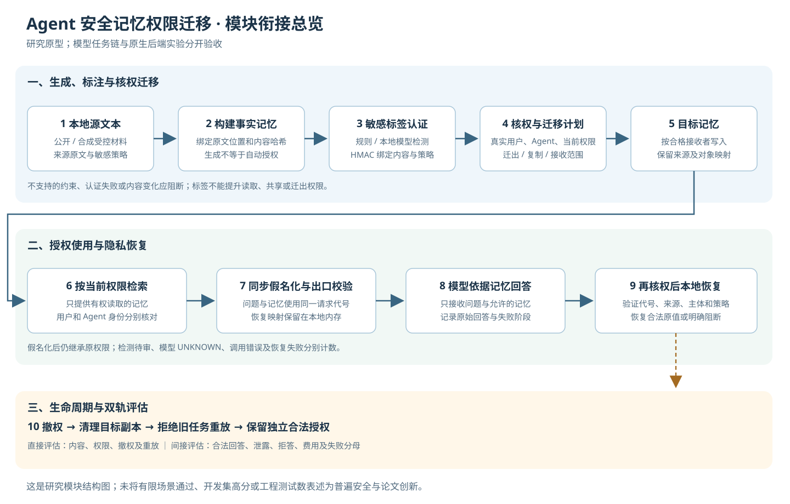

# Agent 记忆安全迁移与权限保持研究原型

本项目研究：Agent A将记忆交给Agent B，或将记忆迁入另一种后端后，怎样保留读取、转交和撤权约束，同时让合法用户继续完成任务。

## 最新研究进展（2026-11-02：七天冲刺，完整基线对照已补齐）

新增 **8次真实Harness Flash/Max调用，正式矩阵12/12格完成**：两个公开合成故事、三种权限视图、合法完整原文与逐来源独立缓存。沿用已有8份WorkBuddy HY3产物，本阶段没有新增HY3任务。SDK实验工作区留有回执，不等同桌面新增聊天。

按原冻结参考，合法题必需信息完整为原文 **8/10**、缓存 **5/10**；另列题目核心完成度为10/10和8/10。两方法的缺证控制均2/2正确UNKNOWN，未观察到政策误拒。发现一份缓存将“超过十五年”变成“大约十五年”并传到两个相关回答；这是同一源产物的失真，尚不能归因于权限变化。参考和复核仍为AI结果，修饰词及新增代词有人工待审项。

**当前未证明强基线无法解决，也未证明新算法优势。** 按用户要求，11月2日至8日完成有门槛的研究冲刺：先做真实时序与强基线，再决定是否值得试生成前分组；原文、惰性生成或简单分组足够时保留负结果。七天交付证据和路线裁决，不承诺论文录用。

[七天完整执行方案](docs/权限变化记忆迁移_创新验证与落地执行方案_2026-11-02.md) · [D1结果与裁决](docs/七天冲刺_D1_完整对照结果与研究裁决_2026-11-02.md) · [公开阶段摘要](benchmarks/permission_partition_sprint_20261102/p1_summary.json)。原始载荷、账户信息和运行配置保留本机；公开摘要不是完整复现包。

## 此前研究进展（2026-11-02：两个新故事真实资格预试）

新增 **8个原生 WorkBuddy HY3逻辑任务，取得8份记忆；5次真实Harness Flash/Max调用**。按冻结原源的独立AI核验：合法回答7/7完整且有依据，缺证据控制3/3正确UNKNOWN，未见主动政策拒答或无依据否定。这是两个公开合成故事的10个相关题目评估，尚非人工金标或泛化100%成功率。

4次目标为合法完整原文，1次为完整缓存费用预检阻断后增加的探索性词法top1交接。**完整两故事×三状态×两方法比较未完成，新算法优势未成立。** 原生连接准备失败、同任务迟到输出及首条宿主元数据核验错误均保留并分别核验，没有重发已完成模型请求。Harness使用官方SDK，独立工作区保留真实回执，不等同新增桌面聊天。

[本轮结果与研究裁决](docs/权限变化语义资格预试_真实客户端结果_2026-11-02.md) · [公开匿名计数与哈希](benchmarks/permission_semantic_qualification_20261102/summary.json)。原文、记忆、回答、账号信息和运行配置保留本机，公开摘要不能单独复核语义成绩。

## 此前研究进展（2026-11-02：按创新手册否证与真实客户端）

按“事实卡 → 机制缺口 → 论文与代码 → 改动溯源 → 否证实验”重新核查，**尚未证明新方法优势**。

- 发现直接近邻，旧的“限定语保留＋遗漏检查”降为强基线。删除鲁棒备选准备暂缓：4个开发故事、8次历史原文请求最大8068字节，低于既有24000字节守卫上限，未观察到容量瓶颈。
- 新增完整消息选择器及结构化角色适配。4故事两臂各保留24条合法原消息，4对载荷完全相同；9项工程检查通过，不能据此声称回答效果提高。
- WorkBuddy原生连接已恢复，本轮两个新HY3会话分别生成四来源M和合法三来源R；撤销S01迁出许可后，未过期旧M被阻断。run04在目标发送前因预算预检退出，不能记为完整在线链。
- 已独立复用R完成一次真实Harness Flash/Max回答：必要信息覆盖2/2、主动拒答0/2、撤源控制UNKNOWN 1/1；严格整段核验1通过、1体裁标签待复核，不能称全部断言正确。原链仍记停止，SDK隔离profile不冒充桌面聊天。

[本轮执行报告](docs/创新筛选与真实客户端推进_执行报告_2026-11-02.md) · [创新筛选台账](docs/创新点筛选_按手册重新核查_2026-11-02.md) · [完整消息强基线](experiments/source_role_baseline_20261102/README.md) · [公开计数复算](benchmarks/innovation_gate0_20261102/README.md)

此前四批真实Harness SDK诊断为65请求（60完整、5输出上限失败），只涉及4个已知开发故事。Max合法原文8/8；三个配对故事全局5/6、逐来源缓存6/6，仅一题差异、实际资源不等，非新算法优势。[历史诊断与边界](docs/真实模型记忆对照与研究裁决_2026-11-02.md)。

## 最新进展（2026-11-01：真实首次交付前撤权）

当前聚焦 **WorkBuddy HY3 → 可信宿主 → DeepSeek Harness**：四来源生成 M 后，首次交付前仅撤销 S01 的迁出许可；保留读取和复制许可，从合法三来源重新生成 R。

- 首条可观察的真实时序链已经完成：M 封存 → 实际撤权 → 未过期旧 M 阻断 → 独立 HY3 新会话生成 R → 再核权 → 原生 Harness 加载与回答。本轮新增两个源作业、一次受控目标请求。
- 一个已暴露开发故事的三道相关题，按预先封存参考进行 AI 核对：合法题完整 **2/2**、主动拒答 **0/2**，撤源控制 **UNKNOWN 1/1**。尚无独立人工最终验收或新算法优势。
- 完整 SDK 请求正文尚未保存；已取得 bodyhash/shape、R 的原生加载和确切包含证据。全面隐私验收仍有 **inconclusive** 项，不能由三题答对推成一般安全保证。
- 上一轮观察器提前退出及晚到记忆单独保留，没有补认旧链通过。只读元数据观察补丁已离线验证；未知错误仍停止，不自动重发模型请求。
- [真实链与研究裁决](docs/首次交付前撤权_公开元数据成果与研究边界_2026-11-01.md) · [公开元数据复算包](benchmarks/pre_delivery_revocation_metadata_20261101/README.md) · [分阶段主机驱动与合同](experiments/pre_delivery_revocation/README.md)

本次公开统计、权限事件及哈希证明；来源、M/R、参考与回答正文保留本机，公开包不能重新审查原文语义。

目标用量为输入 1,116、输出 47 token；按保守费率估算 0.004840 元，供应商实际账单仍未知。WorkBuddy 完整生命周期费用未知，不能据此声称总开销优势。下一步先补请求审计，再与完整合法原文、全量重建、普通独立缓存公平比较。

## 此前进展（2026-11-01：人工转交与目标基线）

当前主线收窄为：记忆生成之后、首次交付之前，撤销部分来源交接许可时，怎样保留仍合法的信息。用户已要求发送端改用 **WorkBuddy HY3**，接收端为 **DeepSeek Harness**。

- 回收到A/B两份各60项评分，但两份均披露AI预评、非独立盲评，独立人工金标仍未成立。
- 新增 **10次真实Harness调用**，5个PersonaMem开发案例比较合法原文与固定BM25。非盲AI初审：原文9/10完整、1项待审；检索7/10完整、3项UNKNOWN；各5个缺证控制全部UNKNOWN。
- 另完成 **1次WorkBuddy输出→主机核权→Harness** 验证：发送/接收身份明确，旧混合包被拒，新三源内容获准，三题结果及其局限已在此前报告单独记录。WorkBuddy输出由用户从可见聊天转交。
- WorkBuddy独立CLI仍缺GUI凭据初始化，自动源端生成尚未接通；不把登录前退出或人工转交记为自动成功。
- [本轮完整报告](docs/评分回收核查与PersonaMem后续实验_2026-11-01.md) · [匿名数据与离线复算](benchmarks/review_followup_20261101/README.md) · [WorkBuddy权限桥接代码](experiments/workbuddy_harness_20261101/README.md)

本轮两批Harness共11次，token保守估算合计0.050564元，实际账单未知；主对照和单例资格分别报告。未建立新算法优势或一般隐私保证。

## 前期工程结果（2026-10-30）

**有限场景工程验收通过，完整投稿前验收尚未完成。** 当前聚焦可信主机上的Qoder→Harness记忆交接，已将授权、实际规则检测、假名化、目标加载、回答和再核权恢复放入同案例验证。此前联合批次采用合成源夹具；新增一例由Qoder原生Write实际保存静态源文件，再迁入Harness。不声称已经完成Qoder原生Auto-Memory导出。

| 最新交付 | 已取得的证据 | 结论边界 |
|---|---|---|
| [授权合同与独立判决器](experiments/submission_acceptance_20261030/CONTRACT.md) | 1206次登记请求，新增未授权放行0、参考允许但未交付0 | 有限主体、操作、状态与确切片段；不是一般安全证明 |
| [同案例联合验收](docs/公开版_投稿前联合验收与复核交付_2026-10-30.md) | 9个合成故事36题的离线全链；2个故事8次真实Harness调用，4道合法题全对、无UNKNOWN，禁迁出/缺失题各2题通过 | 明确EMAIL字段、固定单事实任务；尚无复杂语义检测结论 |
| 完整强基线 | 整请求阻断、逐片段、已有选择性隔离在本批有效输入等价 | 8次真实调用另有16行关联重放；没有证明新算法优势 |
| [可公开复核包](benchmarks/submission_acceptance_20261030/README.md) | 149个冻结文件，隔离重算摘要一致，53项定向测试通过 | 内部交付前复核；正式外部人员验收仍未完成 |
| [真实源端写盘补证](docs/Qoder真实源端写盘与交接_补证记录_2026-10-30.md) | 1个故事：Qoder原生Write事件和实际文件一致；4次Harness调用，2道合法题全对，禁迁出/缺失题各1题通过 | 指定事实的静态保存，不是Auto-Memory或语义抽取；前两次源端资格失败单列保留 |

复核无需模型或API密钥。在仓库根目录执行：

```powershell
cd benchmarks/submission_acceptance_20261030/review_bundle_v1
python -I -B -S run.reproduce.py
```

当前研究继续补证：先核实真实源端长期记忆与静态文件交接的边界，再检验完整强基线尚未解决的问题。人工标注复核、外部人员复核和论文方法贡献均保留为待办。旧检测漏遮、关系误判与向量空结果没有被这批简单材料覆盖；[历史交接记录](docs/阶段收尾与发布交接_2026-10-28.md)单独保留。

[详细任务结构与成果](docs/项目阶段收尾与任务汇报_2026-10-25.md) · [最新联合验收报告](docs/公开版_投稿前联合验收与复核交付_2026-10-30.md) · [公开复核入口](benchmarks/submission_acceptance_20261030/README.md)

## 工作流程



1. 准备原文和服务端规则，区分事实内容与授权依据。
2. 本地摘录或选择记忆事实，核对原文位置和内容哈希。
3. 标注敏感片段，分别认证访问授权与隐私标签。
4. 检查真实用户、执行Agent、源规则、接收范围及目标能力，规划获准副本。
5. 迁移时校验来源、标签和对象映射；未知约束不自动放行。
6. 使用时同步替换问题与记忆中的敏感值，恢复表留在本机内存。
7. 模型回答后再次核权，校验代号与来源，再恢复允许展示的原值。
8. 分开评估底层访问、模型效用、撤权及旧包重放。

这是可组合组件的设计顺序；模型任务链、客户端互通和后端迁移仍分别验收。标签认证不证明没有漏检，假名化也不等于完全匿名化。

## 历史批次的已验证成果与范围

| 内容 | 当前证据 | 主要边界 |
|---|---|---|
| 新材料条件位置标记 | 24条中英文新合成正文；24次GLiNER提取、29次本地Qwen生成；确定案例完整正确12/20→15/20 | 精确率84.6%、召回率91.7%；1个拟载荷漏遮未消除，合法事实保留18/24未提升；未进行下游问答，不切默认 |
| 本机完整材料回归 | 当前双客户端运行对应的1780项全部通过，0跳过/失败/错误 | 359.782秒、387份Python源码前后不变；后续检测续跑器另有27项定向检查通过，不代表模型效果验收 |
| 仓库干净环境回归 | 2026-10-28版本2022项：2008通过、14可选资产跳过，0失败/错误 | 434.734秒，428份Python源码未变；仅测试自建回环862次、禁止连接0次；[验证摘要](benchmarks/release_closeout_20261028_summary.json)。远端CI须核对实际提交 |
| Qoder↔Harness | 统一JSON交接格式、各端适配器、原生AGENTS.md，双向4个任务位置符合 | 外部主机迁入核权；没有原生逐次ACL或即时撤权 |
| 双客户端隐私集成 | 另行2次单值问答，2/2代号与本地恢复正确、6项主机控制通过 | 已知合成词表；完整云端请求、真实多租户及通用任务未验收 |
| 原生API迁移 | WebUI实际原文和Note read ACL→Cognee，169次原生ASGI请求、48条读取关系符合 | 同机隔离应用、正确N单臂、1故事2事实；不是跨机网络或完整政策迁移 |
| 合法回答 | 已暴露8故事：普通短编号31/32、来源事实卡32/32 | 相对强基线只多1题；新独立64题尚未执行 |
| 迁移与隐私表示的配对诊断 | 新4开发故事、48次本地回答、922次原生请求；四格合法题均8/8，原文缺失题4/4、假名化3/4 | 同一逻辑缺失题在两个假名化条件误答；不是2个独立错例，不是独立验收或新算法收益 |
| Qoder/Harness多事实复核 | 2026-10-27调用批次24/24当次流程与答案均正确，156项主机控制通过 | 1个已暴露故事3题、两端同选DeepSeek Flash；上一批23/24当次流程及事后重评记录保留；静态AGENTS不提供原生逐次ACL |
| 隐私表示与提示 | 144次本地回答，6表示×2提示；短粗原提示12/12，长粗原提示10/12 | 仍是4开发故事12题；增强提示有合法拒答代价，人工类型上限不是检测成绩，未建立算法创新 |
| 敏感检测 | 旧40条基线90%/90%、NLI完整池80%/80%；新16条合同开发探测中严格Qwen77.78%/87.50%，宽组织GLiNER60%/93.75% | 不同任务分别计分；尚无精确≥90%、召回≥95%联合达标方法，新配置和NLI均不切默认 |
| 出现位置与关系证据 | 另12条开发材料、72位置；Qwen确定完整正确9/22，GLiNER和NLI均0/22 | 名称候选不全、位置字段误解及大量待审；4个拟载荷原值残留，未发送云端；不构成算法收益 |
| 生命周期与强基线 | 21项受控见证；给定完整事实时，标准重算与普通缓存98格通过 | 未证明新算法优势 |
| 向量稳定性 | 原Mem0→WebUI桥接25/29，后续诊断未复现null | 原4次失败未关闭，新的文件/ACL路径不能覆盖该失败 |

不同实验的请求数、任务位置、故事数和工程检查不能合并为“整体成功率”。当前不能宣称通用迁移成功率接近100%或全面防泄漏。

## 模型与协议各自负责什么

- **迁移与授权**由本地程序、可信当前权限及目标原生API执行，不由模型口头决定。
- **历史DeepSeek Flash API**完成21＋64＝85次真实问答；这些不是85次独立迁移，也不包含后续原生客户端计数。
- **Qwen3 4B、GLiNER、GLiClass和mDeBERTa NLI**用于本地构建、检测、分类或回答开发实验。NLI候选对照实际390次分类前向，效果未达标。
- **Qoder CLI和Harness SDK**是真实客户端，调用接口不同，可以通过适配器使用同一记忆交接格式。本次静态文件导入不等于产品原生共同执行权限协议。

未证明收益的方法没有切为默认；原始失败和完整分母保留。测试隔离错误导致的至少100次额外本地Qwen请求已修复并[更正记账](benchmarks/relation_occurrence_probe_20261027_summary.json)，不能继续称那些历史测试零调用。原生账户实际费用仍未核对，不能把CLI报告的零费用当作免费。

## 快速查看与复查

建议使用Python 3.12。下列基本示例不调用模型或收费API，输出目录须尚未存在：

```powershell
git clone https://github.com/Caixianseng/memory-migration-permission-pilot.git
cd memory-migration-permission-pilot
python -B -X utf8 -m memory_migration_study demo --output results/my_demo
python -B -X utf8 examples/privacy_roundtrip_demo.py
```

GitHub自动测试在Ubuntu和Windows的Python 3.12上执行。复查仓库自带的离线测试时，建议使用独立的虚拟环境安装固定测试依赖，以免影响其他项目；无需下载模型或设置API密钥。下面的命令在项目根目录运行，不需要激活虚拟环境。

Windows（PowerShell 或命令提示符）：

```powershell
python -m venv .venv
.\.venv\Scripts\python.exe -m pip install -r requirements-dev.txt
.\.venv\Scripts\python.exe -B -X utf8 -m unittest discover -s tests -v
```

macOS / Linux：

```bash
python3 -m venv .venv
.venv/bin/python -m pip install -r requirements-dev.txt
.venv/bin/python -B -X utf8 -m unittest discover -s tests -v
```

本机旧工程、原始公开数据及固定官方wheel的14项可选检查，在未提供对应文件时明确显示为`skipped`，不计为通过。测试环境和此前连续红叉的原因见[CI自动测试说明](docs/CI自动测试说明_2026-10-26.md)。

完整测试和原生/模型入口含本机资产及版本核对，不能把仅克隆仓库视为全部依赖已就绪。文档阅读版需要现有Python-Markdown，脚本不会自动安装或联网：

```powershell
python -B -X utf8 scripts/render_project_closeout.py --embed-flow --output results/my_closeout_report/index.html
```

| 入口 | 内容 |
|---|---|
| [历史收尾与待办](docs/阶段收尾与发布交接_2026-10-28.md) | 本轮交付、协议/算法/环境问题划分、发布验证和未完成目标 |
| [新材料条件标记实测](docs/新材料条件标记_前瞻实测与问题定位_2026-10-28.md) | 方法先冻结、新合成诊断材料、实际遮蔽检查与未通过的安全门槛 |
| [PiSAs外部数据核查](docs/PiSAs外部数据适配与初始可见性核查_2026-10-27.md) | 外部数据输入适配和初始可见性核查；不是迁移或隐私效果验收 |
| [问题归因与聚焦研究方案](docs/问题归因与聚焦研究方案_2026-10-27.md) | 协议、算法与环境诊断；四故事四格对照及条件式后续路线 |
| [四格真实实验结果](docs/聚焦语义四格实验_执行结果_2026-10-27.md) | GPT-6.1 Sol ultra实现；本地Qwen实验、实际原生迁移与缺失信息错例 |
| [双客户端多事实复核](docs/双客户端语义记忆迁移复核_2026-10-27.md) | Qoder/Harness双向静态记忆迁入、24尝试、首轮校验错误及承接结果 |
| [隐私表示诊断](docs/隐私表示因素诊断_真实结果与下一步_2026-10-27.md) | 144次本地对照、合法误拒答与缺失题错误分别计分、下一强基线选择 |
| [检测类别合同](docs/敏感类别合同一致性审查_2026-10-27.md) | CUSTOMER两种含义的源码证据与后续公平比较要求 |
| [当前双客户端结果](docs/DeepSeek_Harness与Qoder_当前代码验证结果_2026-10-27.md) | 新24次真实调用、156项主机控制、依赖合同与临时目录诊断 |
| [共同类别合同实测](docs/共同敏感类别合同_实测结果与问题归因_2026-10-27.md) | 96位置、69次Qwen POST与16次NER推理，输出失败保留及负结果 |
| [算法强基线与论文依据](docs/敏感类别判定_强基线与算法候选_2026-10-27.md) | 指南抽取、关系分类与NLI的已有方法和后续可检验假设 |
| [关系证据实际结果](docs/关系证据与出现位置_实测结果与路线裁决_2026-10-27.md) | 72位置封存对照、精确检测/实际拟载荷/合法事实保留分开计分、负结果与归因 |
| [历史向量取证](docs/历史向量空结果_持久化取证_2026-10-27.md) | 旧向量与持久化操作核对、3次副本查询、历史null仍未关闭 |
| [交叉验证与审查修复](docs/审查修复与交叉验证报告_2026-10-26.md) | 8类问题、授权合同、双向原生读取与同条件模型回答 |
| [阶段收尾与交接单](docs/项目阶段收尾与任务汇报_2026-10-25.md) | 项目结构、流程、成果和暂停后待办 |
| [验收与竞品裁决](docs/论文目标_主线验收与竞品核验_2026-10-25.md) | 强基线、研究边界及尚未满足的论文要求 |
| [双客户端互通](docs/双原生Agent统一记忆协议_实测报告_2026-10-26.md) | 同一数据格式与不同客户端适配器的实测 |
| [单值隐私集成](docs/原生客户端隐私交接_双端单值实测_2026-10-26.md) | 假名化、真实回答与本地核权恢复 |
| [WebUI→Cognee原生迁移](docs/原生API导出迁移_WebUI到Cognee实测_2026-10-26.md) | 源API字节、实际ACL、目标映射与旧包复查 |
| [NLI真实对照](docs/NLI候选语义_三臂真实结果与裁决_2026-10-26.md) | 效果负结果和另存的事后探索 |
| [公开汇总](benchmarks/) | 可公开指标与原件哈希 |

`memory_migration_study/`为研究组件，`scripts/`为运行/核验入口，`examples/`为自编示例，`tests/`为工程检查，`docs/`为说明。逐条原始证据留在被Git忽略的`results/`；模型、环境、凭据、数据库和用户原始交接包不随仓库分发。


