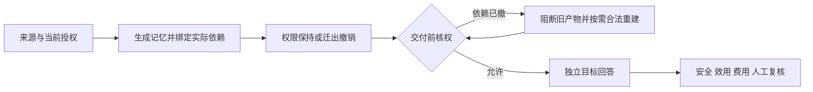

# Agent 记忆安全迁移与权限保持研究原型

研究问题：来源的迁出许可发生变化后，怎样阻止旧派生记忆交给未获授权的接收者，并保留仍合法的信息完成任务。

当前采用可信宿主核权、实际生成输入的依赖闭包、来源和正文绑定、交付前再次检查。模型可以生成记忆与回答，授权依据来自宿主。

## 当前结果（2026-11-05）

WorkBuddy HY3 与 DeepSeek Harness Flash 的双向持久化交付完成 12 个独立合成项目、96 个条件、768 条回答。每个 Agent 分别具有 20、50、100 条原始记忆，撤权比例覆盖 0%、10%、30%、50%。接收库完成导入、关闭重开和读取核验，再由另一端真实模型回答。

| 方法 | 按项目等权合法任务得分 | 合法题必需值全部匹配 |
|---|---:|---:|
| 当前合法完整原文 | 100.00% | 121/121 |
| 旧整条记忆删除 | 20.83% | 40/121 |
| 合法来源全部重建 | 86.46% | 99/121 |
| 固定两块选择性重建 | 77.72% | 95/121 |

百分比以项目等权计算，不等于跨项目合并的题目比例。四组在交付正文和回答中均未命中 38 个去重保密值；18 个撤权旧记忆视图均被拒绝，72 次交付包副本攻击均被拦截，两项真实多层记忆往返测试完成。精确值零命中不等于任意语义泄漏安全。

**本轮安全交付机制通过所测检查，固定分块候选没有证明优势。** 36 个撤权场景块中 35 个需重建。来源合规配对子集中，选择性得分 95.83%、全部重建 97.92%，前者仍使用更多生成尝试、交付包也略大。主分析保留失败，不用补充子集替换主结果。WorkBuddy 的实际费用和供应商物理调用数保持未知，不声明总金额优势。

本轮保留 132 次源结果尝试、98 次接收外层尝试，形成 96 个有效条件。两次空输出服务错误各补测一次；之后的本地回核未新增模型请求。另一次旧会话续跑产物单列且未进入交付。统计独立单位为 12 个项目，不是回答条数或调用次数。

[完整结果与边界](docs/双向持久化记忆交换_完整实验结果_2026-11-05.md) · [可离线复算的公开材料](benchmarks/persistent_exchange_v1_public_20261105/README.md) · [本轮代码与运行条件](experiments/persistent_exchange_v1/README.md) · [前序实验代码与材料索引](docs/前序实验代码与材料索引_2026-11-05.md)

早期 D1 联合分组已有实现及开发、保留和长场景实验；本轮 96 条件测试的是固定来源 ID 哈希分块。两者分别报告。前序长场景中联合方案与单源缓存的实际分区、业务输入相同，尚未证明联合机制的独有优势。

## 前期结果（2026-11-04）

两个新合成开发故事完成四方法、三权限状态对照：16次源生成、20次目标回答，另4个位置被系统阻断。独立SDK资格和HY3→Harness资格另行记录；本轮合计40个成功Harness SDK请求、2个真实HY3原生任务。

| 方法 | 应可答合法题完成数 | 完整源端＋目标端费用上界 |
|---|---:|---:|
| B0 旧混合记忆整块阻断 | 6/16 | 0.015392元 |
| B1 当前合法完整原文 | 16/16 | 0.010852元 |
| B2 交付时合法重建 | 16/16 | 0.041752元 |
| B3 独立单源缓存 | 16/16，含一项措辞待审 | 0.028236元 |

实际送达的54道合法题AI复核均正确，6道缺证题均UNKNOWN；B3争议题暂不计通过时为53/54。仅两个独立故事，人工gold仍为空。系统阻断不计作模型拒答。当前结果支持简单强基线，D1新算法尚未参测，尚无方法优势结论。

[阶段成果与流程](docs/阶段收尾_记忆撤权安全交付_2026-11-04.md) · [前期公开复核包](benchmarks/revocation_rebuild_controlled_20261104/README.md) · [11月4日研究计划](docs/新算法优势停滞原因与七天验证计划_2026-11-04.md) · [文档索引与合并说明](docs/文档索引与清理说明_2026-11-04.md)

## 流程



WorkBuddy HY3→Harness SDK已完成一例独立真实资格：旧M在撤销S01后拒绝，新R仅来自S02—S04，目标保留两道合法答案，S01预算题UNKNOWN。该结果不增加正式故事数。静态文件和SDK交付的范围，与产品原生在线ACL、模型遗忘和任意Agent互通分别看待。

## 离线运行与复核

标准库核心检查和本轮公开证据复算不调用模型，不需要API密钥：

```powershell
python -I -B -X utf8 -S scripts/run_persistent_exchange_offline_tests.py
python -I -B -X utf8 -S scripts/export_persistent_exchange_public.py --verify
python -B -X utf8 -S -m unittest tests.test_controlled_revocation_release
python -I -B -S benchmarks/revocation_rebuild_controlled_20261104/reproduce.py
```

[本轮核心代码说明](experiments/revocation_rebuild_controlled_20261104/README.md)。公开证据是经白名单导出的实验材料，支持所声明指标的离线复核，不包含本机账户、原生日志和运行时。原生付费执行器依赖本机Harness/WorkBuddy，不属于公共一键重跑入口。

全仓库离线检查：

```powershell
python -m pip install -r requirements-dev.txt
python -B -X utf8 -m unittest discover -s tests -v
```

[GitHub Actions](https://github.com/Caixianseng/memory-migration-permission-pilot/actions) 同时检查Ubuntu与Windows；请按具体提交查看结果。

## 项目结构

| 路径 | 用途 |
|---|---|
| `memory_migration_study/` | 身份、策略、迁移、隐私表示和原生交接等核心组件 |
| `experiments/persistent_exchange_v1/` | 双向持久化交付、来源绑定、受控恢复、评分与模拟测试 |
| `experiments/revocation_rebuild_controlled_20261104/` | 本轮受控撤权、依赖闭包与四方法调度 |
| `benchmarks/` | 按批次声明范围的公开材料和离线复算入口 |
| `tests/` | 全仓库离线回归 |
| `docs/` | 当前方案、阶段结果与必要历史依据 |

历史敏感检测、假名化、Qoder↔Harness及后端迁移仍保留在相应代码和结果文档中，各批数据与分母不合并成整体成功率。

## 下一步

依据已有负结果检验更窄候选：来源证据的可核验性、不同撤权结构下的复用边界、真实客户端生命周期一致性。任何后续分组或重建方案均需面对合法原文、普通检索和单源缓存的强对照，计入初建、失败与使用成本；新想法使用独立材料验证，普通方案足够时保留负结果。

人工参考与争议裁定、独立新故事、正式方法对照和外部复核仍待完成。项目目前是研究原型与开发证据，不以工程测试数作为论文创新证明。
