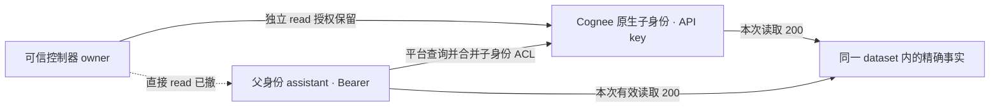

# Cognee 原生读取、分享与撤权：两周期能力资格

2026-10-26。**已建立本机 Cognee 1.6.5 的真实原文/read授权能力资格，不是原25项源策略投影矩阵结果。** 实际原生运行由主任务执行；本说明与独立核验没有新增原生、模型或付费调用。

## 1. 这次测了什么

可信导入者 owner 新建一个 dataset，只写入proposal中 `fact.readonly.text` 的精确19字节 `SYNTHETIC_VALUE_A71`。没有加说明前缀、空格或换行，没有把源文中的另一事实一同导入。owner、assistant、outsider是新建且独立认证的普通用户；子Agent另有原生身份与API key。

两周期在同一新状态中明确分开：先测试只有普通用户read授权时的行为，再建立控制器直接授给子Agent的独立授权，观察其与父身份的组合效果。此处“分享”测试是assistant尝试给outsider授同一dataset的read，不是要求模型口头拒绝。

## 2. 普通用户周期通过

| 原生动作或读取 | HTTP与内容结果 |
|---|---|
| owner完整原文读取 | 200，原字节一致 |
| 未授予outsider读取 | 403，不含事实值 |
| owner给assistant授read | 200；随后assistant完整读取200 |
| assistant尝试给outsider授read | 403；随后outsider仍403，不含事实值 |
| owner撤assistant的read | 200；随后assistant读取403 |

这支持本序列中“read不自动获得再授予read的能力”和“直接read可由控制者撤回”。403均在普通用户身份已资格、owner已读到该实际对象的前提下解释。401、空200、JSON null或执行失败没有被当成授权拒绝。

在assistant仍有read期间创建子Agent，并通过原生 `X-Api-Key` 访问 `users/me` 核对子ID、父ID与非superuser状态。子初始读取403；第一周期撤父read后仍403。这是本次dataset与普通用户配置的观察，不能推广为所有租户/角色中子身份都不会获得父权限。

## 3. 独立子授权保留，父身份也能读取

第二周期显式重新给assistant授read，然后由owner直接给既有子Agent授read。再撤assistant的直接read，观察结果如下。序号是原生HTTP日志的**0起始索引**：

| 索引 | 原生操作 | 实际结果 |
|---:|---|---|
| 30 | owner直接给子Agent授read | 200 |
| 31 | 子Agent用自己的API key读取 | 200，完整事实 |
| 32 | owner撤assistant的直接read | 200 |
| 33 | assistant用自己的Bearer读取 | **200，完整事实** |
| 34 | 子Agent用自己的API key再读 | 200，完整事实 |

因此，这次独立root→child授权在撤父直接read后保留；父身份在该组合状态下也仍能读取。这个结果保留为原生权限组合观察，**不回写第一周期已经成立的用户read撤权结果，不判作请求造假、厂商漏洞或原25项策略失败**。结束时owner仍可读取，outsider仍403。



图中是**授权和有效访问关系**，不是记忆的 `derived_from` 派生血缘。本轮child是Cognee原生身份/API key对象；没有启动自主LLM Agent、规划过程或下游问答。

## 4. 固定源码能支持怎样的解释

只读同一官方wheel及本机安装文件，字节一致的raw读取调用链为：

`raw路由 → get_authorized_existing_datasets → get_specific_user_permission_datasets → get_all_user_permission_datasets`。

最后一个函数合并本人的dataset ACL，并对 `get_user_agents(user.id)` 返回的每个**直接子Agent**合并其ACL。`get_user_agents`按 `parent_user_id == 父ID` 查询。这里是父读取子授权的方向，不是“子自动继承父read”。撤权函数则只删除指定principal、dataset和permission的ACL行。

这为本序列“撤父直接read而保留子独立read，父仍可读”提供了与观察一致的实现解释。本轮没有跟踪SQL授权决策或排除其他合法路径，因此不把静态代码链称为唯一动态根因证明，也不扩展到任意租户和多层Agent。

固定wheel SHA-256：`aaef9fdc02f542b1d125cde21759dde2fac56355d8928e39c734e7b5c6705eca`。以下路径均为该wheel内的官方源码，且与本机安装字节核对一致：

| 源码路径 | SHA-256 |
|---|---|
| `cognee/api/v1/datasets/routers/get_datasets_router.py` | `a3e37faad1ac72559328bca9635b21d31108ea3256227ef92edad4bc274c7c13` |
| `cognee/modules/data/methods/get_authorized_existing_datasets.py` | `3504feadd4f0a482514d6ad94cd380bdf8aa7cad48ded5130e8f5df4d57329c7` |
| `cognee/modules/users/permissions/methods/get_specific_user_permission_datasets.py` | `5b0505ecff9619c13fc4d19c2c55d9cba534058c6479a885275ba543264c435b` |
| `cognee/modules/users/permissions/methods/get_all_user_permission_datasets.py` | `086144118fbfaf2cbd6b6a0e72d847e1c1ac7ab459ddf5ac41df82a2c9c4bda3` |
| `cognee/modules/users/methods/get_user_agents.py` | `512c1a49e08f092ca0720db2779f3aff636a6e0e4de525cf8407c7754d064e04` |
| `cognee/modules/users/permissions/methods/get_principal_datasets.py` | `6ab261722936e6032be244a57f9adb6a367bc3ac15c97581dcbb50b624c29c7c` |
| `cognee/modules/users/permissions/methods/authorized_revoke_permission_on_datasets.py` | `a31f5fc0d9083980684ec94dd0fa851af0622ef2c5f5026825c067f28394cc96` |
| `cognee/modules/users/permissions/methods/revoke_permission_on_dataset.py` | `d67facb5c03ab2e2d691b009b94dee64a32d3a5c4e1c1dd16a8b672180d49cc9` |

## 5. v1失败没有删除或改成权限阴性

v1共13次HTTP：身份、建dataset、空列表成功；原始 `POST /api/v1/add` 返回415，内容为 `Local files are not accepted`，后续read/share未执行。原因是我们worker设定的 `ACCEPT_LOCAL_FILE_PATH=false` 连Cognee自己的内部暂存文件也阻断。它不是权限测试失败，也不是模型失败。

v2保持相同原始 `raw_data`、源事实、driver和48次硬上限，只修worker配置：允许官方文件机制读取本次新state，设置 `COGNEE_ALLOWED_LOCAL_FILE_ROOTS`，实际官方helper确认state内允许、外部路径拒绝；所有官方storage根必须处于state内。URL/path形态RPC输入仍拒绝，外部网络与意外推理入口仍受阻断。没有为了过关把事实改成更长句子，也没有打开任意主机文件读取。

原v1报告、POST原件与源码归档保留在 `results/cognee_read_share_qualification_20261026_v1/`；v2在全新状态运行，目录为 `results/cognee_read_share_qualification_20261026_v2/`。

## 6. 调用量、独立核验与尚未成立的结论

v2实际37次HTTP，低于48硬上限；其中7份认证/密钥响应整体省略，30份非认证原始 `.bin` 逐字节与JSON记录/hash核对一致。当前执行及归档5份本地源码、11份运行契约厂商源码、固定wheel、公开配置helper和proposal均核对一致。独立标准库核验284项通过，核验阶段新增原生/模型调用0。

累计真实HTTP为身份资格10次＋v1失败13次＋v2资格37次＝**60次**，观察到的生成/嵌入尝试均0，网络guard未记录禁止事件。它们仍是一条合成事实、一个dataset和同一两周期机制；60次请求、4个身份和284项工程核对都不能增加独立故事数。这里的0推理是Python入口guard观测，不是GPU forward或OS包捕获证明。

可离线复核：

```powershell
python scripts/verify_cognee_read_share_qualification.py --run results/cognee_read_share_qualification_20261026_v2 --failed-run results/cognee_read_share_qualification_20261026_v1 --identity-run results/cognee_identity_qualification_20261026_v1 --output results/cognee_read_share_qualification_20261026_v2/new_independent_audit.json
```

独立回执为v2目录的 `independent_capability_audit.json`。原始客户端秘密有意不保存，离线核验只能检查认证响应省略规则、公开身份和保存原件，不能与已销毁RAM秘密集合重新比较。

**全部25项源策略投影条目继续未核验。** 本轮没有接入正式source_ref/current-policy校验，没有证明不同 `(user, agent)` 范围已被原生父子关系正确映射，也没测用途、期限、分享受众、委托深度、重放、向量质量或下游Agent回答。后续若源策略要求父/子执行范围独立，应比较正确独立/composite账户映射或明示gateway等强投影，而不能只故意选择不匹配的原生父子映射再宣布失败或创新。
