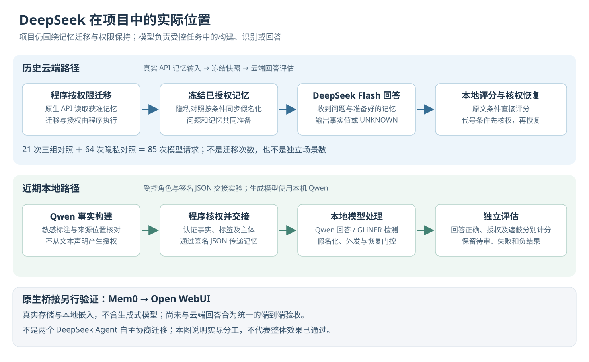

# DeepSeek 使用情况与日志清理：图文汇报

日期：2026-10-25。本汇报补充说明模型在项目中的实际角色，并记录用户要求的日志清理。未追加模型、付费 API 或迁移效果实验。

## 1. 已经使用 DeepSeek 模拟迁移了吗

**已经使用真实 DeepSeek API，测试了迁移后记忆能否被正确使用。** 更准确的名称是“程序控制的记忆迁移＋DeepSeek 下游问答评估”。

迁移的动作由本地程序执行：检查权限，按合法读者创建副本，通过真实 Open WebUI 接口保存和读取记忆，再冻结模型允许看到的上下文。DeepSeek 收到问题和记忆后回答，程序在本地核对结果。

当前没有实现“两个自主 DeepSeek Agent 在线协商、自己决定并搬运记忆”的完整系统。DeepSeek 也不负责决定用户权限，不能依据记忆里的文字给自己授权。



| 环节 | 实际执行者 | 当前证据 |
|---|---|---|
| 决定谁能读、是否能迁出/复制 | 本地授权程序与研究 ACL 网关 | 受控策略、签名及权限检查 |
| 搬运记忆并写入目标 | 迁移程序、目标账号和真实记忆 API | `reader_copies` 等明确迁移策略 |
| 历史两轮的云端回答 | `deepseek-flash` | 实际费用账本共 85 条调用、2 个运行 |
| 近期记忆构建、标注及本地回答 | 本地 Qwen3 4B；GLiNER 提供实体检测 | 最近的 160 / 144 / 96 格开发实验 |
| 最新 Mem0→Open WebUI 桥接 | 程序、原生存储与本地嵌入模型 | 没有生成式模型调用，单独验收 |

“冻结上下文”指把当时已经取回、核验过的记忆保存下来，再以相同输入开展问答比较；它不等于实时在线迁移。Agent A/B 在模型实验中主要是受控程序角色，不能直接理解为两个已部署的自主产品。

## 2. DeepSeek 具体跑了什么

| 实验 | 调用组成 | 实测结果与限制 |
|---|---|---|
| 首轮迁移上下文问答 | 7 题 × 授权参照 / 迁移后 / 无记忆，共 21 次 | 每组 4 道合法题，分别答对 1 / 0 / 0；每组 3 道应拒题均 `UNKNOWN`。两组有记忆输入相同，不能把输出差异归因于迁移丢失 |
| 提示与脱敏四条件对照 | 原/修正提示 × 原文/假名化，56 次；另 8 次无记忆控制，共 64 次 | 修正提示＋假名化合法题 7/8；但该条件 14/14 输入仍残留注册项目名，隐私验收未通过 |

85 是**模型请求数**，不是 85 次独立迁移，也不是 85 个独立场景。两轮均为有限受控材料，不能得出通用 Agent 系统已经稳定成功的结论。历史两轮按 usage 估算费用合计约 0.03714944 元，不是精确账单或当前账户余额。

依据：[首轮真实模型说明](真实大模型首轮实验与运行说明_2026-10-22.md)、[64 次对照说明](本地Agent隐私处理实现与实验_2026-10-23.md)、本机 [费用账本](../results/deepseek_llm_20261022/ledger.json)、[首轮结果](../results/deepseek_llm_20261022/run/report.json) 和 [四条件结果](../results/privacy_agent_20261023/ablation/report.json)。

## 3. 整个项目当前的流程


1. **准备原文和业务规则。** 原文提供事实，服务端规则决定谁能读以及哪些内容需要保护。
2. **生成记忆并检查来源。** 本地模型摘录或选择事实，程序核对原文位置和内容；当前不等于通用语义摘要。
3. **进行敏感标注并认证。** 找出受保护片段，将标签、具体事实、来源和主体绑定；认证标签不证明检测没有漏报。
4. **核权迁移。** 检查用户、执行 Agent、源限制、接收范围以及目标限制，建立获准副本及映射。
5. **检索并同步假名化。** 同一次请求中，问题和记忆里的敏感值使用一致代号，本地保留恢复表。
6. **请求回答模型。** 历史云端对照使用 DeepSeek；近期开发对照主要使用本地 Qwen。模型不获得评分答案。
7. **再次核权恢复。** 验证代号、证据来源和当前权限后，将允许展示的原值交给用户。
8. **分开评测。** 底层权限正确与模型答对分别计分，撤权、清理和旧任务重放单独核验。

上述是可组合研究组件的流程。原生跨后端实验与真实生成式问答实验还没有完成同一条端到端联合验收。

## 4. 已有成果与未完成项

| 内容 | 当前状态 |
|---|---|
| 工程原型 | 已实现来源认证、隐私标注、迁移校验、同步假名化及核权恢复 |
| 最近一次完整离线回归 | 1,028 项通过；本轮不重复运行效果实验，不把历史测试写为新测 |
| 无模型演示 | 参考迁移与假名化恢复两个演示已在收尾时实际通过 |
| 最新 32 道开发合法题 | 默认严格 26/32；同输出格式兼容后 30/32，尚非新独立验收 |
| 原生桥接 | 保留 v3 的 25/29 失败；后续同序诊断 29/29，未证明根因修复和稳定性 |
| 原检测目标与新独立 64 题目标 | 尚未通过；后者尚未执行独立验收 |
| 论文创新与强基线优势 | 尚未成立 |

详细证据、负结果及后续任务见 [项目阶段收尾报告](项目阶段收尾与任务汇报_2026-10-25.md)。

## 5. 日志清理范围与实际结果

按本次“清除所有日志”的请求，清理范围为本项目的运行和调试日志：`results/` 中的 `.log` / `.log.*`、项目根级同类日志，以及核实的本地安装/服务日志。清理脚本只逐个处理已验证位于仓库范围内的文件，不递归删除目录，不跟随符号链接或目录联接，不停止无关服务。

实际清理结果：**90 个日志全部删除，0 个失败、0 个仅清空保留**；清理前合计 95,880,223 字节，约 91.4 MiB。清理后重新运行同范围扫描，日志候选 0 个、字节数 0。20 份关键实验结果、逐请求评测数据及费用账本均存在，内容哈希全部保持不变。

清理回执：[逐文件处理摘要](../results/log_cleanup_20261025/cleanup_receipt.json)、[清理后复查](../results/log_cleanup_20261025/post_cleanup_inventory.json)、[20 份研究结果完整性复核](../results/log_cleanup_20261025/protected_artifacts_verification.json)。公开版只提供 [聚合指标](../benchmarks/deepseek_role_and_log_cleanup_20261025_summary.json)，不上传本机逐文件清单或日志原文。

保留实验结果、失败结论、原始模型结果 JSON、逐请求评测数据、费用账本、模型资产、代码、数据集及 `.git` 历史。它们不是本次运行日志清理的对象。清理不表示历史失败消失，也不构成新的效果验收。

完整回归的控制台日志会随本次清理移除；1,028 项通过的结构化回执继续保留。报告不再宣称被删除的日志仍可打开，后续核对以现存结果与结构化记录为准。

新增 `scripts/clear_project_logs.ps1`，默认只列清单；显式 `-Mode Clear` 才执行清理。仓库增加日志忽略规则，减少后续误提交。

```powershell
# 查看清理候选，不删除
powershell -NoProfile -ExecutionPolicy Bypass -File scripts/clear_project_logs.ps1 -Mode Inventory

# 按明确范围清理项目日志，保留结构化清理回执
powershell -NoProfile -ExecutionPolicy Bypass -File scripts/clear_project_logs.ps1 -Mode Clear

# 生成本图文报告，不调用模型
python -B -X utf8 scripts/render_project_closeout.py --input docs/DeepSeek使用与日志清理_图文汇报_2026-10-25.md --output results/deepseek_role_and_cleanup_20261025/index.html
```

本轮新增模型请求、收费 API 请求和 API 费用均为 0。GitHub 发布仅包含代码、自编说明、图示和去原文聚合信息；本机实验输出不上传。
