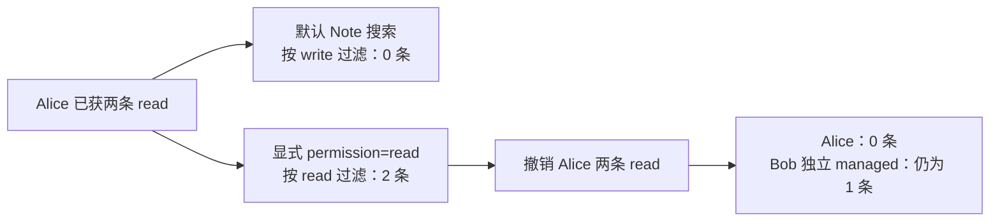

# WebUI 旁路实测：读取与搜索权限差异

日期：2026-10-26。对象：Open WebUI 0.12.3；1 个自编合成故事、2 个精确事实。本文只解释本次有限原生接口实测，机器可读数据见[汇总](../benchmarks/webui_surface_probe_20261026_summary.json)。

本轮确认：**“搜索为空”需要先核对搜索使用的权限。** Alice 已有两条 Note（笔记容器）的读取权限时，默认 Note 搜索返回 0 条；在同一阶段显式传入官方参数 `permission=read`，返回 2 条。默认搜索采用写权限过滤，这一差异不能算模型拒答、权限漏洞或算法创新。

## 两个隔离状态怎样测试

两臂各使用新的原生数据库、独立凭据和两个 owner 文件；四个 `(用户, Agent)` 组合分别映射为普通平台账户，另有 owner 和初始化所需的 bootstrap 管理账户。没有运行自主 LLM Agent。

| 测试臂 | 实际权限安排 | HTTP | 接口观察 | 额外原文读取关系 |
| --- | --- | ---: | ---: | ---: |
| N：原生权限投影 | 先不授权；再给 Alice 两条 read、Bob 一条独立 read；随后撤销 Alice 两条，保留 Bob | 192 | 145 | 16 |
| G：原生存储隔离 | 四个组合账户始终没有原生 ACL（访问权限表），只有 storage owner 读取 | 187 | 145 | 16 |
| 合计 | 每臂硬上限 200，实际均未超限 | **379** | **290** | **32** |

G 本轮只测 **owner-only storage 的原生直达隔离**，没有重跑外部网关。G 的 `source_read_allowed_objects=[]` 表示该臂原生直达集合为空，不能据此说抽象源策略把所有用户都拒绝了。源端本来合法的读取，仍需经先前验证的可信网关路径；本次不再次测量该路径。

## 观察到了什么

| 同一控制序列 | Alice 默认搜索 | Alice 显式 read 搜索 | Bob 显式 read 搜索 |
| --- | ---: | ---: | ---: |
| 已授读取权限 | 0，HTTP 200 | 2，HTTP 200 | 1，HTTP 200 |
| 撤销 Alice 后 | 未重复测量 | 0，HTTP 200 | 1，HTTP 200 |

原文读取检查也确认：授权阶段 N 有 3/8 条可读关系，撤销后剩 Bob 的 1/8；G 两阶段均无四个组合账户可原生直读的关系。撤权由控制器显式同步原生 ACL，不能描述成平台自动追踪源端权限或实时撤权。

文件全列表和文件名搜索只枚举上传者自己的文件。因此，只读共享用户能按 ID 读取文件，同时搜索不到共享文件，符合本轮固定原生接口的查询范围；这里的搜索是文件名/标题的数据库筛选，未涉及向量或语义检索。

## 哪些结果具备资格

先让 owner 访问同一个接口，取得确切对象或原文阳性，再判断其他主体；检查完整响应中的两条注册原值及所有文件、Note ID。

| 290 条接口观察的分类 | 数量 | 本轮含义 |
| --- | ---: | --- |
| owner 阳性 | 16 | 证明相应接口能返回受控对象或原文 |
| 具备 owner 阳性的原生视图检查 | 170 | 返回内容与该接口权限、查询范围相符 |
| owner 无已提取文本 | 4 | `process=false` 上传后，`data/content` 为空，不具备内容评测资格 |
| owner 的 HTML 接口不适用 | 4 | 原生 HTML 路由要求上传者为管理员，本轮上传者为普通 owner |
| 因上述 owner 接口无资格而不评分 | 96 | 即使其他主体返回空值或 404，也不计安全通过 |

合计 **186 条有资格观察，104 条不适用或未具备资格**。受控检查没有发现新增注册材料披露；这不能改写为“7 条路由全部通过”或普遍隐私成功率 100%。

186 条进一步分为：52 条命名下载接口的原值读取/拒绝、52 条文件元数据 ID 检查、82 条列表或 Note ID 检查。后两类验证对象可见性，不能把全部 186 条都描述成隐私原值防护实验。

本轮观察到 0 次生成/嵌入推理入口，网络守卫未发现被禁止的连接；这属于 Python 边界仪器证据，不是硬件级证明。没有调用 DeepSeek，也没有把另行下载的 NLI 资产算作本实验模型效果。

## 证据与剩余边界

最终独立离线回执为 `independent_surface_audit_v2.json`：**3217 项检查通过**，补核了实际 multipart 上传、Note 附件 JSON 及所有事件与 RPC 的归属。其 SHA-256 为 `c9dabbbc2396f1b700a20a79b18993482bd50e2371469557d0d107c24826206f`。v1 的 2904 项通过回执原样保留；这次补核没有新增原生客户端或模型调用，没有读取认证数据库或导入原评分器。检查数不是故事数或新增独立样本。

本机原件目录为 `results/webui_projection_surface_20261026_v1/`；原件哈希保存在公开汇总。运行代码为[驱动](../scripts/run_webui_projection_surface_probe.py)及[仅新增 read 搜索参数的扩展](../scripts/native_webui_surface_worker.py)，原冻结 worker 未修改。此处 Mermaid 保留可编辑源码；未声称已经在 GitHub 端渲染核验。

`full_get_search_list_bypass_qualified` 继续为 `false`：HTML 未适用，提取内容接口没有阳性原文，其他 WebUI 路由、Cognee 其他接口、合格索引上的语义搜索及并发撤权仍未完成。新增独立故事为 0；本轮提供的是原生接口资格与查询权限差异证据，不建立论文创新结论。
