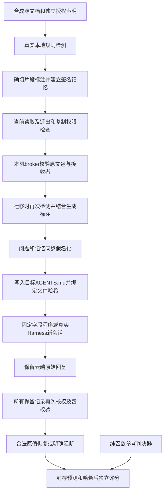

# 投稿前联合验收与复核交付

公开阅读副本：证据链接指向白名单公开镜像，本机原件和冻结摘要保持不变。

日期：2026-10-30。结论：已把有限授权规格、独立参照、实际规则检测、保护载荷、目标加载、回答和再次核权恢复串进同案例验收，并交付可离线重算的独立目录包。有限工程链路通过；尚未发现超越完整强基线的方法优势，正式外部人员验收未完成。

本轮不扩展平台、不继续平行移植算法、不修改生产默认，也不覆盖旧实验。研究主线仍是Agent记忆交接时的权限保持；邮箱保护用于检验该链路中的内容处理。

## 四项交付及完成边界

| 交付 | 已完成 | 仍未成立 |
|---|---|---|
| 冻结授权规格及独立参照 | [合同v1](../experiments/submission_acceptance_20261030/CONTRACT.md)、不导入生产授权的[独立判决器](../experiments/submission_acceptance_20261030/reference.py)、18项手写合同测试；绑定身份、来源、操作、接收者、版本、逻辑时间和当前状态 | 任意Agent协议、一般安全证明、完整FACPL实现、真实时钟同步 |
| 同案例联合评价 | 9个合成故事36题的离线全链；其中固定2个故事8题的真实Harness目标运行，检测不是回放 | 复杂语义敏感检测、大样本自然任务、自由摘要和派生依赖发现 |
| 完整强基线 | 整请求阻断、逐片段处理、已有选择性隔离使用相同材料、权限、检测、提示与预算 | 新算法优势；本批三个方法的完整有效输入等价 |
| 第三方可复核 | 本机[复核包](../benchmarks/submission_acceptance_20261030/review_bundle_v1/README.md)已在隔离目录运行；固定文件hash、数据、响应、评分与命令齐全 | 真正未参与的外部人员验收、永久公开托管和目标期刊认可 |

研究制品依据是可获得、可运行、结果可复现等独立维度，不能用测试数量替代。USENIX Security 2026还要求其永久制品存放于认可的长期平台；GitHub本身不满足该会议的永久托管要求。这些属于该会议制度，不是所有SCI的统一门槛。[官方要求](https://www.usenix.org/conference/usenixsecurity26/call-for-artifacts)。

## 实际流程与信任边界

broker的原文包仅用于可信本机内部验证，发往目标模型的是保护后的AGENTS.md和同步处理的问题。恢复映射留在进程内存，不保存到日志或复核包。UNKNOWN同样必须通过完整当前授权检查，不能绕过撤权。

本轮源端是Qoder适配格式的合成源夹具，主机建立确切片段；没有新增Qoder推理，也没有从Qoder私有数据库自动提取原生长期记忆。真实在线部分运行已安装的DeepSeek Harness。不能把这批实验说成已验证Qoder自动生成记忆或任意Agent私有数据库互通。

## 数据、冻结和失败记录

[材料清单](../experiments/submission_acceptance_20261030/data/manifest.json)冻结3个开发、6个检查故事，共36条事实36题，每个故事含2道合法题、1道禁迁出题和1道缺失题。6中文、3英文；模板家族分开，但字段语法相近，全部AI辅助合成，人工标注复核未完成。只有EMAIL具有本批敏感真值；内部口令按迁出权限排除。

cases.json中的privacy_spans空列表是初始化占位，实际运行中忽略并由真实规则检测覆盖。评分敏感区间和答案单独存放；运行器不打开参考值，预测关闭并核验hash后才评分。开发和检查结果分开，不把相关调用计作独立故事。

早期两轮联合接线失败分别暴露了迁移模式参数错误、问题文本被包装为记忆导致保留标识冲突。后续还修正随机载荷来源ID的等价比较，以及共享调用读取已消费事务的问题。原生资格批次native_run01因新门禁模板文件绑定错误未启动推理；native_run02加载完成但3700字节门禁拒绝完整SDK请求，允许模型流为0。失败原件均保留，未发送位置不计作安全成功。

最终离线批为offline_run07、真实客户端批为native_run03；中间重复运行是工程验证，不增加故事数。现在本批结果已被查看，今后不能把这些故事重新称作新算法的未见保留集。

## 有限授权结果

独立参考与实际入口比较共1206次登记请求执行，开发402、检查804。合计参考允许135次、参考不允许1071次；其中Indeterminate为288次。实际接口unknown为297次，逐项保留，不能据此声称四值决定逐字相等。

| 分组 | 请求数 | 参考允许 | 新增未授权放行W+ | 允许但未交付W− | 实际unknown |
|---|---:|---:|---:|---:|---:|
| 开发3故事 | 402 | 45 | 0 | 0 | 99 |
| 检查6故事 | 804 | 90 | 0 | 0 | 198 |

新的W−包含参考允许时的所有非allow结果，包括未知、错误与阻断，修正旧统计只计deny的遗漏。动态状态包含实际当前授权未知和实际撤权探针，参照显式接收独立状态。矩阵的restore行仍为许可预检，不能替代实际回答恢复；后者由同案例任务及撤权测试另行验证。

上述数字只支持登记有限域。来源义务不再只填一个常量True，而是执行原文定位检查并由独立判决器另行核对。签名和hash支持完整性，不能代替授权判断。

## 离线联合结果：回答者是固定字段程序

最终离线批9故事×4题×3方法=108行工程记录。每行完整经过规则检测、保护、写入与重开目标文件、固定字段回答和当前授权恢复。它验证接口和信息流接线，不是大模型答题准确率。

| 分组，每种方法分别统计 | 合法题正确 | 合法UNKNOWN | 禁迁出题正确 | 缺失题正确 | 全阶段联合通过 |
|---|---:|---:|---:|---:|---:|
| 开发3故事 | 6/6 | 0 | 3/3 | 3/3 | 12/12 |
| 检查6故事 | 12/12 | 0 | 6/6 | 6/6 | 24/24 |

三个方法均为上述结果。生成与迁移的登记邮箱片段未见漏检或额外误报；检查分组每种方法只有6个独立邮箱片段，不是24个独立敏感病例。实际保护载荷中的登记原值漏遮、公共字符过遮及禁迁出值交付均为0。该结论限定明确字段和登记真值，不能推广到人名、机构关系、改写或隐私推断。

## 真实客户端联合结果

固定检查故事joint-check-01/02，共8个不同任务。实际Harness允许模型流8次，8次都有原生instruction加载事件和文件hash；输入含真实规则保护后的记忆。本批模型输出版本使用显式deepseek-flash选择器，供应商隐藏版本可能变动。

| 真实观测，2个故事 | 结果 |
|---|---:|
| 合法题正确 | 4/4 |
| 合法题原始UNKNOWN / 明确拒绝短语 | 0 / 0 |
| 禁迁出题正确返回UNKNOWN | 2/2 |
| 缺失题正确返回UNKNOWN | 2/2 |
| 实际目标加载和再次核权恢复 | 8/8 |
| 实际载荷登记敏感原值漏遮 | 0/8 |
| 原始回复中的登记敏感原值或禁出值披露 | 0/8 |
| 实际调用的接口失败 / 恢复失败 | 0 / 0 |

这是2个故事，不能以4道合法题全对声称一般成功率接近100%，也不能证明比旧批次或强基线更少误拒。

三个方法的完整输入经规范化随机代号、保留来源位置和同一事实集合检查后等价，故只发送whole_block的8次真实请求；另外两种方法各8行是明确标记的关联观测重放，各自执行本地再核权恢复。总表24行不等于24次真实调用，更不等于24个独立样本。关联行没有独立原生加载事件，因此严格联合通过数保持0而不冒写8；它们的答题计数不作为新实验复制。共享观测行的耗时也不能用来声称基线更快。

有限强基线已足以处理本批材料。这里交付的是联合证据，没有新增候选算法，也没有方法优越性结论。

## 费用、用量和预算

真实批次最多8次、无自动重试、无工具、每次最多64输出token，完整请求门禁7500字节。实际请求3810字节左右（范围3806—3815）；合计使用回执inputTokens=3780、outputTokens=63。本轮新本地大模型调用和Qoder推理均为0。

按2输入token/序列化字节、输入4元/百万token、输出8元/百万token的保守假设，每次预留0.060512元，8次0.484096元，低于0.5元。官方当前Flash高峰输入2元、输出8元/百万token，输入估算另留一倍价格余量。[官方价格，2026-10-30核对](https://api-docs.deepseek.com/zh-cn/quick_start/pricing/)。这是本地保守估算与请求限制，不是供应商原子货币上限。

账户前后观测差额为0元；可能受赠送额度、计费结算等影响，不将其解释为免费或实际账单核验。费用账本、原始调用和失败全部保留。

## 第三方复核包

- [包内说明](../benchmarks/submission_acceptance_20261030/review_bundle_v1/README.md)、[隔离复核回执](../benchmarks/submission_acceptance_20261030/review_bundle_v1_verification.json)。
- 清单固定149个文件；源码、合成数据、响应、授权矩阵、封存hash、评分、合同和测试均按白名单组织。原始账户快照、运行凭证、恢复映射和模型缓存未进入包。
- 基线git为3e3c9641e6e96b4b4480c80a6b57abd1df6924a0；最新实验尚未写入该提交。因此使用完整源码文件SHA-256冻结，不能假装仅checkout该旧提交即可复核最新工作。
- manifest SHA-256：10e20b0b7953c532c683a77508ccddf3f194a7a95dc3821e9f17ce7cd1fb01a0。
- 从包自身目录实际执行python -I -B -S run.reproduce.py：两批summary完整JSON、规范化字节与实际字节均一致，53项定向测试通过；重算新增网络、模型、客户端调用均为0。
- 路径使用POSIX相对形式并拒绝越根、额外模块和文件篡改。重算已记录响应不等于再次运行当时已销毁密钥的鉴权，更不等于保证未来在线模型逐字重复。

本轮独立子代理完成交付前复核，不能替代真正外部人员。用户可把整个复核包交给未参与实现的人，按包内说明重算；取得其检查记录后，才更新正式第三方验收状态。

## 投稿裁决

近期四项工作的前三项已形成可运行的有限制品与同条件结果，第四项已交付并内部隔离重算，外部验收待办。复杂语义检测和一般授权安全未被本批证明；小样本、合成字段材料、源夹具、可信主机以及静态目标文件都是结论范围的一部分。

下一项研究问题应先是“哪个真实交接反例在完整强基线下仍失败”，再决定是否需要新方法。当前没有该证据，不能用增加测试、包装模块或全对的小样本代替论文贡献。

辅助审查：[授权合同及旧参照问题](投稿验收_授权合同与独立参照审查_2026-10-30.md)、[旧结果重算与复核缺口](投稿验收_第三方复核缺口与旧结果重算_2026-10-30.md)。
