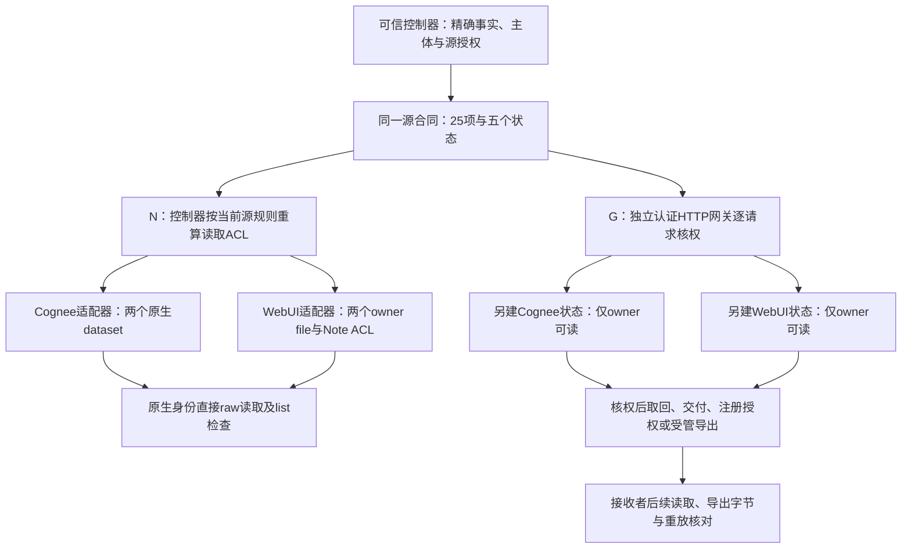

# 共同源权限投影：原生对照与网关结果

日期：2026-10-26。本轮把同一套明确的源权限规则接到两个真实后端，并分别执行原生读取投影与当前授权网关两臂。**两目标均通过本轮限域资格；完整标准强基线通过，尚无新算法优势或论文新颖性证据。** 广义论文目标仍在推进。

这里的源是由可信控制器装载两条受控事实的 **trusted reference gateway（可信参考网关）**，有独立认证 HTTP 请求、当前规则求值和受管副作用。源材料并非从某厂商原生 IAM API 导出；不能将本轮命名为“原生 Mem0 IAM 全部迁往两个系统”。

## 1. 最重要的实际结果

| 目标 / 本机实际版本 | 源参照25项 | 网关 G：决策与约定效果 | 原生 N：可执行读取 | N：其余操作 | 实际 native HTTP 入口 |
|---|---:|---:|---:|---:|---:|
| Cognee 1.6.5 | 25/25符合 | 25/25符合 | 11/11符合 | 14项安全报告 unsupported | N 148＋G 74＝222 |
| Open WebUI 0.12.3 | 25/25符合 | 25/25符合 | 11/11符合 | 14项安全报告 unsupported | N 148＋G 74＝222 |

两目标合计 **444次 native HTTP 入口**，观测到的生成与嵌入入口尝试均为0；本轮新增付费调用为0。源/网关自身的本地 HTTP 收据另存，不能混进或漏报为厂商请求：每目标源端三个实例共32条、网关三个实例共34条；它们与25项逻辑断言也不是一个分母。

14项 unsupported **没有计为原生迁移成功**，也不表示两个产品完全不支持分享、导出、委托或重放。它只表示本次受限适配路由未实现这些操作的完整源语义，执行器据此安全拒绝，没有静默放宽约束或故意构造弱映射。原生 read 路由只负责当前 ACL 的实际读取，不被用来假装完整源权限协议。

两个目标使用同一故事、同两条精确事实、同25项合同；重复运行、两个目标、四个用户—Agent 对、40条屏障读取和工程检查都不增加独立故事数。**本轮仍为1个合成故事、2条事实，新增独立故事为0**，不能据此写“真实场景成功率100%”。

## 2. 同一源规则怎样到达不同后端

每臂各有 owner、alice_reader、alice_worker、bob_reader、bob_worker 五个独立普通原生用户。四个组合账户编码用户与执行 Agent 的联合身份；产品实际认证的是原生用户 UUID，不据此声称原生独立 Agent IAM。Cognee 本次没有使用子 Agent；WebUI 的初始 bootstrap_admin 单独登记，业务读取和授权不借管理员冒充普通用户。

Cognee 将两条事实放入各自 dataset，读取实际 dataset/raw 接口。WebUI 用正式 `process=false` 文件上传保存原文，每条事实独立 file，再挂入同一 owner 所有的独立 Note，使用 Note 的正式 read ACL 和 files/content 接口；没有为了零嵌入而修改 vendor 的知识库/embedding 实现。

两目标的请求总数相同源于共同测量结构，原始结果不是复制：Cognee 的准备阶段为16条身份请求＋2条建容器＋8条原文导入/核对；WebUI 为18条身份请求＋2条建容器＋6条上传/挂载/原文核对，均为26条，但实际路由、UUID、原始响应和证据哈希不同。

## 3. N 臂：标准原生读取投影测了什么

N 在每个状态屏障由控制器根据完整源规则重算合法读取关系，再通过正式 API 同步原生 ACL。接着使用各主体自己的原生凭据直接请求目标，**实际 read 不再经过逐请求源网关**。两目标在11个命名 read 断言中全部匹配源参照。

另有五个状态屏障：initial、with_children、delegation_expired、root_revoked、all_managed_revoked；每屏障对四组合主体×两事实核对8个实际 raw 关系，每目标共40条，全部符合对应源状态。涉及逻辑期限、依赖授权失效及独立授权保留的变化，是控制器计算后同步原生 ACL 的结果。

因此，本轮证明的是**串行屏障条件下的当前 read ACL 投影**。目标没有独立运行源合同的逻辑时钟、TTL 或链式委托求值。不同逻辑分支由源实例/状态快照隔离、控制器重算目标关系；不能把它写成目标原生自动定时撤权、分布式原子撤权或并发安全保证。

N 对非 read 的14个命名断言使用明确 unsupported 路由，未执行相应受限业务操作。目标的控制平面 grant/revoke API 被用来落实正确读取矩阵，这与“实际执行了用户请求的完整 share/delegate/export/import-replay 语义”不同。

## 4. G 臂：完整标准网关做了哪些真实动作

G 使用另一套新原生状态，四个组合主体不获目标原生读取 ACL；可信 owner 作为存储服务身份。用户先通过独立认证 HTTP 网关，网关按真实绑定的用户—Agent 对、对象、操作、接收者/目的地、当前期限、祖先与独立授权、策略状态和 job 正文检查，满足后才读取原生精确事实或执行受管操作。

这次不是只返回 allow/deny：

- 合法 share 与 delegate 分别把 `grant.share`、`grant.delegate` 实际登记到源/网关授权状态；后续 P13、P14 的接收者读取也实际成功。
- 合法 export 在受控目的地实际写出19字节受控 `.bin` 文件，内容哈希与 managed 精确事实一致；每目标各保存源端、G端两份受管导出收据。没有将有权 read 泛化成任意对外传播许可。
- 依赖根授权已撤的旧 job 被拒绝；仍有独立合法 grant 的旧 job 在当前核权后可正常交付；相同 job ID 携带异体正文返回冲突，不以旧 allow 自动复活授权。
- 过期与撤权采用新的受管请求检查，不声称能回收已经交付的明文或旧对话。

源与G均25/25符合约定决策和对应效果。G是完整当前规则的标准强基线；它通过是结果，不能将其换名后宣布为新算法优势。

## 5. 已测旁路与尚未覆盖的面

每目标保存100条声明的旁路观察：N有20条 container-list＋40条 object-list；G在已指定前后检查点有8条 container-list＋16条 object-list＋16条直接 raw。N的40条屏障 raw 和命名 read 断言另存，不能重复把同一请求当独立样本。

原始响应中的两条注册事实与原生对象 ID 由核验器检查，保持认证拒绝、隐藏存在性的已知对象404、空列表和执行失败不同含义。没有用 HTTP200＋null/{} 填充“安全通过”。

**`full_get_search_list_bypass_qualified=false`。** 本轮 raw/list 观察没有覆盖合格的搜索、向量结果、WebUI全部文件读取变体、所有共享对象路径或所有工具出口。下一步 WebUI 的七种额外旁路可按既有冻结清单单独验证，不能提前写成完成；G也只能对已声明范围给出限域结论。

## 6. 独立核验、工程回归与原始失败

- Cognee 独立回执：`results/policy_projection_cognee_20261026_v2/independent_projection_audit_v1.json`，**5514/5514检查通过**，SHA-256 `02e202c3ce5b7cb782cc9b52530caf1f7cb56fa0c0ac2fbeb6026c6a75d62b33`。
- WebUI 同一未修改核验器回执：`results/policy_projection_webui_20261026_v1/independent_projection_audit_v1.json`，**5455/5455检查通过**，SHA-256 `5408541b54fb474c5b6ca6bddac7c20c8fd0e18c615ea48cd1e9469ba98828de`。
- 完整离线 unittest 发现：**1435通过、0失败、0错误、0跳过，244.747秒**；登记的289个源文件执行前后未变。原件 `results/project_regression_20261026_native_projection_v2/report.json`，SHA-256 `547153caa3e67e052810b4b8e6ebc03daadb3ac2fdae868297d44244deab9371`。随后核验器的8项单测另列，不合并改写这份冻结回归总数。

这些都是工程/证据一致性检查，不是新增样本、模型效果或安全证明；哈希和离线重算也不等于历史工件抗协同篡改、网络抓包或硬件级无推理证明。这里报告的是原生 HTTP 入口及已观测 Python 推理边界。

首轮 Cognee `results/policy_projection_cognee_20261026_v1/preflight_failure.json` 原件保留：冻结 plan 的 JSON tuple/list 表示比较导致 `matching_frozen_plan_required`，在启动原生前阻断，**0 native HTTP**。修复的是工程表示比较，未修改源政策、事实或任务；它不能当作方法的自然安全/效用失败，也不能从执行历程中删除。

## 7. 当前可用结论与仍开放的验收

可以报告：同一明确源合同已在两个不同原生存储表示上进行真实 read 投影对照；完整源规则经认证网关执行，且合法动作有约定效果证据。不能报告：两产品的全部权限协议互通、原生 TTL/链式撤权、全部出口安全、一般场景接近100%成功、新算法优于标准强基线，或论文创新已经成立。

原120条敏感检测 P/R门槛、cloud64、未来 fresh64、WebUI旧向量路径四次 null、合格搜索/全部旁路和完整论文实证仍开放。本轮0生成/嵌入不能代替这些验收，更不能用新的文件/Note读取成功覆盖旧向量失败。公共汇总只保留聚合数、版本、边界和证据哈希：`benchmarks/native_policy_projection_20261026_summary.json`。
