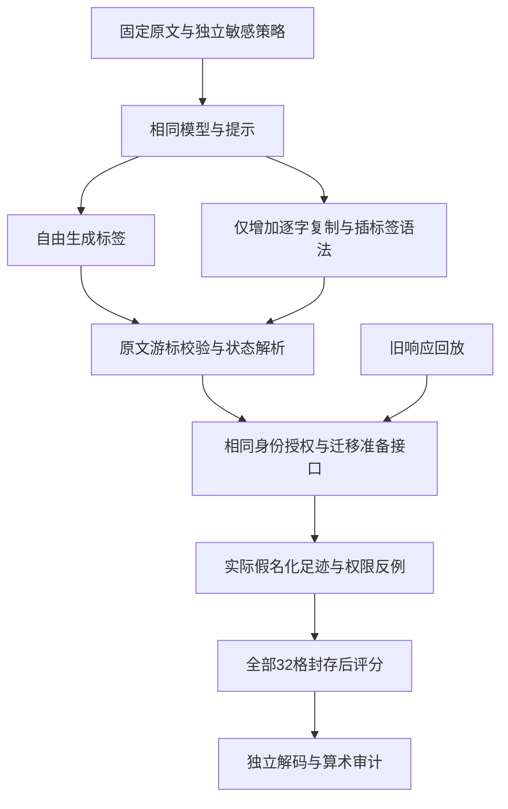

# 原文受限标签：真实对照与语义瓶颈

日期：2026-10-28。**原文复制机制通过，敏感检测效果失败。** 8条受限输出全部逐字保持原文，但精确率33.3%、召回率50%，仍有1处准备成功后的实际漏遮。原默认流程保持现状，不推进本方案的完整24条扩展，也不能据此宣称减少合法问题拒答或达到论文验收。

## 1. 本轮验证了什么

上一轮实际失败包含两类问题：一是把名称抄错、把不同实体序号当作同一名称的出现次数；二是实体漏识别，以及否定、交易方向和时间语义判断错误。本轮只隔离检验第一类机制能否修复，并单独评分第二类。

固定使用8条已经暴露的困难开发材料：`[1,4,6,11,13,16,19,22]`，中英文各4条，其中6条关系确定、2条关系未知，确定材料有4处参考敏感跨度。按已知错误类型选取的材料不能作为独立自然材料验收，更不能代替原独立64题。

两个实际生成条件使用同一Qwen3.5 4B Q4_K_M GGUF、同一llama-server、同一提示词和采样参数：

- **自由标签**：模型生成`OK/REVIEW`和带标签原文。
- **受限标签**：增加输入相关GBNF语法，只能逐字复制原文或插入指定开闭标签。GBNF是生成时约束输出形式的一套语法规则；这里并不约束哪个实体在业务上属于客户。

每条两次调用的先后顺序交替，两个条件各4次先运行。另回放同8条旧Qwen3.5全文quote/occurrence及Qwen3条件位置响应，作为不同方法、不同运行封装的工程参考。只有自由/受限两组可用于本轮语法约束的归因比较。

本轮使用空源标签，四种检测结果分别进入相同的迁移准备接口，没有合并它们的正标签。这样能够隔离检测输出差异；它不是一次新的Qoder/Harness原生互传或下游问答实验。

## 2. 真实结果

| 指标 | 自由标签 | 受限标签 | 旧Qwen3.5全文 | 旧Qwen3条件位置 |
|---|---:|---:|---:|---:|
| 原文及标签解析通过 | 0/8 | 8/8 | 不适用 | 不适用 |
| 确定材料可准备 | 0/6 | 4/6 | 3/6 | 6/6 |
| 确定材料精确位置全对且可准备 | 0/6 | 0/6 | 0/6 | 4/6 |
| 未知关系有语义待审证据并阻断 | 0/2 | 1/2 | 0/2 | 2/2 |
| 原始精确跨度TP/FP/FN | 0/0/4 | 2/4/2 | 0/3/4 | 3/1/1 |
| 精确率P | 未定义 | 33.3% | 0% | 75% |
| 召回率R | 0% | 50% | 0% | 75% |
| 实际完整遮蔽参考跨度 | 0/4 | 2/4 | 1/4 | 3/4 |
| 因阻断未交付的参考跨度 | 4 | 1 | 2 | 0 |
| 准备成功后的实际漏遮跨度 | 0 | 1 | 1 | 1 |
| 已准备确定材料多遮的非敏感字符 | 0 | 293 | 31 | 33 |
| 合法附加事实保留 | 0/8 | 4/8 | 5/8 | 6/8 |

P/R包含所有确定材料响应中的原始预测，含被阻断行；未知关系不计入跨度分类P/R。自由组无预测，P分母为0，不能写成100%。其零交付、零漏遮也不能解读为安全效用成功。

“合法附加事实保留”仅检查预先指定事实的字符是否仍可交付，不是下游回答正确率。可准备也不意味着敏感判断正确，例如受限组有1条未知关系被错误放行。

自由组8份响应都完整结束，却附加JSON包装或空行，不符合逐字正文合同，所以全部按格式失败阻断；没有移除包装或另加修复来提高结果。受限组8份均完整结束且精确复制，支持本受控环境中的形式执行改善，不能推出模型已经正确理解客户关系。

效果推进门槛中，P≥90%、R≥95%、零准备后漏遮、确定材料准备不劣于条件位置基线、未知关系全部正确语义待审，均未通过；权限反例和调用账目通过。`proceed_full24=false`。

## 3. 两个原始问题现在能怎样回答

### “苔藓”能否由发送方提前标注

可以在发送方增加标注阶段，项目已有该能力，但是否有用取决于标注是否正确。本轮index22受限输出是`REVIEW`加空标签：机构名仍没有识别出来，整条被阻断。它从旧方案的漏遮变成待审，不能算成功识别，也不能称为合法可用性提升。

旧源标注并集与拿到相同两份输出的接收侧并集，在24例上等价；签名或标注时机本身没有创造新的识别信息。参见[源端标注对照](源端上下文标注_实现与真实对照结果_2026-10-28.md)。若要使用“发送方知道实体”的优势，需要真实上游工具字段或业务来源，而非从评分答案补造源事实。

另一个同名普通词例index11中，受限输出完整复制后仍返回`OK`和空标签，机构名第二次出现的`hush`在`[78,82)`实际漏遮。这是本轮受限组准备成功后的一处漏遮。

### “从未采购／并非客户”是否值得处理，符号能否解决

值得处理，因为它同时影响隐私多遮和合法任务可用性。本轮index4把含“从未是客户”的整段172字符全标成CUSTOMER，连合法事实“货架四层”也被遮蔽；index1又把供应商且“从未向我方采购”的114字符整句标成客户；index13同样把供应商机构误标。index16明确否认客户关系却仍标名并进入待审。

这些输出都可以逐字精确复制，错误在“谁向谁买、是否发生、何时发生、什么才是实体边界”。修改引号、删标点或清洗符号不能证明关系成立；直接改写原文还可能破坏已绑定的位置和哈希。引号包裹兼容属于有限的表示层处理，应和否定语义分开。

## 4. 问题归类与下一步边界

| 层面 | 本轮证据支持的判断 |
|---|---|
| 表示与位置执行 | 输入相关语法在8/8上保证了本次完整输出的原文及位置可核验；普通词也能被合法标注，因此不保证语义 |
| 检测算法 | 漏掉实体、把关系句或整段当名称、误判否定/方向、未知关系错放行，仍是主要瓶颈 |
| 迁移协议 | 可以验证标签来源与内容绑定、执行身份授权；不能把错误标签变成正确知识。原文复制也不授予权限 |
| 仿真与原生环境 | 本轮是受控迁移准备测试，不能据此解释历史WebUI null或声称新增原生在线撤权能力 |

下一步先做零模型的**源字段资格核查**：是否存在先于记忆生成和评分的真实组织ID、组织名、交易方向、肯否、时间及授权来源。若存在，再固定同一信息，比较“普通JSON＋完整ACL”与“项目迁移包＋相同ACL”，检查字段与生命周期保持。若两组等价，收益来自信息条件，而非新协议算法。该对照也不能替代自然语言检测验收。

该零模型核查现已完成：在`datasets`、`examples`、`artifacts`、`configs`及相关来源适配说明的限定范围内，核对10份关键文件，未找到上述字段与授权链均合格的真实工具来源。公开和合成材料仍可用于受控实验，但不能把评分属性、初始可见性或模型抽取改称可信业务字段。因此本支线暂不启动新模型实验。具体路径、摘要和未查范围见[源工具字段资格核查](源工具字段资格核查_2026-10-28.md)；“尚未找到合格来源”不等于断言全部未读数据都没有这些字段。

不能直接重新堆事件抽取或NLI：项目已有真实负结果。关系事件法10次生成中6次无效、R为0；旧关系NLI臂全部阻断。见[事件对照](关系事件组合_实际对照与负结果_2026-10-27.md)、[关系NLI对照](关系证据与出现位置_实测结果与路线裁决_2026-10-27.md)。再次采用需有新的、可检验的失败原因与机制证据。

## 5. 文献先例与创新口径

[Constrained Tagging for Span Labeling](https://arxiv.org/abs/2610.28922v1)及[SPANIEL](https://github.com/harshsinghal/SPANIEL)已有原文复制与插标签的直接先例。本项目用一般状态机独立编译[llama.cpp GBNF](https://github.com/ggml-org/llama.cpp/blob/master/grammars/README.md)，没有复现原作者的HF字节trie处理器，也不能沿用其硬件、速度或零开销结论。

本轮核查的两个代码版本未见明确代码许可，未直接复制或vendor代码；论文或模型权重的许可不替代仓库代码许可。这次实现应定位为强基线适配与工程工具，**论文创新尚未成立**。

## 6. 调用、核验与失败记录

- 实际生成：1次Unicode运行资格＋16次正式生成，共17次；无修复和追加调参调用。正式输入7,584、输出802 token；资格441/16，合计8,025/818。
- 正式批次墙钟12.891秒。两组各3,792输入token，输出分别405和397。缓存命中已记录且先后顺序平衡；小样本不作速度优越性结论。
- 0云端、0付费API、0下游生成、0原生后端写入。服务仅在回环地址运行；任务结束后按PID、路径、UTC创建时间和父子关系关闭本轮运行器及其隐藏控制台。
- 模块与执行器31项离线测试通过。独立仪器另有15项游标解析、7项结束合同合成检查；这些不等于全仓CI或独立效果验收。
- 独立标准库审计核对32格、16份原始生成捕获、完整24条参考后再选8条、82份历史制品、244份冻结源码，以及实际遮盖和32项错误user/Agent权限反例。32项全部拒绝；自由组没有可准备项，因而没有对应权限反例。临时HMAC密钥未落盘，未声称离线重新验签。
- 资格阶段首次校验错误要求旧结束字段；保留失败，仅用同一原始响应按真实`stop_type=eos/truncated=false`离线重判，没有新增资格调用。
- 独立审计首次在请求wire键顺序检查失败：排序保存的JSON被错误当成原始wire。保留失败记录，审计器独立重建原插入顺序后重新核验。原冻结与修订审计器SHA均保留；正式计划、模型响应及评分未更改。
- 清理的两次保护检查在停止进程前阻断：一次为JSON自动日期转换丢失UTC解释，一次发现未单独核验的conhost子进程。校验UTC字符串及子进程来源后完成清理，记录均保留。

## 7. 制品与可复核入口

- [公开聚合摘要](../benchmarks/copy_tag_probe_20261028_summary.json)
- [原文标签模块](../memory_migration_study/source_tagging.py)
- [执行器](../scripts/run_copy_tag_probe.py)、[独立审计器](../scripts/verify_copy_tag_probe.py)
- [预注册](原文受限标签_机制开发预注册_2026-10-28.md)
- 本机原始证据：`results/copy_tag_probe_20261028_run01/`
- 本机独立审计：`results/copy_tag_independent_audit_20261028/audit.json`
- 本机运行资格与清理：`results/copy_tag_runtime_20261028_run01/`

计划SHA256：`a15e7a552060de5e576e84588b775e5369e6fb292267d3fb94bdcdb6dce0ab55`。

正式报告SHA256：`ef892e8c9bde95c5ba1c18131f1681b1eec74206abd3f1498e918d5d3f92d9e5`。

独立审计SHA256：`8b8e763009ea70af5274e1d08db4786e83c4ac62186e737858f1b1d3327341bf`。

原独立P90/R95、新独立64题至少63题联合成功、零未授权动作/注册敏感非法外发、真实下游Agent与原生环境、WebUI四次null闭环及论文创新要求，均继续保留为未完成项。下游任务效果、拒答率和独立验收指标保持`null`，不能以这次工程机制通过替代。
