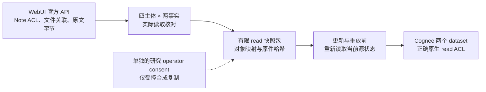

# 原生 API 导出迁移：WebUI 到 Cognee 实测

2026-10-26。一次真实单向受控实验：Open WebUI 0.12.3 → Cognee 1.6.5，1 个合成故事、2 个精确事实，四个预声明的 `(用户, 执行Agent)` 组合分别绑定为普通平台账户。公开数据见[汇总](../benchmarks/native_api_read_handoff_20261026_summary.json)。

本轮完成了**从真实源 API 读取原文和原生 ACL，再重建异构目标读取权限**的有限流程。首次导入、撤销 Alice 第一事实读取、重放初始旧包三个阶段，两端读取关系相符；旧包没有恢复已撤权限，Alice、Bob 对第二事实的合法读取均保留。这是普通“完整当前源复查＋正确原生 ACL 映射”强基线通过，没有建立新算法优势。

两个应用在同机独立子进程和新数据库中运行，通过各自FastAPI `TestClient` 调用真实原生路由、认证与存储，未使用伪造响应；没有部署两个TCP/HTTPS服务。下文169次HTTP指原生ASGI请求次数，原报告字段`physical_http`也按该计数解释，不能当作169次物理网络往返或跨机性能测量。

## 原文和权限证据来自哪里

源 owner 通过 `GET /api/v1/notes/` 发现对象；`GET /api/v1/notes/{id}` 提供实际 Note 的 `access_grants` 和所关联 file ID；`GET /api/v1/files/{id}/content` 提供实际原文字节。每阶段再以四个独立主体的凭据执行八条原文读取，核对显式 ACL 与实际生效读取一致。

仅接受这四主体的 `user/read` 授权；group、role、公开访问、未知字段或未映射主体须进入 `unverified` 并停止。本轮没有遇到这些越界输入。主体映射来自主机预声明的普通账户绑定，不是平台第一类 Agent IAM。

两条原文各 **19 字节**。初始源端原文证据为 HTTP 序号31、33，对应 Note 策略证据为30、32；目标两个写入的内容来自这些实际 API 响应并核对大小、SHA-256 和文件关联，未从计划中的事实文本回填。完整摘要与两条源对象→目标对象映射保留在原件。

这里是 **API 读取式导出适配**，没有调用厂商完整备份/export 接口。原生 export/share 授权、完整有效策略导出均为 `false`；复制许可来自单独明确的研究操作者 consent，只覆盖本轮合成材料。owner 能读取不自动证明任意迁出、分享或委托被允许。

## 三阶段读取关系

下表每格为“源可读集合 / 目标可读集合”。①=`fact.readonly`，②=`fact.managed`；“无”是已资格的原生拒绝，401、null、执行失败不能填成“无”。

| 组合主体 | 首次导入后 | 仅撤 Alice 的①后 | 重放初始旧包后 |
| --- | --- | --- | --- |
| Alice reader | ①② / ①② | ② / ② | ② / ② |
| Alice worker | 无 / 无 | 无 / 无 | 无 / 无 |
| Bob reader | ② / ② | ② / ② | ② / ② |
| Bob worker | 无 / 无 | 无 / 无 | 无 / 无 |

源和目标各3组×8条原文关系，共48次；首次与最终重放后还核对两端容器/对象枚举，共48次。它们是同一个有限故事的重复机制观察，不是48个独立任务。

初始目标新增3条 read；撤权屏障只撤销 Alice 对①的1条 read。重放原包时再次读取当前源 Note 策略、owner 原文和四主体读取关系，按当前源重算目标权限；此次没有新增写入或 ACL 变更。正确结果是 `current_source_revalidated_noop`：不必把整个旧包一概拒绝，也不能采用包内旧 ACL 恢复 Alice 的①。Alice 与 Bob 的②都继续合法可读。

## 运行量与结论范围

| 项目 | 源 WebUI | 目标 Cognee |
| --- | ---: | ---: |
| 实际原生 HTTP | 91 | 78 |
| 冻结硬上限 | 100 | 90 |
| 原文关系观察 | 24 | 24 |
| 容器/对象枚举观察 | 24 | 24 |
| 生成/嵌入推理入口 | 0 / 0 | 0 / 0 |

合计169次真实 HTTP，未触发网络守卫拒绝；源码、固定资产后验核对通过。权限变化由控制器串行显式同步，只有规定屏障后的新读取属于本合同，未测跨后端原子提交、并发窗口或旧会话已经持有的明文遗忘。

独立只读审计 `independent_audit.json` 的 **1105/1105** 项通过：核对12份当前/12份归档源码、25项资产、批准计划原字节、实际源 ACL、原文→包→Cognee `raw_data` 与对象映射、三阶段权限及重放。48条原文关系中14次合法读取均精确返回19字节，34次拒绝未含注册材料；142份安全 `.bin` 逐字节核对，27份认证正文按约定省略，没有读取认证数据库，也没有新增原生或模型调用。它重算保存的证据，不构成外部执行证明。

审计回执 SHA-256 为 `ffc16c625d0bd54c4a6507da5e66f3dab8476a028c7652edf09fc343cea0d206`。原件目录为 `results/native_api_read_handoff_20261026_v1/`，其哈希见公开汇总。[新驱动](../scripts/run_native_api_read_handoff.py)复用原冻结 workers，没有修改厂商包或旧 worker。

这是单正确 N 臂，没有重跑 G，也没有反向 Cognee→WebUI，因此不支持 N/G 优势或双向往返结论。完整策略、全部 get/search/list、语义检索、复杂下游 Agent 效用、检测门槛、新独立64题、旧向量四次 null 和论文新颖性仍未关闭。流程图保留 Mermaid 源码，未声称已在 GitHub 端渲染核验。
