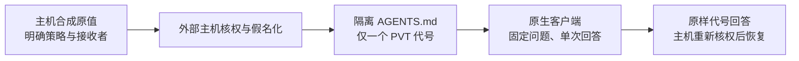

# 原生客户端隐私交接：双端单值实测

2026-10-26。本轮把既有外部隐私网关连接到 Qoder 1.1.77 与 DeepSeek Harness 0.2.1-rc.3，真实启动两个原生客户端，各执行一次新会话问答。使用两条预先登记的合成单值，属于小规模集成测试；[公开汇总](../benchmarks/native_private_handoff_20261026_summary.json)保留计数、边界和原件哈希。

**两个客户端均返回正确代号，主机恢复后的哈希均等于对应合成原值，记录中的六个主机控制均阻断。** 这说明“外部核权→假名化→原生工作区上下文→核权恢复”的单值工程链已实际连通，不能据此认为敏感检测、完整迁移效果或论文创新已通过。

## 实际流程与证据

每个 `AGENTS.md` 只有 41 字节请求级代号，没有注册原值或 source-only 合成标记。固定问题本身不含事实值；源问题中的原值和记忆同步替换，来源 ID 同时变为不透明 ID。恢复映射与临时 HMAC 密钥保留在主机进程内，未作为目标记忆文件交给客户端。

| 方向与接收端 | 实际调用 | 原生最终答案 | 本地恢复核对 | 原生上下文证据 |
| --- | ---: | --- | --- | --- |
| Harness 身份→Qoder 接收端 | 1 | 精确等于该请求 PVT | 原值 SHA-256 一致 | 本地文件前后哈希与唯一代号回答；没有导出原生 baseline 事件 |
| Qoder 身份→Harness 接收端 | 1 | 精确等于另一请求 PVT | 原值 SHA-256 一致 | 文件哈希、原生 instructions baseline 的文件 digest 与代号一致 |

这里的 sender/recipient 是主机统一协议中的身份。两份源事实由测试主机明确构造和授权，没有让发送端模型自主提取或生成记忆。目标持久形式是工作区 `AGENTS.md` 静态指令，未测试自动记忆生成或向量存储迁移。

## 六个控制实际检查了什么

每方向各有三个已记录的阻断：错误接收者在客户端前失败；另一个已撤权 broker 的旧包在客户端前失败；成功恢复后，消费过的响应再次恢复失败。两次客户端调用均只有合法正例，**没有追加六次模型负例调用**。

这些是外部主机的导入/恢复控制。当前权限回调来自合成夹具，不是企业身份服务；本轮也没有测试“模型运行期间撤权后立刻停止回答”。原生客户端自己不执行逐条记忆 ACL。

## 调用量、费用与隐私结论边界

| 项目 | 本轮证据与解释 |
| --- | --- |
| 预算 | 两个原生客户端各一次，配置上限各64输出 token；Qoder单turn、0重试、无工具；Harness记录1次允许的stream、无工具 |
| 用量 | Harness报告输入282、输出23、总305；Qoder CLI报告用量/费用为0，不能据此认定未推理或免费 |
| 费用 | 原生账户实际收费和底层物理模型 HTTP 数仍为未知；未直接调用原始 DeepSeek API |
| 已检查的外发材料 | 主机构造的 `AGENTS.md＋固定问题`，以及返回的最终文本；均无预登记原值/源标记 |
| 未检查的外发材料 | 完整云端请求内容；Harness只有请求形状/摘要，完整渲染上下文仅存哈希；Qoder managed-plugin 缺席未证 |

因此，“本轮任务素材为合成数据”不能扩写为“客户端所有隐式上下文均已逐字审计”。假名化也不自动证明语义隐私、推断攻击防御或所有敏感信息均已发现；本轮检测为规则加人工合成实体登记，本地检测模型调用为0。

## 独立核验与剩余工作

标准库离线核验器没有导入被测评分器、读取凭据或启动客户端/模型。最终 `independent_audit_v2.json` 的 **95/95** 项通过，重算了12份登记源码、计划绑定、两份实际文件、输入/策略/不透明来源及恢复哈希，并核对主机控制代码顺序和原生回执。SHA-256 为 `c0938105c0f3607239329c48fc2217e82030d94bfd1ce48c11e456c736c71134`。

首次回执为93/95：核验器误把已假名化的来源 ID 当成原 ID；仅修正新核验器的合同理解后另存v2，原实测及首份回执均保留。这不是重跑原生客户端。临时密钥和原恢复对象未持久化，所以离线核验没有重新执行原 HMAC 验签、当前权限回调或原映射恢复。

本机原件位于 `results/native_private_handoff_20261026_v1/`。本轮只提供两个合成单值的真实集成证据，不增加 fresh64 独立验收样本；原检测 P/R、复杂合法问答、工具传播、在线撤权、原生向量旧四次 null 和论文强基线优势仍需各自验收。流程图保留 Mermaid 源码，未声称完成 GitHub 端渲染核验。
