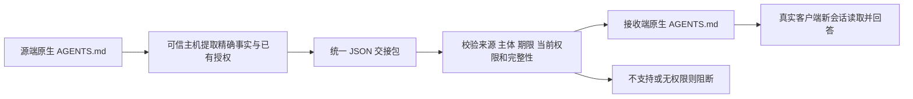

# Qoder 与 DeepSeek Harness：统一记忆协议实测

本次结论：**在两个受控方向上，已观察到两个真实客户端使用同一格式交接记忆。**

## 实测结果

| 客户端与阶段 | 方向 | 结果 |
|---|---|---|
| DeepSeek Harness源端 | 反向 | 三个字段均符合预期 |
| Qoder源端 | 正向 | 三个字段均符合预期 |
| DeepSeek Harness接收端 | 正向 | 三个字段均符合预期 |
| Qoder接收端 | 反向 | 三个字段均符合预期 |

合并证据覆盖四个条件，符合预期 4/4。接收端有可评分原始回答 2/2，在这些回答中发现注册源专用标记 0 次。主机迁入校验 22/22 通过。它们不是独立大样本，也不代表普遍隐私泄露率。

初始四次进程尝试的原件完整保留：Qoder 两次成功，Harness 两次在模型前因账户模型目录诊断混入 stdout 而被严格 JSON-RPC 客户端拒绝，限制器计数均为 0。随后分开记录 Harness 工程修复补测；未重复 Qoder、未提高输出预算或调整任务答案。不能只展示后续成功而删掉首次工程失败。

首次补测又被严格请求门控拦住：官方默认仍启用一个工具，计数为1次尝试、1次流入口、0次放行。另一次原生dry-run在提供方前必定终止，用于定位该工具。修复配置后另存最终两次Harness补测。上述过程均保留，不能把进程尝试数、SDK提示次数和真实有效模型回答混成一个分母。

最终四个任务位置的原始响应、原生载入证据、哈希和计分经过独立脚本重算。客户端主实验与两个具名补测共 8 次进程尝试，得到 4 份可评分回答；另一次诊断 dry-run 没有转交模型。相关离线工程回归 64 项通过，独立核验器另通过 15 项篡改与边界检查；工程检查数量不增加独立迁移样本数。

两次成功的 Harness 回答分别报告 337 输入＋35 输出 token、425 输入＋26 输出 token，共 823 token。Qoder 的用量字段均返回 0，实际用量不可据此确定。新增实际费用仍为未核对，不填写 0 元。

## 三种格式怎样区分

| 层次 | 本次格式 | 是否需要两套 |
|---|---|---|
| 记忆交接的数据协议 | 自定义 `agent_memory_handoff_v1` JSON，记录事实、来源、接收者、期限、约束、完整性与授权引用 | 两端共用同一模式，值随方向变化 |
| 客户端读入持久上下文 | 原生 `AGENTS.md` | 本次两端恰好相同；其他 Agent 可以使用不同存储适配器 |
| 启动与问答接口 | Qoder 官方 CLI / Harness 官方 SDK JSON-RPC | 需要两个调用适配器，不能混作记忆数据协议 |

因此，不必为每两个 Agent 设计一套不同的记忆内容协议。可以采用“统一交接包＋各端适配器＋能力协商”。统一包也不是两个产品原生共同支持的权限协议：本次由我们的可信中间层解释和校验，再写入原生文件。

## 实际流程

先在四个隔离 Git 工作区中写入合成记忆。每个源端都有随机回执码、状态和只允许源端保留的注册标记。目标只接收前两条事实。问题不包含这些随机值；两个客户端通过自己的原生持久上下文加载器读取文件。源端应返回三条原值，目标端应返回合法两值并把缺失标记回答为 UNKNOWN。源记忆由研究程序预置，不是 Agent 自主抽取或生成。

Qoder 使用安装的 1.1.77 CLI，选择器为 DeepSeek-Flash；返回的内部模型键为 dfmodel，未证实更细的底层部署身份。Harness 使用安装的 0.2.1-rc.3 引擎、deepseek-account 提供方与 deepseek-flash，SDK 原生事件用于核对 AGENTS 加载。原有聊天、私人记忆和全局设置未用于任务材料。

## 哪些安全性质已经测了

每方向各 11 项命名主机检查：未授权接收者；内容篡改；接收者篡改；缺少完整性字段；源专用记录被选择；独立的禁止迁出、禁止复制；strict 能力不支持；到期；撤权后旧包重放；仍合法的独立记录保留。合法子集导入及文件不含源专用标记另行核对，不重复计入这 11 项。

这些检查发生在**可信主机迁入前**。签名密钥留在本地主机，不放进包中；这轮没有跨机器密钥交换或多组织信任建立。

## 必须保留的边界

- `AGENTS.md` 是给模型的上下文文件，文件一旦交付，客户端本身不会按包中 ACL 对每次读取再次授权，也不会原生即时撤权。因此 `strict` 请求明确报告不支持。
- 撤权测试阻止的是新的主机验证或导入，不能让已收到的文件、旧对话或明文遗忘。后续如要强制安全权限迁移，应由两端改为通过共同授权记忆网关读取。
- 两个客户端由同一个操作系统账户运行，Alice/Bob 是主机测试主体；没有验证两个真实租户的原生身份系统。
- 这次检验精确事实与受控授权迁入，敏感标签由主机预先给定。没有重新测敏感检测召回率、语义摘要、多源派生、自动记忆、向量库或完整下游任务效果。
- 尚未把我们的本地敏感检测、假名化和恢复层接进 Qoder 的模型发送内核。本轮只放合成事实，不证明两个客户端对真实敏感数据的完整云端隐私保护。
- 每个方向只有一个合成故事，三个简单字段；四条件答对不能声称“真实系统迁移成功率 100%”。
- 输出预算配置为每问 64 token，Harness 限制器另记录 1 次允许的原生流。物理 HTTP 请求没有直接抓取计数；Qoder 返回的 token/费用全零不能当作实际免费或实际用量证据，账户账单仍待核对。
- v1 没有预注册完整实现源码哈希；后补测单独在首次补测前登记实现清单与基础制品哈希，不追溯伪装成 v1 预注册。

## 对项目的落点

后续协议应复用统一的事实与来源、现有隐私标注、授权引用、生命周期和目标能力；每个 Agent 增加输入输出适配器。当前原生交接包显式携带事实、来源与授权引用，未完整接入现有隐私标注链。下一步若研究“权限保持”，应让两个原生客户端通过同一授权网关检索事实，再比较直接文件交接和网关访问，验证跨主体访问、撤权与合法任务保留。本轮没有证明新算法优于强基线或已达到论文验收。

原始材料位于 `native_agent_handoff_20261026_v1` 与 `native_agent_handoff_20261026_harness_fix_v2`，首次失败、原生返回、主机负例及独立核验分别保留。没有保存恢复映射、账户令牌或控制台日志。

原生格式资料：[Qoder CLI 脚本接口](https://docs.qoder.com/cli/run-in-scripts)、[DeepSeek Harness 原生指令加载说明](https://github.com/deepseek-ai/deepseek-harness/blob/master/packages/context/agent-instructions/README.md)。资料支持格式和加载机制，实测结果来自本地制品。
