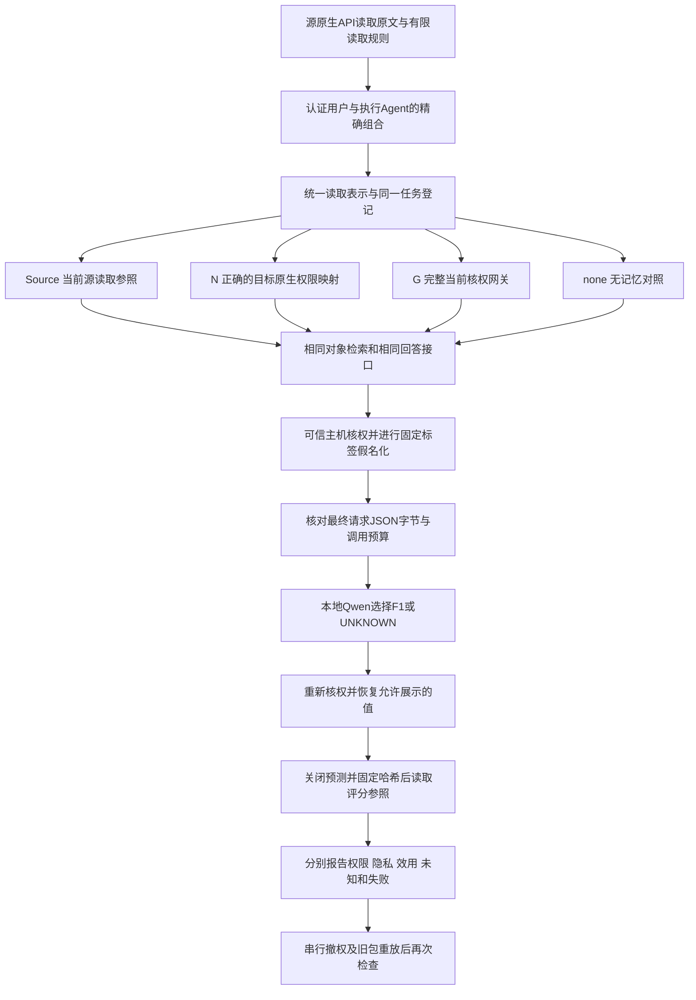

# 审查修复与交叉验证报告

日期：2026-10-26。基线提交：`d6ec88d5b3027f38424fb7a590742b226fc6f57f`。

**结论：交叉验证复现了8类评分、接口与运行控制问题，均已修复并加入回归测试。另完成精确主体授权、当前状态核验，以及同一条原生迁移—隐私处理—回答链的受控实现。没有建立新算法优于完整强基线的证据。**

本报告对应用户提供的《方案审查与优化建议_2026-10-26.md》及后续“先做交叉验证”的要求。自动研究仍暂停。本轮没有扩大独立任务集、调用付费API或改变敏感检测默认算法。旧阶段报告、原始失败、预测与评分保留；这份报告是新增复核记录。

## 1. 交叉验证怎样进行

分授权与生命周期、接口与运行时、评分与证据三个方向独立阅读和构造见证，再由主任务合并修复、运行干净目录回归。见证是能够稳定触发问题的最小受控输入；故障注入是主动给验收器一个错误响应，检查它能否发现，不能当作实际产品已经发生该故障。

检查范围包括：精确用户/Agent配对、旧授权兼容、撤权后重启与旧备份、未知状态、跨请求恢复、拒绝响应正文、最终请求体、预算、CLI退出码、评分分母、依赖版本与冻结工件。所有复现使用合成材料，不读取封存的新独立任务标签。

复现针对审查修复过程中的工作区版本，各见证保留修复前源码哈希。当前核权、统一实验链与配对评分器是本轮新增组件，不能把其中发现的问题反推为基线提交或已部署产品的既有漏洞。交叉验证覆盖主线关键路径，不代表逐个验收仓库所有可选工具和部署场景。

| 级别与问题 | 修复前的独立见证 | 修复与验收 |
|---|---|---|
| P1：正确答案掩盖夹带泄露 | 最终答案正确，但模型原始回答还含另一条禁止内容；评分仍记联合成功、泄露0 | 分开检查正确性与各输出通道的禁止标记；发生泄露时联合成功为假。支持按本地展示、模型回答、请求体分别指定禁止值 |
| P1：网关拒绝正文漏验 | 故障注入让34个403/deny响应携带受限事实，旧验收仍报告48/48、泄露0 | 检查状态码与决定对应、拒绝无data和交付ID；扫描原始正文及JSON解码后的全文。普通和Unicode转义泄露均有负向测试 |
| P2：畸形记录导致接口异常 | prepare/restore的8组`records=None/整数`或`record_id=[]/{}`输入抛异常 | 第一次授权回调前检查批次和关键标识；返回结构化blocked/invalid。同一组见证修复后8组均阻断，14个正常/安全对照保持；另补非dict及混合批次防护测试 |
| P2：模型格式错误算作主动弃答 | `None + ready`被计为模型UNKNOWN | 增加`model_output_invalid`分类，保留合法分母；不把接口格式错误描述为用户无权或模型主动拒答 |
| P2：执行失败退出码仍为0 | 模拟原生RPC失败，集成CLI正常退出 | 增加`main(argv)`和明确退出码；原生未完成返回非零。科学上有效的低正确率仍作为实验结果保留 |
| P2：异常用量数据到收尾才崩溃 | 合法答案伴随NaN用量，预测先记成功，finalize序列化失败 | 在记录预测前校验JSON及可选用量；拒绝非有限值、布尔值、负数和越界输出用量，保留失败尝试 |
| P2：通用消费回调先执行后查预算 | cap=0时模拟回调已有一次模型副作用，随后才报超限 | 调用前按可信回调声明预留上界，预算不足不调用；返回后核对实耗。不能用此接口约束任意恶意Python代码 |
| P2：依赖数硬编码破坏兼容 | reader精确声明51项，verifier仍要求50项 | 显式版本合同：v1固定原50项，v2精确增加主体模块；检查实际成员和哈希。缺项、多项、同数替换、未知或混配版本均拒绝，旧v1归档仍可核验 |

两项P1均为**验收/评分假阴性**：本来不安全的测试输入会被误判合格。它们值得优先修复，但不是实际后端已经越权泄漏的证据。本轮在声明的可信主机与串行条件内，未复现认证主体绕过授权。

## 2. 统一了什么授权标准

### 精确主体：允许Alice用A，不自动允许Alice用B

新增[主体模块](../memory_migration_study/principal_scope.py)。新记录使用受签名保护的`(user_id, agent_id)`配对集合；旧的用户列表和Agent列表仍明确表示二者的笛卡尔积，即所有交叉组合。不猜测旧记录本意，不自动补签，不允许有损展平。迁移准备与答案恢复绑定同一用户、Agent、请求、策略和授权摘要。

该模块处理的是已经认证的身份。记忆文字、调用者自行提交的身份字典或签名授权文件，都不能替代服务端认证。

### 签名证明“没改过”，当前状态还要另查

保留`MemoryLabelAuthority`作为明确的离线快照合同。新增[当前授权模式](../memory_migration_study/current_authority.py)及[状态持久化组件](../memory_migration_study/authority_freshness.py)：

- 必须配置独立状态见证和实时授权回调；回调结果绑定完整主体、对象、动作、策略、检查点和本次随机数。
- 状态先写入不可覆盖的签名快照，再以比较并交换方式提交最新检查点；重复事件、冲突、乱序和提交确认丢失分别处理。
- 有效签名旧备份、外部权威不可用、响应不匹配或提交结果不确定时，阻断交付并标记unknown；不能算正确业务拒绝。
- 恢复只加载独立检查点指向的快照，不把旧备份自动登记为最新。撤权恢复后仍拒绝，独立合法记录仍可使用。

本机SQLite是受控的状态见证原型。它与快照目录分开，不代表抵抗拥有整机控制权的管理员同时回滚二者；生产部署需要不同故障域中的可信依据。本轮也没有实现跨系统原子撤权。

## 3. 同一条实验链现在怎样连接



入口为[原生读取链](../scripts/run_review_native_read_chain.py)和[消费集成](../scripts/run_review_read_integration.py)。WebUI→Cognee与Cognee→WebUI均运行；每个方向隔离源、N、G应用实例，使用实际原生凭据。G的目标数据保持所有者私有，网关绑定用户/Agent身份并核对当前源读取结果，还检查普通用户不能直接绕过网关读取。

这是有限对象ID的原文读取实验。反向Cognee源记录的是已测主体的有效读取矩阵，尚不支持完整ACL导出。传输使用官方FastAPI TestClient的本机进程内ASGI，不是跨机器网络。普通账户表示用户/Agent组合，也不等于厂商已有Agent身份权限系统。

敏感标签使用固定的完整合成标签，用于隔离“迁移与回答”的效应；不评价未知秘密检出率。Source、N、G、none使用相同模型、查询、预算、检索及回答接口。`memory_delivered`指原生API将正文交给可信主机，不表示正文已发给模型。

[最终请求边界](../memory_migration_study/private_request_boundary.py)冻结system/user、模型、选项和JSON schema；扫描已登记原值，检查同一份不可变JSON字节，再交给固定loopback sender。恢复映射不进入普通回执。这只覆盖这条受控客户端请求构造路径，尚未核验Qoder/Harness原生客户端隐藏上下文，也不是一般语义隐私证明。

## 4. 实际执行结果与失败保留

每个完整运行登记48个主体—对象—阶段位置，四臂合计192条消费观察；每臂14个合法位置、34个应拒绝位置。三个阶段为初始、撤回Alice的一条读取授权、旧包重放。全部来自**1个已经暴露的合成故事、2个事实**；方向、阶段和副本不能增加独立故事数。

| 实际运行 | 原生请求 | 本地模型调用 | Source / N / G合法正确 | none合法正确 | 结论 |
|---|---:|---:|---|---|---|
| 首次固定回答集成 | 93 | 0 | 未运行 | 未运行 | 主机解释器缺FastAPI，明确保留为基础设施失败；之后新增启动前依赖检查 |
| 固定回答控制 | 558 | 0 | 14/14、14/14、14/14 | 0/14 | 48/48直接关系符合；验证程序链通路，不算模型能力 |
| Qwen字面代号接口 | 551 | 56 | 11/14、12/14、12/14 | 0/14 | 保留5次代号括号抄写导致的恢复阻断、2次有事实仍UNKNOWN |
| Qwen标准Flat-ID JSON接口 | 558 | 56 | 14/14、14/14、14/14 | 0/14 | 48/48直接关系符合；受控观察未见新增未授权披露 |

none组合法任务的14次UNKNOWN是预期的无记忆控制行为，不计为答对。其他组每臂34个应拒绝位置没有模型调用。初版和Flat-ID版分别使用冻结的统一接口，不把二者差异归因于新的权限算法或来源算法。

本轮合计1760次原生ASGI请求、112次本地Qwen调用、**0次付费/云模型调用**；原生worker生成与嵌入调用为0。Qwen运行于固定Ollama v0.40.8，模型`qwen3:4b-instruct-2507-q4_K_M`，完整摘要为`0edcdef34593eac1aa2be9c7d06c432dcf81945adca5eca2f27662c18f168ba0`。

交叉审计发现问题后，修正评分器对冻结预测另存v2复核结果，不覆盖原评分、预测或关闭回执。真实运行各自绑定当时源码；后续接口加固的证据来自负向单测与最终源码回归，不能把后来源码冒称为此前实际执行版本。

两轮模型实验分别有116份原文件在重评前后哈希不变，归档源码92/92、固定资产25/25匹配。修正评分后的合法正确数保持上表结果。网关每轮34份拒绝均满足403/deny、data为空、交付ID为空，原始正文哈希及JSON解析一致，两个注册敏感值在原文和解码检查中均未命中。目标原生接口对网关用户的直读拒绝另行核验，不能与网关拒绝混为同一项证据。通用评分输入没有保存完整模型请求体，因而请求标记计数为0不能单独当作输入无泄露证明；请求边界的客户端回执另行报告。

## 5. 最终源码验证与复查入口

全量回归结果见[公开机器可读汇总](../benchmarks/review_cross_validation_20261026_summary.json)。在只复制仓库文件及本轮新增源码的干净目录，使用Python 3.12与固定的`requirements-dev.txt`运行；没有旧工程、历史结果、模型或本机资产。**发现1662项，1648通过、14跳过，0失败、0错误**；unittest耗时323.294秒，整体325.641秒。执行前后337份受测源码哈希一致。14项缺少可选外部资产的检查明确跳过，不算通过。

```powershell
python -m pip install -r requirements-dev.txt
python -B -X utf8 -m unittest discover -s tests -v
```

只生成本轮集成的冻结计划，不启动原生应用或模型：

```powershell
python -B -X utf8 scripts/run_review_read_integration.py --plan-only --model-mode fixed --output results/my_read_plan
```

`--execute`必须使用已冻结计划和新输出目录，并先满足固定本机资产与解释器检查；`--model-mode local`才允许受上限约束的loopback模型请求。克隆仓库本身不提供原生环境和模型。本轮没有再次执行最终接口加固后的付费或真实原生实验。

| 可复查组件 | 新增测试 |
|---|---|
| 精确主体、当前核权与状态恢复 | [配对](../tests/test_exact_principal_scope.py)、[当前模式](../tests/test_current_authority.py)、[新鲜度与提交](../tests/test_authority_freshness.py) |
| 出站请求与原生接口 | [请求边界](../tests/test_private_request_boundary.py)、[原生链](../tests/test_review_native_read_chain.py)、[模型消费](../tests/test_review_read_consumer.py)、[CLI](../tests/test_review_read_integration.py) |
| 评价与版本兼容 | [配对评分](../tests/test_paired_task_metrics.py)、[依赖合同](../tests/test_source_card_dependency_contract.py) |

逐条本地原件位于被Git忽略的`results/cross_audit_20261026/`及`results/review_read_*_20261026/`。公开汇总只包含必要计数、版本、源码/证据哈希和限制；普通日志、恢复映射、凭据及个人原文不上传。

## 6. 尚未关闭的边界

本轮没有证明并发原子交付、完整语义检索入口、所有业务工具权限、厂商原生Agent身份或抵抗主机管理员回滚。已登记原值扫描也不覆盖全部语义推断泄露。

独立64题尚未执行；单故事的14/14不能证明总体接近100%。正确N与完整G的合法任务结果相同，未建立G优于N或新算法优于基线的结论。原敏感检测旧40条精确90%/召回90%仍未达到联合门槛；原Mem0→WebUI的4次向量null失败也未因本轮原文/ACL实验而关闭。

下一阶段如恢复研究，应先确定独立故事与模板分组、完成同条件强基线比较，再决定是否有值得研究的真实缺口。本轮交付是可复查的工程修复与受控链路证据，论文验收目标保持未完成、暂停。
