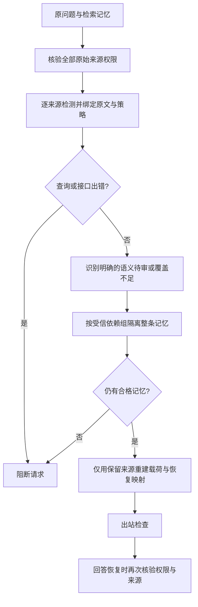

# 整条记忆隔离：实现、受控对照与剩余问题

日期：2026-10-27。当前阶段仍研究 Agent 记忆安全迁移与权限保持。本轮补充迁移后使用记忆时的可选隔离机制；没有改变默认路径，没有新增模型调用，也没有完成论文验收。

## 1. 本轮结论

**整条隔离可以保住其他合格记忆，但不能修复敏感实体漏检或客户关系判断。**

在“所有具体机构名均受保护”的固定配对条件下，与整请求阻断相比：

- 可准备请求从 **4/6 增至 6/6**。
- 保留原始合法事实位置从 **8/12 增至 10/12**。
- 仍有 **2 个敏感名称只遮住部分字符**；不能把 6/6 可准备说成 100% 安全成功。
- 严格的“仅保护当前或历史客户”条件仍没有合格输入，隔离没有带来收益。

这些结果来自旧检测响应的重放。程序没有向模型提问，因此不能据此声称模型拒答下降或回答正确率提高。

## 2. 改了什么

新增可选模块 `selective_memory_isolation.py`，默认仍为 `request`。只允许受信宿主启用记录级隔离。

处理规则：

1. **先核全部原始来源授权。** 不能通过删掉未授权记录，让非法请求悄悄变成合法请求。
2. 每个问题/记忆使用同一策略独立检测，缓存绑定源 ID、正文和策略。重新准备只重放进程内缓存，不重复调用检测模型。
3. 只隔离明确归属于该记录的语义待审或覆盖不足。绑定、格式、调用计数、传输等错误仍阻断整个请求。
4. 对已知有依赖的记忆，整组隔离。没有可信独立性声明时，把所有来源与问题视为同组，保守阻断。不同 ID 本身不是独立性证据；绑定哈希也不是身份认证。
5. 查询不确定时阻断；不会清空问题来获取“成功”结果。全部记忆被隔离时也不发起模型调用。
6. 保留记录重新经过真实 `detect_sensitive → prepare_private_payload → validate_outbound`，建立新的恢复映射。记录仍继承原授权，脱敏不产生共享权。

### 为什么必须重新建立恢复映射

现有 `restore_answer` 不仅恢复代号，还在映射保存的原始记忆中检查字面答案是否有依据。只删除云端载荷中的句子，却复用旧映射，会留下被删除句子的答案证据；把整句换成普通可恢复代号也会重新暴露整句。

新模块从过滤后的来源建立新映射。隔离记录既不进入代号条目，也不进入字面证据全集。恢复前仍检查当前主体、请求、策略与来源权限。这是在防止新增隔离流程引入漏洞，**不表示旧默认流程已存在一次经验证的隔离绕过攻击**。

## 3. 实验设计与分母

使用封存的原生片段属性检测结果：12 条已暴露开发正文、2 种策略，共 24 份检测响应。

| 维度 | 本轮设置 |
|---|---|
| 单条输入 | 12 条 × 2 策略 × 4 请求模式＝96 次执行 |
| 配对输入 | 固定 `(0,1)、(2,3)…(10,11)`，6 对 × 2 策略 × 4 模式＝48 次执行 |
| 独立性 | 受控宿主夹具声明各完整来源独立；不代表现实记忆天然独立 |
| 查询 | 空字符串；只验证准备与恢复能力 |
| 新检测/生成模型调用 | 0；历史 12 次抽取不随重放重复累计 |
| 网络尝试 | 0；执行中设置网络调用阻断器 |
| 评分顺序 | 先封存全部 trace，再解析评价文件并执行事实可达性探针 |
| 独立样本数 | 仍是 12 条旧正文，不是 144 条新样本，不做显著性推断 |

四种请求模式中只有两种有效机制：

| 请求模式 | 实际执行 |
|---|---|
| `request` | 任一来源待审就阻断整请求 |
| `record` | 在可信依赖分区内隔离整条/整组 |
| `sentence` | 缺少完整边界合同，明确 `unsupported`，回退 `record` |
| `position` | 缺少完整边界合同，明确 `unsupported`，回退 `record` |

原生候选如“琥籽筛”“联盟”只有局部位置，不能证明完整公司名边界；句子边界也不能证明别名和关联信息不会出现在其他句子。因此没有为了提高保留率而猜测切分。两个回退模式的统计与 `record` 完全一致，已用程序核对，不能计作两项算法改进。

## 4. 结果

### 所有具体机构名受保护

| 观察量 | 单条／整请求 | 单条／整条隔离 | 配对／整请求 | 配对／整条隔离 |
|---|---:|---:|---:|---:|
| 可准备请求／原请求 | 10/12 | 10/12 | 4/6 | 6/6 |
| 保留合法事实原位置／原事实 | 10/12 | 10/12 | 8/12 | 10/12 |
| 原位置保留且字面恢复探针通过／原事实 | 4/12 | 4/12 | 2/12 | 4/12 |
| 可准备且保留内容中的参考实体均完整遮挡／原请求 | 8/12 | 8/12 | 3/6 | 5/6 |
| 保留实体：完整／部分／完全未遮 | 8/2/0 | 8/2/0 | 6/2/0 | 8/2/0 |
| 隔离实体／未准备请求中的实体 | 0/2 | 0/2 | 0/4 | 2/0 |
| 额外遮挡非敏感字符／可评来源数 | 15/10 | 15/10 | 9/8 | 15/10 |

配对收益来自两个“覆盖失败记录＋合格记录”的组合。原生返回的具体原因是 `candidate_budget_exceeded`，即三个候选超过预定的两个候选上限；不是正文必然太长。程序保留原始原因，没有截取前两个候选后放行。

覆盖失败记录被丢弃，不记为“完整脱敏”。新增保留来源也带来原有额外遮挡，不能只报告可用性增益而省略代价。两处部分遮蔽继续按失败保留。

### 严格客户关系策略

12 条响应仍为 10 条语义待审、2 条覆盖不足。单条请求 0/12 可准备，配对请求 0/6 可准备；两种机制均如此。没有可评的保留来源时，额外遮挡字符统计为 `null`，而不是“零误报”。

### 为什么“事实保留”和“字面恢复”数字不同

评价文件的 `allowed_fact` 是一段带标点的事实文本。六条中文事实原位置仍在，但直接把整段作为恢复输入时，现有单事实输出合同返回 `not_a_single_fact`。本轮没有删除标点、修改答案或放宽恢复规则以提高成绩。

字面恢复由评分器提供参考文本，记录 `probe_answer_origin=evaluation_oracle`、`model_generated_answer=false`。它不是模型回答，不是拒答率，也不能用来推断模型输出更短事实值时仍会失败。下一轮下游任务必须预先区分“证据句”与“允许输出的事实值”，保持两种方法的答案合同一致。

## 5. 当前主要问题归类

| 类别 | 本轮证据 | 应对 |
|---|---|---|
| 检测算法 | 严格关系判断仍全部待审；宽泛策略仍有 2 处名称边界不完整 | 隔离不是检测修复；继续保留 P90/R95 的原验收条件 |
| 权限/协议 | 新隔离流程需要将被隔离来源从恢复能力中同步移除 | 已实现来源约束、依赖组与新映射；未声称完成原生在线分布式撤权 |
| 答案接口 | 证据句被作为单事实恢复输入时，中文标点触发合同拒绝 | 记录为接口适配问题；不能冒充模型拒答，也不事后改真值 |
| 实验环境 | 旧正文、封存检测、空查询、宿主声明独立性 | 这是机制诊断；不能替代真实 Agent 任务或独立 64 题 |

## 6. 文献与创新边界

整条隔离和重新构建只含允许来源的上下文应作为强基线。现有工作已有相近原则：

- **Permissive Information-Flow Analysis，TMLR 2025**：§2.1 假设输入标签正确；§3.4 删除受限上下文后重新生成，仅返回新答案；§6.1 说明目标接收级别已知时可以直接过滤上下文。它不负责发现遗漏的中文名称。[原文](https://arxiv.org/pdf/2410.03055)
- **FIDES**：§4.1 支持字段标签与父标签继承；§5.1 支持按节点隐藏数据；§5.2 的隔离模型仍需要明确释放规则。其模型信任假设不能直接替代我们的“原文留本机”要求。[论文](https://arxiv.org/pdf/2505.23643)
- **Agent Framework 官方安全接口**已经包含来源标签、会话隔离、受限内容变量和工具调用检查。我们不能把添加这些常规组件本身当成算法创新。[官方文档](https://learn.microsoft.com/en-us/agent-framework/agents/security)

下一项有依据的机制验证是：**来源端真实提供可信字段边界时，比较整条隔离与允许字段视图；未知剩余正文整体隔离。** 运行时字段必须来自实际源对象或独立业务合同，不能从本轮 `allowed_fact` 或评分位置反推。需要覆盖秘密重复出现、跨字段依赖、跨主体与撤权。它仍是强基线适配验证；优于完整简单基线的创新证据尚未成立。

后续核查：现有原生接口尚未找到符合上述条件的可信正文内部字段合同，因此没有用评分答案实现“允许字段视图”。已完成 [PiSAs 外部数据适配与初始可见性核查](PiSAs外部数据适配与初始可见性核查_2026-10-27.md)，提供源输入与参考标注分离的开发入口；它仍只保留场景声明的对象访问范围，不是自动字段授权或检测效果的证明。

## 7. 验证与可复查文件

针对性测试及相关隐私回归 **98 项通过，0 失败、0 错误，0.130 秒**。覆盖查询待审、授权变化、依赖组、全部隔离、来源伪造、代号恢复、隔离后字面恢复、模型计数、日志字段、实际遮蔽位置和空分母。测试中使用离线响应，不调用模型。曾有一次验证命令写成不存在的 `tests.test_privacy`；修正为实际的 `tests.test_study_privacy` 后得到上述最终结果，不归因于产品失败。

第一次诊断保存于 `run_01`。交叉审查后补强了源文本与出站匿名编号的对应校验，并将无可评来源的额外遮挡统计改为 `null`；再次零模型重放保存为 `run_02`。两轮均保留，原有有效计数一致；不把重复执行增加到独立样本数。

- [实现](../memory_migration_study/selective_memory_isolation.py)、[机制测试](../tests/test_selective_memory_isolation.py)
- [执行器](../scripts/run_selective_isolation_probe.py)、[评分测试](../tests/test_selective_isolation_probe.py)
- [可提交聚合结果](../benchmarks/selective_isolation_20261027_summary.json)
- 本地原始报告（本机文件：`results/selective_isolation_20261027_run_02/report.json`）

最终计划 SHA256：`add633362cbd18acd6a1b9a36d209a6dbd08cf2428dc2512fbe508d23e5b031b`。

轨迹 SHA256：`09ec42863236969386e9feb0ec1a1961e98a015800b38a6b7b2f10d1d3e58179`。

报告 SHA256：`a5b4addc687e1fec1c96fd667e403f20224721be4591a78b4d68995dcfe3cc74`。

当前未完成：实际检测 P≥90% / R≥95%、新独立 64 题至少 63 题联合成功、历史四次 HTTP 200/null 根因与稳定性验收，以及可重复的论文创新证据。默认流程保持原样，可选模块尚未替代真实 Agent 的默认调用路径。
