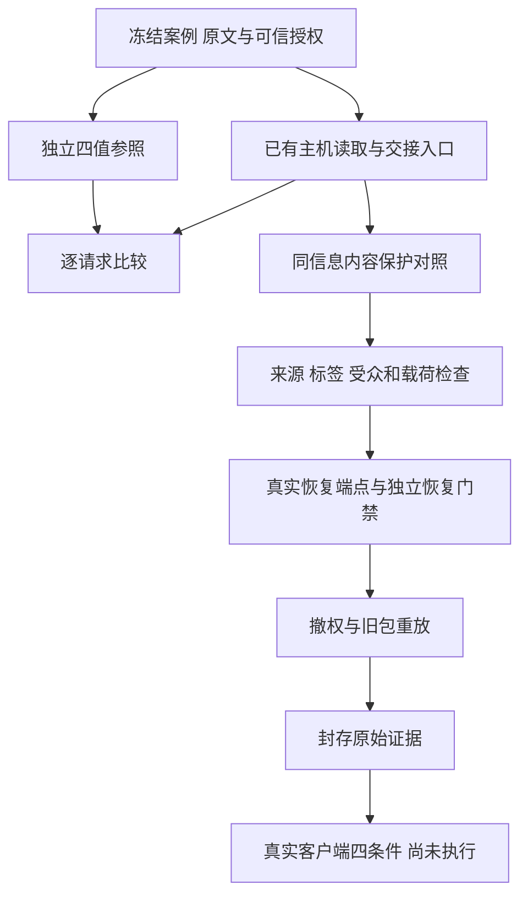

# 期刊方法结合实施结果与继续条件

日期：2026-10-30。按用户提供的两版计划实施；本次完成了无模型资格阶段，真实客户端与检测效果阶段尚未执行。主要结果是：已有逐片段处理与选择性隔离等效；独立恢复权限需要显式宿主合同，现有读取权限不能替代它。尚未建立新算法贡献。

## 实际完成

新增隔离目录 `experiments/journal_methods_20261030`，复用现有 CurrentMemoryAuthority、NativeAgentBroker、脱敏与恢复、选择性隔离。生产默认未修改。独立权限参照不导入生产核权函数，四值组合冻结为 Deny > Indeterminate > Permit > NotApplicable；这是受限研究合同，不是完整 FACPL 复现。

4个开发故事与8个检查故事，每故事4条原文和4题，共48条事实、48题（检查32题）。全部是AI辅助合成研究控制；人工复核为null。检查评分参考未被执行或开发代理打开；读取案例文本、可信政策和控制检测标签不等于获取评分答案。尚未计算语义检测指标或模型任务正确率。

## 流程



## 权限与传播结果

- 2496次请求执行中有2360个不同请求、136次重复；实验单位仍为12个故事。重复调用不增加样本量。
- 新增越权W+=0，合法访问损失W−=0。参考未知724次，实际未知724次；未知下放行0次，无适用规则下放行0次。未知没有算作正确业务拒绝。
- 这些统计针对“现有读取/交接入口＋显式宿主上下文门禁”；矩阵中的42次恢复允许只是预检，不能当作真实恢复成功。
- 48条原文绑定、48条阳性标签投影、12条固定共同依赖交集检查均通过。交集只是已声明依赖的诊断性质，不是任意自然语言依赖推断。
- 2个准备后撤权探针均阻断实际恢复与旧签名包重放。已读客户端的明文无法因此遗忘；本轮没有实际客户端在线撤权实验。
- 静态适配器仍拒绝无法兑现的严格原生ACL/在线撤权模式；没有用capabilities字符串绕过。

## 同信息强基线对照

各条件使用相同可信授权、敏感位置与不确定结果，并显式声明事实独立。先核权筛选，再保护内容。默认与整条阻断在这个合同下是同一实现的等价对照，不能当作两种独立算法。

| 材料 | 条件 | 可交付故事 | 保留事实 | 合法题所需事实可用 | 交付载荷中的注册原值漏遮 |
|---|---|---:|---:|---:|---:|
| dev | 现有默认（请求级） | 3/4 | 10 | 7/9 | 0 |
| dev | 整条保守阻断（与默认等价） | 3/4 | 10 | 7/9 | 0 |
| dev | 标准逐片段核权与隔离 | 4/4 | 12 | 8/9 | 0 |
| dev | 已有选择性隔离 | 4/4 | 12 | 8/9 | 0 |
| check | 现有默认（请求级） | 3/8 | 10 | 7/11 | 0 |
| check | 整条保守阻断（与默认等价） | 3/8 | 10 | 7/11 | 0 |
| check | 标准逐片段核权与隔离 | 5/8 | 13 | 9/11 | 0 |
| check | 已有选择性隔离 | 5/8 | 13 | 9/11 | 0 |

表中“合法题所需事实可用”只检查事实是否进入受保护上下文，且处于撤权前阶段。它不是答案正确率或误拒率；阻断故事保留在分母中。只比较已交付载荷中的注册精确原值，不证明无语义或推断泄露。真实检测器没有参与，不能说检测召回率提高了。

标准逐片段与已有选择性隔离在检查集均为5/8故事可交付、13条事实保留、9/11合法题所需事实可用；相对默认保留更多内容，但没有超过已有强方法。按计划停止把这项等效适配包装为新算法。

## 独立恢复权限的具体边界

44次真实当前恢复端点控制探针中，42条明确允许恢复、2条只允许读取但没有恢复许可。旧端点44条都能恢复，因为原合同只核对当前读取；新增隔离宿主入口实际调用后保留42条、阻断2条。这里是新合同与既有接口语义的差异，不能倒推旧合同存在已证实漏洞，也不是新算法。源端迁出与复制仍由现有broker独立检查。

当前新增恢复门禁只服务本实验受控入口，尚未接入所有生产适配器、自由工具、摘要或任意业务任务。矩阵中的恢复预检与这44次真实端点探针分开计数。

## 端到端与预算状态

签名包已实际在本地主机验证；原文AGENTS.md仅在内存中渲染并解析核对。保护后载荷也做了本地一致性检查，但尚未实际加载Qoder/Harness。不能据此宣称新端到端客户端成功。

两新故事、8题、A源端原文/B源端保护/C目标保护/D无记忆的32次冒烟计划已冻结准备。当前账号客户端调用费用上界、项目累计可用余额仍未核实，因此未启动。旧10月29日账本生成200/200已用满，不重置为新额度。本轮新增提取、生成、客户端、付费云端调用均为0。模型正确率、误拒率、无记忆收益、人类语义指标均为null。

## 验证修订与保留失败

定向工程测试58项通过。首次接线测试55通过、2失败，定位为载荷源ID别名与代号前缀误用，修正后通过。run01保留了未触发撤权、33个整句格式探针被阻断以及自比较来源/受众等评价缺陷；run02修正这些问题；run03让独立恢复门禁通过真实函数调用而非结果投影。旧目录和冻结哈希未被覆盖。这些是评价工具问题，没有计成模型误拒或论文方法失败。

本次没有重跑2172项历史全套回归，58项仅对应新增参照、传播和接线测试，不与旧测试数相加。源端严格CUSTOMER适配器没有被冒充宽组织检测器。

## 后续裁决

1. 权限一致性：在有限登记域内未发现额外放行；这不是一般安全证明。
2. 合法信息保留：标准逐片段与现有选择性隔离已足够解决本批控制案例，尚无新算法必要性。
3. 独立恢复许可：已在隔离主机入口实现可验证补充，待正式合同确认及端到端接线，不作为论文创新。
4. ABAC挖掘：没有实际规则转换/复杂度需求，按计划不实现。SMT：有限域足以完成当前验证，按计划不安装。
5. 客户端和检测效果：冻结计划已准备，费用与可用授权核验后再决定是否执行32次冒烟；当前不扩大模型批次。

## 方法依据与适配范围

- [FACPL作者技术报告](https://arxiv.org/abs/1612.09339)：借鉴四值判决、义务与执行分离和独立验证；没有复制其完整语言、组合算法或证明。
- [DLM作者论文](https://www.cs.cornell.edu/andru/papers/iflow-tosem.pdf)：借鉴明确来源的限制传播、降低限制需要授权；本原型未实现Jif全程序信息流检查。
- [ABAC作者论文及勘误](https://www3.cs.stonybrook.edu/~stoller/abac-mining-TDSC.html)：确有策略转换需求时再适配，当前不启用。
- [Agent记忆综述](https://arxiv.org/abs/2404.13501)：借鉴直接与间接评价分离；真实客户端间接评价仍未执行。期刊条目见[DOI](https://doi.org/10.1145/3748302)。

## 复现

```powershell
python -m pytest tests/test_journal_policy_reference.py tests/test_journal_memory_flow.py tests/test_journal_acceptance.py -q
python -m experiments.journal_methods_20261030.run_paired_acceptance --out results/journal_methods_20261030/new_run
python -m experiments.journal_methods_20261030.summarize results/journal_methods_20261030/new_run
```

运行目录必须不存在。运行器禁止socket网络调用，不打开评分参考，不启动客户端；恢复映射只留内存。`plan.json`和`prediction_closure.json`记录输入/执行代码及原始证据哈希。历史原始结果位于本机results目录，未自动上传。
