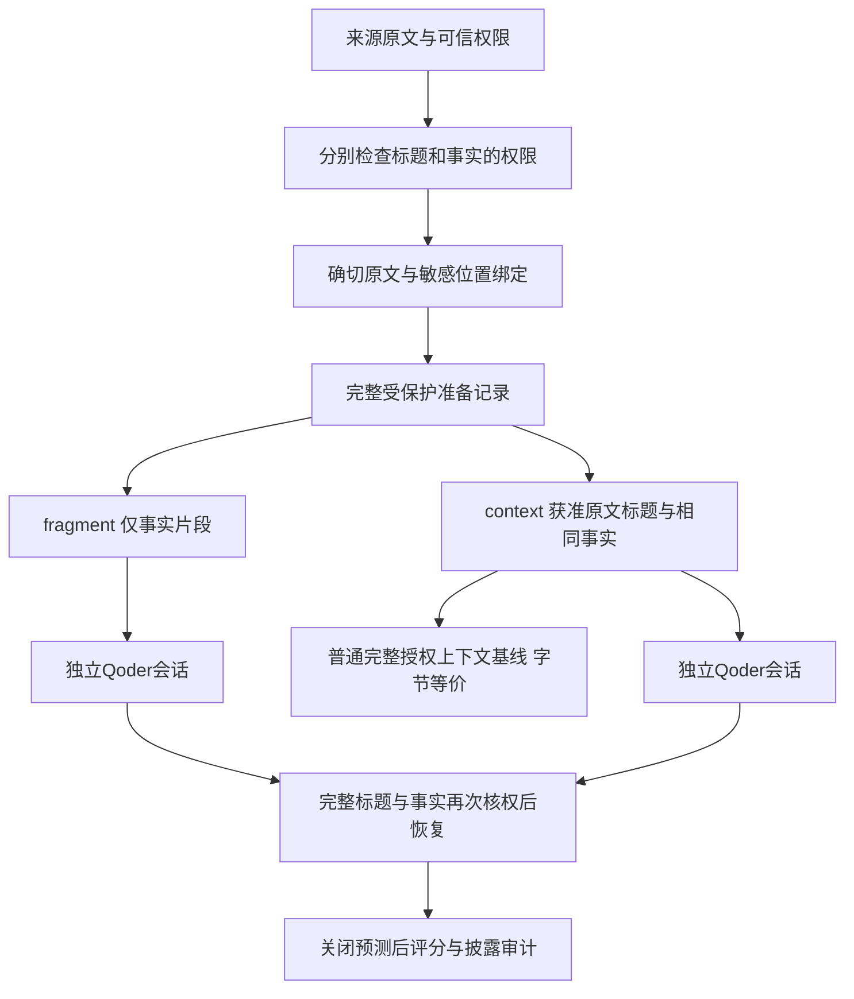

# 期刊方法适配与来源上下文优化结果

日期：2026-10-30。在这批预先构造的来源绑定诊断材料上，保留获准原文标题后，合法题正确数增加5题。但候选保护视图与普通完整授权上下文基线字节等价，因此本轮没有证明新算法优于强基线。它验证的是来源主体在原文投影中是否需要被保留，以及这项保留能否在既有权限检查下执行。

**这批材料刻意设置双主体竞争，fragment删去消歧所需的来源标题，证据不足以唯一回答；context增加了已经获准的来源信息。两组的信息量不同，正确数变化不能解释为同信息条件下的算法超越或一般成功率提升。**

## 本轮范围与旧结果分开

本次新增实际Qoder尝试16次，关闭16个预定位置，成功客户端回执16/16、错误0、未执行0。材料为2个新合成故事、4个源对象、8条事实、8道不同题，每题比较fragment/context两种视图。每组预声明含5道合法题、1道权限排除题和2道缺失事实题。

这是独立于前一次32次Qoder/Harness实验的新批次；旧结果和原件未覆盖。本批只调用Qoder，没有新增Harness、检测器或原始模型API推理。16个位置不是16个独立故事，也不能与旧32次合成48个独立病例。

## 优化怎样适配现有项目

原始来源中，标题或对象名称负责说明后续事实属于谁。fragment视图只保留保护后的事实片段，诊断性地移去这些主体标题；context视图另外保留已经分别获准读取、迁出和复制的确切原文标题，并与同一来源的相同保护事实绑定。标题通过原文半开区间和来源对象登记，不能从用户问题中补写主体，也不能因标题文本相同就推断来源独立。

两组都保留同一套完整标题与事实准备记录作为恢复依据。调用前与恢复时检查当前授权、签名包、原文绑定及请求/工作区能力，UNKNOWN同样经过完整检查；没有只持有一个代号就跳过标题或其他记录核权的恢复捷径。恢复映射仅保留在内存中，没有落盘。

## 合法题效果与弃答

| 视图 | 正确/计划合法题 | 原始UNKNOWN | 原始明确拒绝短语 | 答错 | 客户端失败或未执行 | 恢复/处理失败 |
|---|---:|---:|---:|---:|---:|---:|
| 保护后事实片段（移去主体标题） | 0/5 | 5 | 0 | 0 | 0 | 0 |
| 获准原文标题＋相同保护事实 | 5/5 | 0 | 0 | 0 | 0 | 0 |

正确数差为context减fragment：+5题；最终合法UNKNOWN数差为-5题。5道合法配对中，两组均对0题，仅context对5题，仅fragment对0题，两组均未成功0题。这里的“未成功”仍包含表中独立列出的运行或处理失败。

**fragment的主体证据被诊断性地移去，UNKNOWN不能直接叫作安全误拒。** 它可能是对不完整或无法绑定来源的证据的合理弃答。明确拒绝只按冻结的原始短语规则统计，不等于人工语义裁决；恢复失败不会删除已经观察到的原始回复。该材料专门暴露来源绑定问题，不能代表日常任务分布，也不能以题面给出的对象名称替代来源证据。

## 权限排除与事实缺失

| 视图 | 控制类型 | 正确/计划数 | 最终UNKNOWN | 客户端或处理失败 |
|---|---|---:|---:|---:|
| 保护后事实片段（移去主体标题） | 权限排除 | 0/1 | 0 | 0 |
| 保护后事实片段（移去主体标题） | 事实缺失 | 2/2 | 2 | 0 |
| 获准原文标题＋相同保护事实 | 权限排除 | 1/1 | 1 | 0 |
| 获准原文标题＋相同保护事实 | 事实缺失 | 2/2 | 2 | 0 |

这些控制题与合法题分开，不能把权限排除题返回UNKNOWN纳入合法误拒率。本批权限排除题有1个位置未正确返回UNKNOWN。即使没有披露登记的禁出原值，回答仍可能发生事实选择或来源归因错误；不能仅用精确原值披露为0认定控制题通过。本次封存回复的错误表现为：片段组把另一来源的已获准值回答给了该问题，保留标题后返回UNKNOWN。该现象属于来源主体丢失后的错误归属，没有据此记录为真正禁出原值或邮箱的披露；具体合成回复仅列在本地明细中。失败记录：本批未记录客户端或恢复处理失败。

## 强基线与论文贡献裁决

普通基线是从同一获准安全输入中，按明确的位置关系连接确切原文标题与事实。候选上下文投影与该普通完整授权上下文逐字节等价；共有8/8份逐题宿主证据登记这项等价。两者共享context组的8个相应调用结果，不另跑一批同输入，也不把共享结果当作第二组独立实验。

因此，context相对fragment的任何改善都不能证明候选超过普通完整上下文或构成新算法。若本轮没有改善，同样保留负结果。当前较明确的工程价值是：在确切摘录迁移时避免把“有值但不知道属于谁”的记忆交给下游，同时对标题和事实共同保持授权检查。进一步论文贡献仍需真实失败机制、独立材料和强基线不足证据，不能靠改名、增加模块或扩大平台数量替代。

## 期刊方法的角色与来源

| 来源 | 本项目借鉴 | 本轮未声称完成 |
|---|---|---|
| FACPL权限框架 | 明确权限合同、条件缺失与执行义务，独立检查实际判决 | 完整FACPL语言、Java工具链、SMT证明或一般安全证明 |
| DLM信息传播模型 | 明确来源下保持限制，标题与事实分别获准，变换不能自行放宽权限 | Jif全程序检查、任意摘要依赖推断或通用端到端信息流保证 |
| Anthropic Contextual Retrieval | 避免分块或摘录丢失理解所需的来源上下文 | LLM生成分块说明、contextual embeddings、BM25检索或重排效果复现 |

FACPL将授权语义、义务和策略分析纳入严格定义的框架，本项目只做受限方法适配。[作者技术报告](https://arxiv.org/abs/1612.09339)。DLM研究不同主体约束下的数据传播与有授权的限制放宽，本轮仅保留明确原文及其已登记权限。[作者论文](https://www.cs.cornell.edu/andru/papers/iflow-tosem.pdf)。Anthropic方法将来源上下文用于检索，本轮仅使用确定性的获准原文标题连接，没有移植其完整检索流程，也没有运行新的上下文生成模型。[官方说明](https://www.anthropic.com/research/contextual-retrieval)。

FACPL与DLM在这里服务于安全合同和验证；上下文保留是效用适配。两类工作不能互相替代贡献证据。

## 披露、加载与执行边界

fragment组可观察原始回复中的注册敏感值披露为0/8，权限排除值披露为0/8；context组分别为0/8和0/8。原始审计在恢复前进行，无回复位置不计为已证明零泄漏。这只检查登记精确原值，不能证明无改写、推断或未知敏感实体披露。

Qoder固定显式选择器为`DeepSeek-Flash`；返回的模型标识为`dfmodel`。这类不透明返回标识不能用于证明后端固定修订。文件SHA-256与包装器输入绑定合格16/16；Qoder未提供Harness同等级的原生instruction加载事件，证据是文件字节、固定加载配置和客户端回执，不能仅由答对倒推加载已获直接证明。

标题与事实的当前授权仍由本地主机执行；静态AGENTS.md本身不提供原生逐次ACL或即时撤权。各位置用新工作区与新进程，同题两组采用预声明交替顺序。整批不进行自动重试、不开放工具，输出最多64 token。原始宿主记录可在临时密钥销毁后核对一致性，但不能冒称事后重新执行了当时的密码学鉴权。

## 调用、输入与费用

fragment组计划8次、context组计划8次；实际总尝试16次。输入说明文件总字节数分别为4928与7496，这是本机上下文文件大小，不等于云端总token或隐含系统提示长度。

Qoder账户前后观察到的Credits差额为0；仅用现有额度，没有充值。该差额不是独立供应商账单，0差额也不能单独证明所有未来调用免费。账户原始快照只留本机，公开文档不贴账户剩余额度、充值余额或参考答案。Harness新增调用为0，新本地检测器调用为0，旧200次本地生成账本没有被重置。

## 验证记录与后续范围

本轮相关源码20项测试实际通过。首次预检出现15项失败、2项通过，定位为broker双actor合同与本批Qoder目标身份的接口不匹配；修复后测试通过。这是调用前工程接口问题，没有计作模型失败或用修改评分真值处理。本批使用合成控制标签，人工语义复核和真实检测效果仍未成立。

后续若要扩大实验，应保持来源依赖和授权可验证，使用新故事检验自然任务中这种缺失实际出现的频率，并继续比较普通完整授权上下文。当前不扩展为自由摘要、跨源语义依赖发现或新权限优化算法，也不把本轮16次与旧32次合并成通用成功率。

## 可核对文件

- [上下文投影与共同核权](../experiments/context_closure_20261030/context_projection.py)、[冻结执行器](../experiments/context_closure_20261030/run_probe.py)、[关闭后评分器](../experiments/context_closure_20261030/score_probe.py)。
- [期刊方法结合实施与验证](期刊方法结合实施与验证_2026-10-30.md)。
- [前一批32次真实客户端对照](Qoder到Harness_32次真实客户端对照结果_2026-10-30.md)，结果和原始工件保持分开。
- 本机原始目录`run01`中的plan.json、predictions.json、prediction_phase_closed.json、scoring_summary.json、accounting.json及逐题host_evidence；本地HTML另外展示16行合成回复。

预测SHA-256：`37d5e2ec8298a5988a5009c852a6051df224be685c18f054cda8bc5a9b565be4`。评分在整批预测关闭并核对该哈希后进行，参考未进入模型上下文；报告生成器不读取原始评分参考。本轮不自动上传原始结果或更改旧报告。

本机另存独立核验文件independent_verification.json，状态为`passed`；其SHA-256为`5ecc6f5e877c8e2ef00377a8e1a9b9b0816c0ff08d270252d7f60443f5b2a437`。具体检查范围以该文件为准，不能将文件存在本身当作所有性质已证明。
