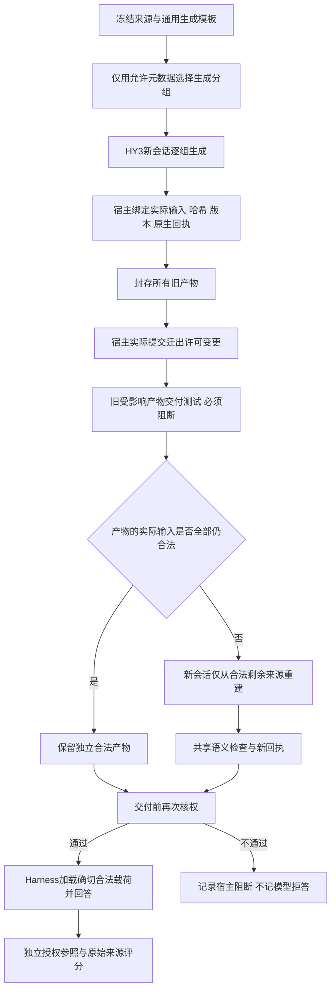

# 权限变化记忆迁移：创新验证与落地执行方案

日期：2026-11-02。状态：**方案已编制；本方案的新算法、新数据和实验尚未实施。**

适用项目：Agent 记忆安全迁移与权限保持研究原型。

本方案结合用户的《找创新点_完整手册》《给GPT的任务书》《推进计划》，以及截至本日已经取得的真实客户端证据。保留 WorkBuddy HY3 → 可信宿主 → DeepSeek Harness Flash / Max 的范围。此次交付是研究与实施计划，没有新增模型调用，没有改动生产权限逻辑。

## 1. 决策：把研究问题压缩到哪一点

**优先检验：首次交付前发生迁出许可撤销时，记忆在生成阶段的分组粒度，能否改善安全约束下的完整任务质量与全生命周期开销。**

通俗地说：不要先把所有资料揉成一份记忆，再试图从里面剪掉不能转交的部分；研究能否在生成时就合理分开，使后续撤权只影响必要的一部分。与此同时，必须证明这种做法比“原文直接交付”“到交付时再生成”“每个来源单独缓存”更值得用。

暂定研究题目：**《面向交接前权限变化的智能体记忆生成分组与安全重建》**。这是候选题目，不表示已经有可投稿的方法。

本轮只检验一个方法候选：**生成前分组，真实隔离构建，撤权后局部重建**。语义支持检查、原文角色、UNKNOWN 提示、现有核权器作为各方法共享的基础能力；暂不把它们另包装为三个创新点。

“强基线解决不了”应分成两种情况：

1. 基线确实存在安全或合法任务质量缺陷，而候选解决了该缺陷。
2. 基线能正确完成任务，但候选在保持质量与安全约束的条件下，显著减少完整流程的资源消耗。

第二种也可能有研究价值。我们不需要故意让原文基线答错，更不能人为压低上下文、遗漏原文、削弱提示或漏算成本来制造优势。若简单方法已经达到同样的质量—开销边界，就结束该候选。

## 2. P-0：事实基础与目前缺口

| 锚点 | 已有事实 | 本方案如何使用 |
|---|---|---|
| F1 / E1 | 最新资格实验取得8份真实HY3独立来源记忆，完成5次Harness请求，只有2个独立故事 | 证明链路可运行；不作为大样本有效性证明 |
| F2 / E1 | 7个合法回答通过完整性与原源支持复核，3个缺证控制正确UNKNOWN；尚无人工作最终金标 | 不能声称已发现普遍拒答、错误否定或新的越权问题 |
| F3 / E1 | 原定2故事×3状态×2方法共12个目标槽，只完成其中4个原文槽；另1个是事后探索性top1 | 补齐需要8个槽：2原文＋6完整缓存；不是7个 |
| F4 / E1 | 故事931合法完整缓存8553字节，原文5812字节；完整SDK请求分别13102与10304字节 | 缓存目前不等于压缩；字节也不等于token或实际费用 |
| F5 / E2 | 旧开发对照有全局摘要遗漏用户请求、增加无依据归属的线索；部分配对为5/6与6/6 | 仅用于构造诊断；没有证明权限变化导致该误差，也没有证明新方法优势 |
| F6 / S0 | 现有可信宿主按实际输入AND依赖控制首次交付，支持政策版本与交付前再检查 | 保留安全合同；不重新开发一套权限平台 |
| F7 / E3 | B/F等增量依赖机制已有移植；复杂方法未证明胜过索引队列等简单维护 | 本轮不把“建图、级联失效、局部更新”单独称创新 |
| F8 | 本项目使用公开合成材料和研究者外附的权限事件 | 不能写成真实企业权限变更或企业失误发生率 |

证据入口：

- E1：[真实客户端资格结果](权限变化语义资格预试_真实客户端结果_2026-11-02.md)；本地原始记录位于 `results/permission_semantic_qualification_20261102/`。
- E2：[真实模型记忆对照与研究裁决](真实模型记忆对照与研究裁决_2026-11-02.md)。
- E3：[算法逐项移植与效果评估](算法逐项移植与效果评估_2026-10-29.md)。
- S0：`experiments/pre_delivery_revocation/driver.py` 的 `begin_generation`、`_seal`、`set_source_export`、`commit_delivery`。
- D1：PersonaMem-v2，公开合成对话，CC-BY-4.0，固定提交 `ed956dea41521fc4499acbc63f966e0fd3c053ba`。目前一个“来源”是登记的消息单元/交流片段，不自动等于独立自然会话。
- 历史公开结果固定提交：`239563e75bc53cb877dadaffc78f0fe048cefb04`。本地最新实验代码尚未全部进入该提交；执行前必须另冻结实际代码清单，不能假定公开提交包含所有适配器。

### 2.1 先区分问题类型

| 类型 | 当前判断 | 下一步 |
|---|---|---|
| 协议/授权问题 | 已测的可信宿主条件下，没有新增强基线越权反例；未知身份、真实输入依赖和最终核权仍是硬约束 | 保留定向回归与独立授权参照，不扩大到跨主机协议 |
| 算法问题 | 旧摘要有语义失真线索，但原文强基线表现好；真实质量—成本优势未证 | 检验生成粒度是否存在可利用的折中，而非默认需要更大模型 |
| 仿真/数据问题 | 权限是受控外附；最新三状态是独立视图，非一条真实连续撤权链 | 新方法试验必须恢复真实“封存→撤权→阻断→重建→交付”次序 |
| 工程/测量问题 | 对照未齐、预算历史风险未完全核销、部分执行器依赖results中的代码 | 先完成预算分类、对照补齐、可独立运行的薄驱动和同案例联合评分 |

## 3. P-A：五张可证伪的机制卡

以下是候选不足或实验缺口，**没有一项被预先认定为新算法已解决的问题**。

| 卡片 | 机制、现有依据 | 最强简单反证 | 允许继续的证据 |
|---|---|---|---|
| G1 混合依赖放大失效范围 | 一次生成实际读了A、B，A撤销迁出许可后整个产物受影响；F6 | 合法原文、惰性生成、全量重建足够便宜 | 正常任务中确需提前形成记忆，且实测全量重建有可观成本；否则止步 |
| G2 细粒度缓存有初始化与拼接开销 | 分源缓存需要多个真实隔离任务；F1、F4 | 固定每源缓存已满足质量和资源需求 | 在至少两个独立开发故事上，存在可重复、非只由队列偶发拥堵造成的代价 |
| G3 分组边界可能改变语义完整性 | 原文限定语、角色和跨消息条件可能被摘要遗漏；F5 | 完整原句、角色模板、现成支持核验已经解决 | 同样合法信息与总预算下仍有差距；人工构造与原始样本分层 |
| G4 交付前惰性生成可能支配全部预生成 | 若来源一直可读，可以交付时才生成；F6及用户原合同 | 直接原文或惰性生成既快又正确 | 不能靠新增人为截止时间排除它；必须以真实流程测量说明预生成必要性 |
| G5 不完整成本与病例分母会制造假收益 | F1–F4，旧实验最大输出一致不等于总计算一致 | 统一完整生命周期与故事级配对后差距消失 | 只作为实验修正；永远不列为算法创新 |

优先顺序：**先G4、再G1/G2，最后才讨论G3的附加语义处理。** 若原文或惰性生成已经支配候选，没有必要先实现复杂规划器。

## 4. 结合你的创新手册：借什么，改什么

采用手册中的“结构相似领域→有出处的机制→必要场景改动→强基线与消融”，并保留四格溯源台账。手册中的候选分数仅用于内部排序，不用分数预测中科院分区或录用。

### 4.1 跨领域映射

| 相似领域 | 原问题 | 映射到本项目 | 是否需要直接移植 |
|---|---|---|---|
| 数据库物化视图选择 | 预先保存哪些中间结果，平衡查询与更新开销 | 在生成前决定哪些来源合并成记忆单元 | 借问题建模；没有核实作者代码时不声称复现原算法 |
| 增量构建系统 | 文件变化后只重建实际依赖它的目标 | 迁出许可变化后，使受影响记忆失效并重新构建 | 优先复用现有依赖队列；不另造构建引擎 |
| 组合优化 | 在多个可行分区之间选择成本较小者 | 选择生成分组，但不让优化器决定授权 | 首版4来源标准库枚举；规模扩大再考虑OR-Tools |
| 文档事实核验 | 检查生成句是否有原文依据 | 发现归属、极性、时间、限定条件错误 | MiniCheck作共享核验基线；不把分数当授权 |
| 数据库/逻辑溯源 | 区分联合前提与替代推导，维护失效传播 | 维护真实生成输入；只承认确实独立生成的替代产物 | 已有B/F作为基线，不重复包装 |

### 4.2 本轮重新核对的主要来源与限制

| L编号 | 来源、位置与代码 | 借用/限制 |
|---|---|---|
| L1 | Gupta、Mumick，ICDT 1999，*Selection of Views to Materialize Under a Maintenance Cost Constraint*，[出版页](https://doi.org/10.1007/3-540-49257-7_28) | 已核出版页及摘要：查询与维护成本共同决定预计算选择。尚未取得可复用作者实现，不把其近似保证套用到自然语言质量 |
| L2 | Mokhov、Mitchell、Peyton Jones，ICFP 2018；扩展JFP 2020，*Build Systems à la Carte*，[作者机构页面](https://www.microsoft.com/en-us/research/publication/build-systems-la-carte/)、[作者代码](https://github.com/snowleopard/build) | 可借实际依赖与重建调度的分离。仓库MIT元数据已核，未在本机复现；现阶段复用本项目现成队列更省实现成本 |
| L3 | [OR-Tools CP-SAT官方文档](https://developers.google.com/optimization/cp/cp_solver)、[代码及Apache-2.0许可](https://github.com/google/or-tools) | 可实现集合分区约束；它是现成求解器，不是本项目新算法；首版不安装新依赖 |
| L4 | Tang、Laban、Durrett，EMNLP 2024，*MiniCheck*，[论文](https://aclanthology.org/2024.emnlp-main.499/)、[作者代码](https://github.com/Liyan06/MiniCheck) | 支持性核验；既有核查定位`MiniCheck.score`。不保证完整覆盖，也不负责授权；本轮不训练模型 |
| L5 | Zhao等，2026预印本，*MemoRepair*，[全文§2.1–2.4](https://arxiv.org/html/2605.07242v1) | 已有撤下后修复、依赖闭包和成本选择。固定图上的选择性修复不作为我们的独有创新。官方可运行代码未核准，若按论文实现须标“论文规则适配”，不能冒称作者原实现 |
| L6 | Liu，2026预印本，*Audience-Bound Persistent Memory*，[全文§3、附录E](https://arxiv.org/html/2609.36373v1) | 已有按受众拆分、限制继承及撤权设计；“按权限分组”必须是强基线，不能作为唯一创新 |
| L7 | Bae等，2026预印本，*AkasicMEM*，[全文§4.2、§5.2](https://arxiv.org/html/2609.25563v1) | 已有真实输入血缘、策略组合与再检查。其讨论为形成阶段的选择留下问题，但不是证明我们方案新颖的凭据 |

本轮网上核对日为2026-11-02。近邻中多篇为预印本，不写成已发表SCI。更完整的旧核验、固定代码提交及许可见[第二轮创新台账](创新点台账_跨域机制筛选第二轮_2026-11-02.md)及其三个核查附件。

**与近邻的候选差别只写这一条：**从“既定依赖图发生失效后选哪些修复”，前移到“生成前如何构造依赖粒度，使后续变化更便宜”。该变量改变值得检验，但数据库预计算与按受众分区已有先例，不能据此宣称首次。

### 4.3 四格改动台账

所有S*均为拟实现，没有真实代码行号。

| 原工作做了什么 | 本项目拟改动 | 依据 | 保留原样 |
|---|---|---|---|
| L1/L3优化预计算选择或组合约束 | S*1：按来源集合、已知委托边界及开发期成本，选择生成分区；当前测试撤权事件不输入规划器 | G1/G2/G4待验证 | 优化求解逻辑与来源归属明确，绝不声称发明集合分区 |
| L2及现有B/F维护依赖和重建 | S*2：把隔离HY3任务的完整实际输入登记为依赖；撤权后仅重建受影响组的合法剩余来源 | F6/F7 | AND依赖、失效队列、策略检查、真实回执和旧失败记录 |
| L4检查文本支持 | S*3：共享的角色/否定/条件/时间审查，失败时从合法原文重新生成或返回原句 | F5 | 原核验器和分数；不得通过核验放宽源权限 |
| L5固定图后修复选择 | 同一生成图上使用相同修复器；仅更换“生成前的图构造”作消融 | G1 | 修复策略、目标模型、提示及预算保持可比 |

三个候选的取舍：生成分组作为唯一条件主候选；归属/限定语修复作共享诊断；“撤权不等于事实否定”继续保留测试但不单独立项。后两者已有直接近邻，且最新强基线没有出现对应错误。

## 5. 通俗例子：我们到底准备改变什么

假设四份资料S1、S2、S3、S4当前均可读取、可交接，稍后S1只被撤销交接许可：

| 构造方式 | 生成时 | S1撤权后 |
|---|---|---|
| 全混合 | 一次读取四份资料，生成M1234 | M1234整体不能交付；从合法S2、S3、S4重建 |
| 逐来源 | 四个隔离任务生成M1、M2、M3、M4 | 去掉M1，保留其余；但初建与拼接成本可能较大 |
| 固定两两分组 | 生成M12与M34 | M12失效，M34保留，从S2重新生成M2 |
| 候选分组 | 事前用允许的元数据选择分区，例如M1与M234 | 此例可去掉M1、保留M234；若撤S2而非S1，代价可能相反 |
| 惰性生成 | 先保存原始资料，交付时才生成 | 直接用当时合法的S2、S3、S4生成一次 |
| 原文交付 | 不额外摘要 | 直接交付合法原始资料，无源端生成费用 |

上表是解释，不是实验结果。候选不能提前知道这次必撤S1，也不能只挑撤S1的结果展示。应测试撤销其他来源、分布偏移与无撤权，观察是否只是把成本从一种情况转移到另一种情况。

## 6. 冻结安全合同：算法不能动哪些边界

定义当前允许交付的来源集合为A_t。每个记忆产物a的真实输入根集合为Dep(a)。当前用户、发送Agent、接收Agent、操作、资源和策略版本分别绑定。

交付必要条件：

`valid_receipt(a) AND Dep(a) subset_of A_t AND receiver_allowed(a,t) AND current_version_matches`

这是现有合同的简化表达，不是新安全定理。

1. **真实输入不等于模型自报引用。** 一次任务读过S1和S2，所有输出均继承S1 AND S2。模型只引用S2，不会使其变成S2独立产物。
2. **不能事后拆句解除依赖。** 旧M包含撤销来源时，不能把它、它的摘要、从它提取的待修复句或题目送入新模型，再声称新产物仅来自合法来源。
3. **修复只见合法来源与事先公共模板。** 未受影响产物只有在其实际输入全部合法时才可复用。新产物登记新一轮完整实际输入。
4. **跨组拼接保持可分解。** 首版用确定性列表封装；不再让源模型读取全部组写一段全局摘要，否则会重新形成全体AND依赖。目标回答当然依赖其实际看到的全部组，仍须按该次交付核权。
5. **规划元数据与正文分离。** 首版规划器仅用预先允许的来源标识、长度、可信权限/委托/有效期元数据及开发期成本模型。不得用被撤旧摘要内容生成排序理由或向目标透露撤销来源。元数据本身的使用权限单独登记。
6. **不声称完整侧信道非干扰。** 分组、长度和调度可能体现元数据；本轮证明范围是登记载荷及当前合同，不能把它扩大成任意推断隐私保证。
7. **事实未知与权限拒绝分开。** 当前合法证据不足可以UNKNOWN；明确否定必须有合法原文支持。不能把“不让看”解释成“没有发生”。
8. **操作范围只到首次受控交付。** 不包括已收到明文的接收者遗忘、模型参数遗忘、跨主机全局即时撤权或原生WorkBuddy ACL保证。

在线语义检查也要保持组间隔离：检查某组时只读取该组产物、该组实际来源与公共模板。若读取其他组，必须登记新增检查依赖；由检查结果生成的修复提示或新文本继承全部实际输入，不能继续算独立单组产物。独立评价可以读取完整参照，但评价输出不回流本轮生成、排序或放行。

### 6.1 真实执行链



“未变、撤无关、撤关键”三状态是同故事的配对分支。若复用共同初始产物，须先真实封存，再创建明确登记的隔离宿主分支，并分别真实提交事件、构建后继；这种分支试验不冒充一个现实用户连续发生三种状态。最终至少有一条不分支的G0至G4真实链通过。

## 7. 候选算法具体怎样实现

### 7.1 输入与输出

输入：来源清单、已获准的规划元数据、固定公共记忆模板、开发期成本估计、预登记事件情景集合。

不输入：测试问题、参考答案、本次实际将撤销的来源、目标回答分数、含撤销来源的旧混合记忆。

输出：生成分区、每组构建任务、成本估计、选择依据和配置哈希。各组仍由真实HY3生成正文；规划器不代写模型记忆。

### 7.2 可检验目标

令分区π由若干互不重叠来源组构成，每份来源恰好属于一组。对事件e，I(π,e)为实际依赖包含失效来源的组；L_e为仍合法来源。

`Total(π,e) = Init(π) + Validate(π) + Rebuild({G∩L_e : G∈I(π,e), G∩L_e≠∅}) + Delivery(π,e)`

其中初建、检查、失败、工具操作和目标回答都计入；不只计算撤权后那一小段。原文与惰性生成分别以自己的真实初建费用参与比较，不能强迫它们承担不需要的提前生成。

选择目标为开发集估计的总串行耗时，附加模型分项token、逻辑任务数及可核算费用；不同模型token不能直接当等价人民币相加。若HY3实际费用未知，就不声称“全系统费用降低X元”。

可用开发期事件集合做均衡情景平均或最坏情景比较，但**模拟权重不是现实撤权概率**。首版同时报告：无撤权、每个来源单独撤权、已登记委托组撤权；不假设不同来源独立撤权。论文主分析只采用冻结后实际执行的事件，模拟扫描另列。

语义质量不进入测试期的真值寻优。规划器可以使用开发集冻结的长度/组大小经验，但质量最终由真实回答和独立评价决定。组内各自正确不保证组合后的回答正确。

成本模型先用已合格开发记录校准：按来源数、登记输入字节数及任务固定开销，使用分桶中位数或简单非负线性估计；不为它训练新的大模型。分别估计排队与实际处理，保存误差范围。未见组大小没有可靠测量时标记外推，不把预测当实测；若误差大到足以颠倒候选排序，先补最小校准或停止优化主张。正式检查使用冻结参数，不以检查集账单重新选择分区。

### 7.3 最小算法版本

1. **V0资格**：不写求解器，先测原文、惰性、全量重建、分源缓存、简单权限分组。
2. **V1枚举参考**：4个来源只有15种分区，用标准库枚举并评估成本代理；只真实执行预先选定分区，不为每个分区调用模型。
3. **V1部署候选**：在来源数较小时使用上述枚举选择；设置确定性平局规则。真实测试只看该选择，不用实际目标成绩反选最好分区。
4. **V2可选扩展**：8来源有4140种分区、255个非空子集。只有V1通过后才考虑剪枝/CP-SAT；不预生成255种记忆，也不运行4140次目标回答。

“精确”最多指代理成本在枚举集合中最小，不指真实自然语言质量最优。这里的成本不一定满足子模性，不继承其他论文的近似比例。

```text
plan = choose_partition(authorized_metadata, frozen_dev_cost_model)
for group in plan:
    old[group] = HY3_fresh_session(source_texts(group), public_template)
    seal_with_complete_registered_inputs(old[group])

commit_real_permission_event()             # 先有旧产物，再提交事件
assert affected_old_payloads_are_blocked_without_target_request()

for group in plan:
    if every_actual_dependency_is_currently_allowed(old[group]):
        selected.append(old[group])
    else:
        inputs = currently_allowed_original_sources(group)
        if inputs:
            new = HY3_fresh_session(inputs, public_template)
            selected.append(seal_with_complete_registered_inputs(new))

payload = deterministic_package(selected) # 不全局重摘要
check_current_policy_and_receipts(payload)
deliver_once_to_fresh_Harness(payload, evaluation_questions_only)
```

任何状态未知、回执缺失、版本冲突均进入显式失败/待审状态。重建失败可以使用预登记的合法原文回退；各方法都有同样回退机会，计入全部开销，不能只给候选兜底。

## 8. 最强基线与公平条件

| 编号 | 方法 | 它防止我们误称什么 |
|---|---|---|
| B0 | 整包阻断 | 安全但无效用不能被算成最佳方法；宿主未发送不等于模型正确UNKNOWN |
| B1 | 完整合法原文＋真实角色＋逐字段UNKNOWN | 排除只是把原文删掉、再靠新方法找回的假收益 |
| B2 | 交付时才从合法来源生成一次 | 排除预生成本身没有必要的情形 |
| B3 | 先全混合生成，撤权后合法全量重建 | 测量真实重建负担；初建费用保留 |
| B4 | 真正逐来源独立缓存＋确定性失效 | 排除把已有独立缓存换名当创新 |
| B5 | 固定大小、长度均衡分组 | 排除收益只来自减少任务数或普通批处理 |
| B6 | 相同权限集合/委托边界/有效期分组 | 排除收益只是已有受众分区或权限分组 |
| C | 冻结成本模型的生成前分组选择 | 唯一拟研究候选 |

B5/B6不能使用本次真实撤销标签；与C得到相同元数据。B1/B2不是旁边陪跑的“上界”，必须进入最终质量—资源比较。

另做同图消融：固定C的分组，分别运行现有索引失效队列与拟复用机制。若相同，增量维护部分不列为贡献。需要语义核验时，原版核验器＋原句补齐也作为对照，不只给C增加检查机会。

一致条件：相同来源版本、合法信息全集、真实身份与权限、记忆模板、目标问题、目标模型与思考档位、输出上限、回退机会及运行环境。源任务条数允许不同，因为这正是粒度选择的变量，但必须同时计总计算、耗时、失败和质量。

不以相同单次输出上限冒充相同总计算。先给每故事所有方法相同的总生成资源上限，再补“各方法自然运行到完成”的资源曲线；无法观测HY3底层token时，标明无法严格实现等计算，只能比较观测到的任务/时间/输入输出量。

检索扩展暂不进入主算法。如果需要检索基线，使用逐题检索后取并集，不能只用“两题拼接后全局top1”作为唯一强基线。

## 9. 数据设计：发现机制与验证效果分开

### 9.1 数据分区

- **旧开发材料**：所有已看过的故事、两份人工回传评分、931和605、旧失败例，均只作开发和回归。
- **第一轮新诊断**：最多4个独立故事，先运行2个。建议2个按预先固定队列抽取的公开合成故事、2个清楚标记的人工构造压力故事；结果分开报告。
- **后续开发**：若通过门槛，扩展至12个开发故事；其中包含前4个，不重复计数。
- **冻结检查集**：暂排48个未用于调方法的故事，按长度、来源数、角色与支持结构分层。正式数量在开发效应、区间宽度及预算核实后冻结；48不是期刊要求，也不保证统计检验充分。

同一原故事的改写、权限变体和重复调用不能分到开发与检查两边。排除理由与候选队列全部保留，不按谁失败挑样本。

### 9.2 诊断结构

| 结构 | 要确认的问题 | 对照 |
|---|---|---|
| 单来源独有事实 | 唯一支持撤销后应UNKNOWN | 同源未撤、撤无关来源 |
| 独立替代证据 | 撤A后，B仍独立支持的内容是否保留 | B必须独立取得，不凭文本相同认定 |
| 联合条件 | 一个来源是结论，另一个包含必要限制，拆分是否丢条件 | 保留完整合法原句的基线 |
| 角色/草稿/转述 | 记忆是否把建议、草稿升级为事实 | 无变化时也测，区分普通摘要错误 |
| 显式否定 | “原文明确否定”与“当前无证据”是否混淆 | 明确否定材料作独立语义控制，不与纯撤权主效应混算 |
| 无变化 | 预生成本身是否徒增成本 | 所有策略都报告，不只展示撤权收益 |

主事件是仅改变export许可，read/copy及原文不变。恢复许可、相关多源同时撤销、8来源扩展放在首轮通过后的鲁棒性附录，不把多个新任务同时加入主实验。

### 9.3 避免评分泄漏

源生成器只见来源和公共模板。规划器只见允许元数据与冻结开发参数。目标模型只见当前合法载荷及题面。评价进程单独读取原始参考、合法字段集合和预登记支持路径。

规划时不知道哪一条是测试关键来源；压力结构、权限事件和题目由评价侧登记。每题可有多个字段，分别判断完整、部分、缺证、错误，不因一个字段不可答而鼓励整题拒绝。

真正的两名人工复核者在生成输出前校核小规模参考，随后盲化方法名和收益审核新输出；AI预评分另列。既有评分不能自动升级成这批新数据的人工金标。

## 10. 分阶段执行、调用上限与关卡

下述为**计划上限，不是本轮已经执行，也不是把现有9元窗口扩大**。先完成少量开发资格，再决定是否值得花后续预算。

| 阶段 | 工作 | 新增模型计划上限 | 产物/门槛 |
|---|---|---|---|
| P0，0.5–1天 | 核预算、固定代码、独立参考、梳理事件与输入证据 | 0 | 所有已完成/未决费用分类，代码可在新目录运行 |
| P1，约1天 | 补齐最新2故事的原文/完整缓存资格矩阵 | 0 HY3，8 Harness | 复用8份已绑定记忆；新增槽与原失败分开；不称新方法实验 |
| P2a，约1–2天 | 2个新故事×3状态，比较B1/B2/B3/B4 | 至多20 HY3逻辑任务、24 Harness | 先排除原文/惰性支配，以及纯摘要误差 |
| P2b，有线索才做 | 扩至4故事，同样比较；B6用元数据与实测成本先诊断 | P2合计至多40 HY3、48 Harness，不是再加同样数量 | 至少两个独立故事留下同类有解释的折中，且有预生成的实际用途证据 |
| P3，通过P2才做，2–4天 | 先真实验证B5/B6，再有条件实现C；同4故事的未变/撤关键两状态比较 | 至多60 HY3、24 Harness | 分为P3a与P3b；简单分组足够就不实现C |
| P4，第8–10个工作日 | 独立复核、消融、完整成本分析、路线裁决 | 先用已保存结果；追加调用另列冻结清单 | continue / engineering_only / stop / inconclusive |

P2的源任务上限计算：每故事B2三状态最多3次生成，B3初始1次＋两次撤权后重建，B4四次独立来源生成，共10个逻辑任务；B1无源生成。目标为每故事3状态×4方法。若有完全同构、同事件后合法输入的已登记产物可共享，按明确映射减少实际调用，但共享观测不当成两次独立模型实验。

共享产物同时维护两本账：实际发生的实验总支出，以及每种策略独立部署时应承担的生命周期成本。不能把共享构建成本只记给先运行的方法，再将另一方法标为免费；共享回执不增加独立样本数。

P3的保守上限为4故事×3新增方法×最多5源任务＝60，目标4×3×2＝24。相同分区与相同输入不为凑表重新运行；不能把测试后选择的最好输出当作共享缓存。

P3内部顺序固定：**P3a先真实运行B5/B6**，最多40个源逻辑任务、16个目标请求；它们若已达到原文/惰性/分源缓存之间最好的可用边界，停止。只有仍有明确且可预测的剩余差距，才进入**P3b实现并运行C**，最多20个源逻辑任务、8个目标请求。不能以P2的元数据估计冒充B5/B6的真实效果。候选公式、参数选择规则和门槛在P3a前登记，避免观察该批表现后任意改写目标。

P1–P3全跑的保守上限为100个HY3逻辑任务、80个Harness目标请求。**这不是当前应一口气执行的批次；先P0/P1，再P2a，任何关卡失败立即停止。** 工具/模型隐藏多轮和失败可能额外消耗资源，应另计供应商实际请求；逻辑任务上限不代表供应商物理调用上限。任何重试或语义检查模型调用均占阶段预算，不自动追加。

P3实现前要冻结候选参数、比较清单、预期收益、允许质量损失和失败条件。P2观察之后写入的假设属于探索发现；必须由后续未见检查集验证，不能倒称全部事先假设。

### 10.1 内部继续标准

进入P3至少满足：

1. 新真实链通过，未发现已知越权反例；参考与实际输入来源清楚。
2. 原文、惰性生成、分源缓存并未共同支配全部预生成策略；并有可核实的提前记忆需求或实测流程收益，而非人为添加时限。
3. 在至少两个独立开发故事上，观测到同类质量—资源折中；人工构造病例单列，不冒充自然发生率。
4. 成本估计对真实测量有基本预测能力；简单分组是否留下空间，由P3a真实比较决定。在P3a通过之前不实现或运行C。

P3继续到正式验证的建议内部目标：零观察到的授权违反；合法字段质量点估计不低于开发期选定强基线超过5个百分点；至少一个预登记完整资源指标改善20%左右，且不是靠其他资源大幅增加换来。这里的5与20是**开发投资门槛**，不是学术录用标准。正式非劣效界及样本量在看检查集前冻结，若区间过宽就记证据不足。

只胜全量重建、却不胜原文/惰性/普通分组，不通过方法优势门槛。候选被简单策略覆盖时停止；不因此自动再加NLI、知识图谱或其他平台。

## 11. 预算处理

执行前沿用现有9元授权窗口及不可变费用账本。已记录窗口累计gross预留为3.640320元，但预留不是实际账单，也不能据差额直接断定可用现金。历史未核销风险须保留并按证据分类处理。

把三种量分开：

1. **项目支出/预留上限**：本次授权窗口累计记录，不能清零重开以绕过上限。
2. **账户当时可用余额**：只在执行前读取，旧截图或历史余额不能替代。
3. **仍可能结算的未决请求**：区分完成、终止、未提交和无法确认；不要永久把同一已完成请求同时当作已支出和在途风险重复扣。

只对有终态、完整usage、请求守卫与单次发送证据的条目做有凭据的核销或条件上界修订，采用追加记录，原账不覆盖。未知实际账单不填0；未决费用不写成已经欠费。

每个阶段生成请求级最坏费用清单并逐槽核验，达到现金、授权或未决风险任一边界即停止。WorkBuddy成本/底层轮数未知时单列，不推定HY3免费。正式48故事检查集需另做费用计划；当前9元不被当成保证完成全部阶段的预算。

## 12. 工程落点与接口

先固定隔离快照，不覆盖工作区已有未提交文件。优先复用：

| 已有位置 | 用途 | 注意 |
|---|---|---|
| `experiments/pre_delivery_revocation/driver.py` | 真实事件顺序、封存、撤权、最终交付核权 | 当前支持固定形态；新分组接口在实验包装层加，不直接改生产默认 |
| `experiments/permission_semantic_qualification_20261102/source-memory-single.mjs` | 单来源HY3原生任务和回执绑定 | 多来源组必须另做严格白名单适配，禁止悄悄使用不支持的输入形状 |
| `experiments/permission_semantic_qualification_20261102/run_sources.py` | 已有准备/执行入口 | 去除对旧结果绝对路径的隐含依赖 |
| `experiments/permission_semantic_qualification_20261102/run_targets_v3.py`及其导入的transport | Harness、预算守卫与回执 | 将真正执行依赖冻结到研究代码；不能让复现依赖results里临时脚本 |
| `experiments/algorithm_ports_20261029/bf_port.py`及索引基线 | 依赖维护比较 | 已有算法保留原名与引用 |

拟新增目录 `experiments/permission_partition_study/`：

| 拟文件/函数 | 输入→输出 | 首版范围 |
|---|---|---|
| `contract.md`、`plan.json` | 身份/操作/事件/数据/预算→冻结合同 | 明确各阶段状态planned，未知费用null |
| `planner.py:enumerate_partitions/estimate_cost/choose_partition` | 允许元数据＋开发成本→单个冻结分区 | 4来源；无LLM、无评分答案、无在线调参 |
| `runner.py:build_group/apply_event/rebuild_group/deliver` | 冻结计划→真实回执与事件链 | 复用现有适配器，单次发送，迟到结果观察不重发 |
| `evaluate.py:score_authorization/score_semantics/summarize_cost` | 封存结果＋独立参考→分层结果表 | 授权参照独立实现；语义AI与人工结果分列 |
| `test_contract.py` | 反例和有效案例→定向回归 | 验证安全边界，不用测试条数代替效用 |

每份产物至少登记：`artifact_id`、`actor_binding`、`policy_version_at_build`、`eligible_source_ids`、`actual_input_source_ids`、输入/输出哈希、模板/模型版本、原生会话或attempt标识、状态、费用字段。

其中“当时可供选择的来源”与“本次模型实际读到的来源”是不同字段。未知回执和身份不自动补成有效。

必要回归：旧混合产物删标签仍阻断；检查器不能授予权限；跨主体/跨会话引用失效；恢复前版本变化阻断；来源撤销不改变其他read权限；失败重建不能自动交付旧产物；评价答案不进入生成；首次交付事件不能靠事后重放冒充。

## 13. 指标与统计

所有指标来自同一病例链，不能把一批检测成绩和另一批回答成绩拼成端到端成功率。

| 层面 | 主指标 | 必须单列 |
|---|---|---|
| 安全 | 实际载荷的未授权来源/产物交付；过期版本交付；未知依赖被放行 | 登记载荷零违反是必要条件，不是普遍安全证明 |
| 效用 | 仍有合法支持的必要字段，完整且原源支持的比例 | 部分回答、合法UNKNOWN、主动政策拒答、错误归属、无依据否定 |
| 缺证 | 唯一合法支持消失后的正确UNKNOWN | 已有独立合法替代支持时不应UNKNOWN |
| 资源 | 完整生命周期耗时；各模型输入/输出token；源逻辑任务数；可核实费用 | 队列等待、实际处理、工具写入、失败、重试、检查和初建分开 |
| 覆盖 | 计划槽、预检阻断、发送、完成、可评分各自数量 | 传输错误、输出超限、回执错误、语义待审不同分母 |

已知越权不能被高平均正确率抵消。工程失败按意向运行统计保留，同时给完成输出的条件语义分数；不能只报告成功请求。

统计以独立故事为单位。对方法做故事内配对，随机/交错安排不同方法的执行顺序以降低服务时段影响；同故事内的因果时序仍严格保持。报告每故事值、均值/中位数和故事级配对区间，小样本优先展示原始差异，不套大样本显著性。

若要声称权限事件诱发语义损失，应比较撤关键来源相对未变的变化，并扣除撤无关来源与模型自然漂移；合法参照随权限而变，正确UNKNOWN不能记为损失。成本收益则不要求出现此语义交互，但必须明确它是维护效率结果。

上述是因果主张所需的设计条件，当前P2/P3的每格一次并不能估计模型自然漂移，只能作配对描述。若后续主张权限诱发语义错误，需另预登记同权限重复子集与调用清单；本轮维护效率主线不自动追加这些调用。

P2与P3在不同日期运行，阶段间耗时差不能直接算候选速度优势。旧回执可用于语义资格与成本代理；正式比较完整耗时时，将冻结的主要比较对象放入同一执行时间块，随机交错并分开报告排队与处理时间。所需新调用另编预算，不暗增本表上限。

正式检验先用开发集确定主要比较对象、主指标、可接受质量损失和样本量；检查集只运行冻结方法。重复调用用于估计随机性，不增加独立故事数；多项次要比较报告探索性质或进行相应多重比较处理。

## 14. 消融：如何证明不是简单拼装

首版只做与主张直接相关的四项，避免调用爆炸：

1. **换成固定分组**：检验选择算法是否优于普通批处理。
2. **换成权限边界分组**：检验是否只是已有受众分区机制。
3. **同一生成图、同一修复器**：隔离“生成前选择”的贡献，避免把更强修复器收益记给规划器。
4. **不使用权限事件成本，仅按初建成本选组**：检验权限变化成本建模是否真正有用。

原文、惰性和逐源缓存一直保留。语义核验器对所有臂一致；若之后确需专门的限定语算法，必须重新冻结单独假设，而不是在这轮结果出来后把它补成原始创新。

## 15. 两周之后怎样裁决

| 结果 | 裁决 | 交付 |
|---|---|---|
| 安全合同通过，候选在独立故事上改善强基线质量—资源边界，近邻差异能定位到具体改动 | `continue` | 冻结正式方案，扩开发集并安排未见检查集 |
| 简单原文/惰性/权限分组已解决，复杂候选无额外收益 | `engineering_only` | 保留最简单有效工程方案、完整负结果、终止方法优势主张 |
| 只能用被撤旧摘要、测试答案或事后选最优分组才能获益 | `stop` | 判实验设计无效，修正边界；不扩大运行 |
| 预算、调用证据或人工参考不足，无法作公平比较 | `inconclusive` | 列明缺哪组证据；不把未运行写成失败，也不换题躲结论 |

三条一票否决：**原文/惰性方案支配；简单权限分组达到同样边界；收益仅在预知撤权或事后oracle下成立。**

如果失败，不自动转成“测量论文就能发”。测量论文还需要有代表性、可归因的新发现。目前这些材料首先能支撑工程原型和研究裁决，不能保证支撑SCI论文。

## 16. 形成论文还缺什么

通过两周筛选后，再用约4–6周完成：固定方法和数据；独立参考及两人盲审；正式强基线与消融；相同客户端下的外部结构/长度检查；干净环境复算；费用和失败表；相关工作逐项比对。

拟交付的三类贡献必须分别成立：

1. **问题证据**：已测边界下，真实输入依赖粒度产生了可复现的任务或维护代价，而非人为参数导致。
2. **方法证据**：生成前选择优于固定大小、权限边界、独立缓存和惰性策略的某个可解释边界；所有借用机制明确署名。
3. **制品证据**：第三人能从固定代码、来源、配置、回执和评分重算主要结论；公开摘要不等于完整制品。

实验图限定四张：信任与事件流程；逐故事质量—资源散点/Pareto边界；不同撤权结构下的分项开销；失败分类与消融。没有数据的图只画结构，不填预测胜率。

拟形成的主张模板：

> 在【明确登记的来源类型、权限事件与客户端】下，相比【冻结的最强简单策略】，本方法在【合法字段质量差及区间】内，减少【完整资源指标及区间】；未在【实际检查分母】中观察到合同违反。优势在【特定边界】消失，不能推及任意平台或接收者遗忘。

空格必须由实验填，不能在写作时补想象中的数字。该计划适合按研究生首篇论文的资源收敛，但不承诺中科院二区/三区录用，也不替代学校与导师的具体成果要求。

## 17. 下一轮的明确执行顺序

1. 冻结实际运行代码和预算核销记录，补齐当前8个缺失目标槽。
2. 保存完整原文、独立缓存和惰性生成的同案例质量—资源表，先回答“是否需要提前分组”。
3. 固定2个新诊断故事及合法参考，运行P2a；有同类线索才扩至4个。
4. P2通过后先做P3a的固定大小/权限边界分组真实资格；若原文、惰性或简单分组已足够，直接交付负结果与最简工程方案。
5. 只有P3a也通过，再实现一个4来源分组候选，并按P3b比较，不同时移植更多算法。

本方案把“继续找创新”改为一个有时间、预算、输入输出、强基线和否决条件的工作包。两周目标是取得可审阅的继续/终止证据，不是保证在两周内得到新算法胜利。

## 18. 用户追加执行指令：七天冲刺

2026-11-02用户授权按本计划推进，并要求七天内完成。执行排期改为2026-11-02至2026-11-08；本节覆盖前文两周排期，不改变安全、预算与否决条件。七天交付为完整证据与路线裁决，不保证方法胜利或论文录用。

| 日期 | 当日目标 | 不可跳过的关卡 |
|---|---|---|
| 11月2日 | P0预算核销、代码冻结、P1缺失8槽 | 无合格费用与请求证据不启动收费调用 |
| 11月3日 | P2a两个新故事、原文/惰性/全量/分源对照 | 真实事件顺序、源端不见问题及参考 |
| 11月4日 | 有线索则P2b扩至4故事；否则提前裁决 | 不为追求数量继续没有收益的候选 |
| 11月5日 | P3a简单固定分组/权限分组 | 简单方法足够则停止复杂方法 |
| 11月6日 | 通过后实现并运行P3b唯一候选 | 共享核权器与语义处理，不放宽权限 |
| 11月7日 | 证据复算、分项成本、盲审材料、已批准的必要复测 | 人工评分未返回就保留待审，不AI代填 |
| 11月8日 | 整理代码、数据、报告与GitHub交付，给最终裁决 | 明示完成/未测/失败，不用估计冒充结果 |

阶段可以提前完成；预算或证据不足时交付`inconclusive`及缺口，不为截止时间降低标准。后续正式48故事检查与投稿仍须按结果另冻结，不纳入七天已必然完成的承诺。
