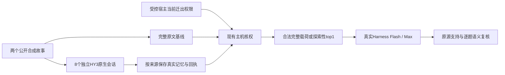

# 权限变化语义资格预试：真实客户端结果

日期：2026-11-02。范围：按《创新点台账：跨域机制筛选第二轮》的先行否证步骤，在两个新选定的公开合成故事上验证简单强基线。源端为原生桌面 WorkBuddy 的 HY3，会话模型经原生接口选择并读回；目标为官方 DeepSeek Harness SDK 的 Flash / Max，输出上限4096。

**本轮取得8份真实HY3记忆、完成5次Harness请求。独立AI按原始来源复核：7个合法回答完整且有依据，3个缺证据控制正确UNKNOWN，未观察到主动政策误拒或无依据否定。完整双故事、三状态、两方法比较尚未完成；新算法优势未成立。**

## 1. 实际运行了什么

材料为PersonaMem-v2固定提交中的两个开发人物：931、605，按已有候选队列顺序选择，没有按本轮模型失误换材。原数据是公开合成对话，CC-BY-4.0。每个故事取最前四个完整user/assistant交流，保留原始角色和消息边界；“四来源”不表示四个独立自然会话。此前使用记录中未发现这两个人物或消息精确哈希的重复，不保证模型预训练从未见过。

- 固定数据提交：`ed956dea41521fc4499acbc63f966e0fd3c053ba`，见[数据集](https://huggingface.co/datasets/bowen-upenn/PersonaMem-v2/tree/ed956dea41521fc4499acbc63f966e0fd3c053ba)。
- 原始消息、问题、评分参考分开保存；HY3生成不接触问题或参考，目标只得到问题和当前允许的记忆。参考在目标调用前冻结，是AI来源参照，尚无人工作最终金标。
- 每故事预设“不变、撤无关来源迁出、撤关键来源迁出”三个受控宿主权限视图；读取和复制许可保留。每问的完整支持路径预先登记，失去唯一支持才应UNKNOWN。

不同权限视图是独立受控条件。本轮不增加原生在线ACL、连续在线撤权链或接收者遗忘的保证。Harness SDK隔离工作区有真实输入、响应、guard和usage回执，不等于桌面聊天中新增了五段会话。

## 2. 源端生成与失败恢复

8个实际原生逻辑任务均取得对应文件，8个会话均选择并读回HY3，来源为单独的S01至S04；相同文本不被当成独立授权。底层模型/工具轮数和WorkBuddy实际费用未知，不把8个任务写成恰好8次供应商推理或免费。

| 项目 | 计数与处理 |
|---|---|
| 适配器进入尝试 | 9次 |
| 首次会话准备失败 | 1次，明确零任务提交；原失败和诊断空会话保留，显式登记替代尝试 |
| 实际原生逻辑任务 | 8个，每个绑定来源、会话、队列attempt和输出文件 |
| 标准路径取得输出 | 7份 |
| 原任务迟到输出 | 1份；原观察因队列读锁退出，恢复观察时同attempt已完成；追加独立核验，未重发模型 |
| 当前文件取得与绑定核验 | 8/8；不等于8份记忆都通过通用语义验收 |

单来源适配器限制输入字段与来源数；没有把问题、评分答案或授权真值交给生成器。原生工具负责写记忆，Codex只读取并复制已核对的输出作为证据，没有代写记忆冒充HY3。

## 3. 已完成的目标结果

| 条件 | 合法题完整且原源支持 | 缺证据题正确UNKNOWN |
|---|---:|---:|
| 原文，931，未撤权 | 2/2 | 0 |
| 原文，931，撤无关来源 | 2/2 | 0 |
| 原文，931，撤关键来源 | 1/1 | 1/1 |
| 原文，605，撤关键来源 | 1/1 | 1/1 |
| 探索性top1缓存，931，撤关键来源 | 1/1 | 1/1 |
| 合计 | **7/7** | **3/3** |

5份回执均为完成终态、单次受guard约束的Flash/Max请求。来源支持、角色、必要限定和额外断言由另一AI工作单元重新读取原始消息核对；未观察到主动政策拒答、合法UNKNOWN、无依据否定或体裁/人物经历升级。

只有两个故事，每格一次，故事内多题、不同视图和方法相互相关。这10题评估不能当作10个独立病例，更不能据此报告一般成功率100%或一般安全证明。

首份真实回答完成后，宿主回执核验因输入元数据缺少`memory_utf8_bytes`发生KeyError。原`verified=false`记录保留；根据同一冻结文本计算字节数，附加核验重新通过全部原条件。未更改模型输入或回答，未重跑模型，也未将该工程错误计成模型拒答。

## 4. 探索性top1意味着什么

完整缓存臂在付费发送前被费用上界预检阻断。此后增加的是**现成的确定性词法top1基线**：把两道登记问题拼接，以去停用词后的词集合重叠排序，平分按source_id，选择一个当前允许的独立HY3产物；选择器未读评分参考。

931撤关键来源条件下，合格库存是S01/S03/S04；重叠得分为11/2/4，实际只把S01记忆送入Harness。`source_ids`库存与`selected_source_ids`实际选择分别记录；本次真实输入依赖是S01，不把库存写成模型实际消费的三来源。

该次回答保留了有依据的题，缺少来源的题正确UNKNOWN，完成了一次真实HY3记忆到Harness的受控使用。它是费用阻断后新增的探索，**不是原定完整缓存臂，也没有证明新方法优于原文**。两臂输入长度和实际计算量不同，源端初建成本也不能漏算。

另一个结果是：本故事全部合法缓存的登记记忆为8553字节，原文基线5812字节；对应无网络离线测得的完整SDK请求为13102和10304字节。当前通用HY3提示生成的缓存更长；不能直接称它实现压缩或更省。字节不等于token，离线请求不是实际网络线上流量。

## 5. 预算与未完成条件

沿用原9元窗口、不可变账本和逐槽余额检查。本轮5槽新增全额gross预留0.593920元；仅完整受guard约束且usage守恒的回执给出保守条件上界0.049580元。窗口累计gross为3.640320元。它们都不是供应商发票；源端费用和整体实际费用仍未知。

预算器继续保留既有任务的历史未核销风险、已审上一槽的条件风险及0.5元余量。完整缓存和第二故事其余原文视图未通过后续预检，因此未发模型请求，不进入拒答或正确率分母。没有清零历史风险、删除失败、换低思考模型或截断原文来凑齐调用数。

尚未完成：

1. 605未撤权与撤无关来源的目标结果。
2. 完整缓存的两个故事×三个状态目标比较。
3. 新方法臂、消融和独立人工验收。
4. 可在干净环境独立运行的本轮完整制品整理。

公开[计数与哈希摘要](../benchmarks/permission_semantic_qualification_20261102/summary.json)不含原始来源、记忆、回答、账号余额或配置。完整输入、原始回执、工作区文件及评分证据保留本机；公开摘要本身不能重新审查语义成绩，也不是完整复现包。

## 6. 对创新点筛选的裁决

本轮没有找到新的权限变化特有语义反例。完整合法原文＋真实角色＋逐字段UNKNOWN提示表现良好，简单top1也完成了一个受控交接。因此：

- C-1“归属/限定局部修复”仍是待验证候选，没有取得新增机制优势。
- C-2“不可见不等于事实否定”在已测条件中未被击穿，不能用这批成功控制来论证该问题已发生。
- C-3独立支持维护已有B/F、ProvSQL等先例，继续暂缓。

这与手册的否证要求一致：没有留下强基线差距，就不通过增加模块数量声明创新。下一步先核销能确证的历史风险、补齐原定完整对照；再判断是否有必要移植MiniCheck/RefChecker等现成核验模块。若完整强基线继续足够，应保留工程成果，回到机制缺口筛选。

主要方法先例：[MiniCheck](https://aclanthology.org/2024.emnlp-main.499/)、[RefChecker](https://aclanthology.org/2024.emnlp-main.395/)、[QuestEval](https://aclanthology.org/2021.emnlp-main.529/)、[ProvSQL许可与否定语义](https://provsql.org/docs/user/semirings.html)、[EAL-Bench](https://arxiv.org/abs/2609.01836)。这些链接说明已有机制来源，不表示本轮运行或改进了这些算法。
