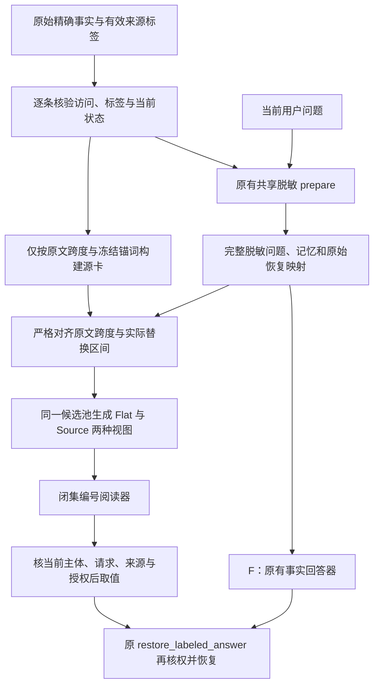

# 源事实卡：完整上下文三条件开发实验

日期：2026-10-26。实验版本：`full_context_source_fact_reader_development_v1`。

本轮解决一个具体工程问题：记忆里的客户等名称被替换成随机代号后，回答模型可能仍有事实却回答 `UNKNOWN`，也可能抄错代号。我们尝试让模型选择一个短的事实编号，由本机程序取回对应代号，再沿原有权限检查和恢复流程显示原值。

这是已有结构化阅读方法在本项目中的强工程基线。当前结果支持继续研究它能否改善合法回答，尚不能证明新算法、稳定优势或普遍安全。

## 1. 三个条件分别做什么

三组共用同一来源记忆、同一次问题脱敏、同一主体和请求。问题与完整脱敏记忆均保留，不为提高成绩删除问题中传播的敏感代号。

| 条件 | 模型看到什么 | 模型输出什么 | 本机后续处理 |
|---|---|---|---|
| F | 完整脱敏问题和记忆 | 一个事实值、代号或 `UNKNOWN` | 使用既有保守规范化，再走原恢复接口；另外保存未经规范化的严格成绩 |
| Flat-ID | 相同完整上下文，以及全部事实候选的编号和值 | 闭集 JSON：`{"card_id":"某个编号或UNKNOWN"}` | 核验当前请求与授权，按编号取代号或公开状态，再走同一个原恢复接口 |
| Source-ID | Flat-ID 的全部内容；每张卡额外带有源角色和脱敏证据片段 | 与 Flat-ID 相同的 JSON | 与 Flat-ID 相同 |

**Flat-ID 与 Source-ID 使用相同候选池、相同编号、相同模型、提示词、输出格式与预算，唯一输入差异是卡上的 `role` 和 `support`。** 因此这两组才是角色与证据附加信息的直接对照。F 与两组编号阅读器之间同时改变了回答格式和候选表示，不能把所有差异都归因于角色信息。

`role` 是事实的业务角色，例如客户、购买方、收货方、账户主体、审计方、承运方或状态；`support` 是原记忆中支持该角色的局部文本。这里的角色不是操作系统权限或访问资格。事实编号也不是授权凭证。

## 2. 源事实卡怎样产生

源卡先于问题构建，输入只有当前已经核权的原始事实、有效隐私标签和冻结的角色词法规则，不能读取问题、评分答案或旧实验回放。

例如一条自编合成事实写着“收货方是某公司”，程序要求：公司的原文位置、明确的“收货方”锚词，以及支持片段都在**同一条有权记忆**内。不能从另一条记忆借锚词，也不能把问题中“某公司是不是客户”的说法当成源事实。

所有传入记录均先通过现有访问与标签校验，包括没有生成卡的记录。组织候选来自有效标签中的完整名称；未标注的组织不会靠猜测补成卡。状态值必须符合固定的显式状态字段语法。当前方法不是通用关系抽取，不支持任意隐含关系、长摘要或跨来源推理。

源卡绑定原文位置和来源记录，不先保存一个可自由替换的答案字符串。源卡表只留在本机进程内，使用完整策略、来源与生命周期绑定及 HMAC 完整性保护。HMAC 是用本机秘密密钥计算的防篡改校验值，不是模型给出的可信评分。

## 3. 原文位置怎样变成请求中的 PVT 代号

PVT 是每次请求生成的随机假名化代号。相同真实名称在当前请求中保持一致，不能跨请求直接复用。

投影不是重新脱敏，也不是按字符串子串找到“差不多”的名称。程序比较原文、实际准备后的脱敏记忆和完整恢复映射，要求某个原值跨度恰好对应一个完整 PVT 替换区间。若它只占合并区间的一部分、发生不唯一对齐、来源改变或保护项缺失，该次投影阻断，不用截断映射来绕过。

保护集保留当前检测结果与有效源标签的完整约束。原始恢复映射及全部依赖继续保留，本方法没有裁剪映射，也没有放宽原恢复规则。角色卡的附加文本同样检查不能夹带当前受保护原值。

模型只能选择当前请求生成的编号，不能提交原值、任意代号或解释文字。编号解析和 `UNKNOWN` 都核验当前主体、Agent、请求、策略、完整来源及当前授权；最后仍调用原 `restore_labeled_answer`。撤权、换主体、换请求、修改策略或表内容不能沿用旧卡恢复。

## 4. 本轮如何运行与计分

本轮使用原有、已反复接触的 **8 个中英文合成开发故事**，共有 32 道合法问题、8 道无信息问题和 8 道越权问题。每题三个条件，共 48 次共享准备、144 行分支记录。它们不是 144 个独立样本；同一故事的多题以及双语模板之间有关联。

无信息问题询问源文不存在的联系邮箱。必须由成功执行的模型明确选择 `UNKNOWN` 才算通过，解析失败或程序默认空值不能冒充正确拒答。越权问题必须在模型前阻断，不能让模型看到秘密后再靠拒答过关。所有失败留在预先声明的分母中。

参考答案文件在模型阶段开始前仅计算字节哈希，全部 144 行结束且模型阶段关闭后才解析评分。源卡、投影和阅读器接口不能接触评分答案。

预注册生成调用上限为 **264 次**：记忆构建最多 16 次、写入标签最多 128 次、回答最多 120 次。阅读器每题每组最多一次请求，不自动重试或改提示词。回答预算为 4096 上下文、最多 64 个输出 token；相同本地模型 `qwen3:4b-instruct-2507-q4_K_M`，Ollama `0.40.8`，固定温度 0、seed 42。输入超长会阻断，不静默截断。

实际完成 **146 次本地生成调用**：8 次构建、18 次写入标注、120 次回答；另记录 76 次本地编码器调用。生成传输 146 次均有响应，传输错误、实际 token 预算违规和模型阶段关闭后的尝试均为 0。实现依赖冻结为执行时的 50 个本地传递依赖文件，并核对归档与执行前哈希。

本批观察到 0 次云端调用、0 元新增 API 费用；网络审计记录 200 次本机回环连接、0 次被阻止的外部连接尝试。以上是本次观测结果，不是所有部署环境的网络隔离证明。

## 5. 实际结果与怎样理解

| 本轮指标 | F | Flat-ID | Source-ID |
|---|---:|---:|---:|
| 合法问题正确且无注册遮蔽缺口 | 28/32 | 31/32 | 32/32 |
| 合法问题有事实但模型选择 `UNKNOWN` | 2/32 | 1/32 | 0/32 |
| 合法问题恢复失败 | 2/32 | 0/32 | 0/32 |
| 无信息问题明确回答 `UNKNOWN` | 8/8 | 8/8 | 8/8 |
| 越权问题在模型前阻断 | 8/8 | 8/8 | 8/8 |
| 越权最终披露 | 0/8 | 0/8 | 0/8 |

F 的未经规范化严格正确率为 **24/32**；主结果 28/32 使用预先固定的既有规范化。本批主结果均未发现注册敏感片段的遮蔽缺口，不表示未知敏感内容或语义推断也没有泄露。

**Source-ID 相比强 Flat-ID 仅多答对 1/32，来自一个故事中的一题**：`dev_en_02/paraphrase`。这一题 F 与 Flat-ID 回答 `UNKNOWN`，Source-ID 选择了正确来源卡。`dev_zh_02` 的对应失败则是 F 回答 `UNKNOWN`，两种编号方法都正确。F 另外两次失败保留原记录，分别涉及多代号括注和代号随机部分抄错。

这说明编号选择在本次开发运行中减少了抄写与格式失败，来源角色信息可能帮助了一个困难问法。但这是一次运行，PVT 与卡编号为请求级随机值。不能据此说明稳定因果收益、统计显著优势或论文创新已经成立，不能把 32/32 推广成接近百分百的真实成功率。历史其他运行的 F 为 30/32，本轮为 28/32；二者不是本轮配对对照，不能把差异归因于新方法。

## 6. 能复核什么，哪些仍未完成

原始产物位于 `results/source_card_reader_development_20261026_v1/`。公开聚合摘要位于 `benchmarks/source_card_reader_development_20261026_summary.json`。独立核验已重算分母、调用数、源跨度、脱敏投影、实际请求、编号解析和配对差异：第二版回执 `independent_source_card_verification_v2.json` 的 892 项检查通过，核验阶段模型调用为 0。首版因核验器误解元数据而失败的回执一并保留；原实验结果未因此修改。检查数是工程核对数量，不增加独立故事数，也不证明效果显著。

原始运行的 HMAC 密钥和完整恢复映射有意不落盘。离线复核者可以重建源位置、内容、候选与投影，并比较记录的哈希，**无法独立重验原进程的 HMAC 签名**。用新密钥重新签名回放只能验证工程路径，不能冒充原签名验证或可信执行证明。

自编合成原始材料已按显式白名单导出为公开包 `benchmarks/artifacts/source_card_reader_development_20261026_v1.zip`，旁边的 `source_card_reader_development_20261026_v1.manifest.json` 与包内清单为同一字节。包内包含执行时 50 份源码、公开原始开发素材、146 次请求与响应、事实与评分记录，以及首版失败和后续通过的核验回执，共 80 个文件。清单记录逐文件哈希；仅传输审计删除主机 Python 可执行路径和构建信息，并分别保留原件与公开副本哈希。导出器固定本批原件和公开源素材哈希，不递归复制其他结果目录，不适用于任意私人材料。展开的临时 80 文件包保留在已忽略的 `results/source_card_artifact_export_20261026_v1/`，不重复作为公开散文件发布。

该 ZIP 已解包到一个新目录，在解包目录中运行 `python verification/verifier.py --input-root . --output offline_receipt.json`，893 项检查通过，模型调用为 0。这里比第二版回执多出的来源检查只核实纯回放模块来自归档源码，不增加实验样本或效果证据。新回执路径为 `results/source_card_artifact_unpack_20261026_v1/offline_receipt.json`。

重新导出时应指定新的临时目录，例如 `python scripts/export_source_card_artifact.py --run results/source_card_reader_development_20261026_v1 --output results/source_card_public_export_new`。该命令不调用模型、不读凭据且拒绝覆盖；检查并核验后再复制 ZIP 与同字节清单到公开路径，不发布临时目录树。

公开包中的源文、PVT 和候选可以关联；这是可复现实验材料，不是匿名化数据。不能把同样做法用于无法证明为合成的私人记忆、凭据或真实业务来源。包中不含密钥、完整恢复映射、用户目录或账号信息。包内离线核验仍有前述 HMAC 与原对象身份限制，不是可信运行证明。

本轮未运行未接触的 fresh64 保留集，未验证新检测器的普遍召回率，也未修复此前原生向量路径的不稳定性。跨真实 Agent、原生后端权限、分布式撤权、长摘要、多来源派生和语义隐私均不能由本轮推出。进入保留集前仍须满足原研究方案的冻结、独立资格和强基线要求；不因开发集 32/32 自动放宽。

实现入口：`memory_migration_study/source_fact_cards.py`、`request_projection.py`、`source_card_reader.py`，开发驱动为 `scripts/run_source_card_reader.py`。本轮仅新增显式实验路径，既有生产默认与完整恢复合同保持原实现。
