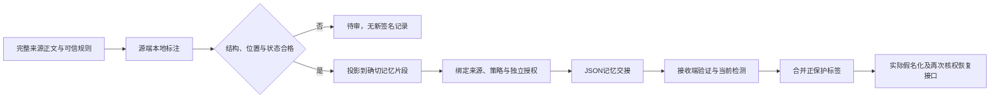

# 源端上下文标注：实现与真实对照结果

日期：2026-10-28。**源端标注、签名交接与接收端继承接口已接通，但这次真实检测没有改善效果。** “苔藓”仍然漏遮，确定案例可准备数由18/20降至11/20，开发推进门槛未通过。默认流程没有切换。

## 1. 实现了什么

新增[source_annotation.py](../memory_migration_study/source_annotation.py)，在可信主机确定记忆片段后，让本地检测器阅读全文，把原文位置上的保护标签投影到具体记忆，再交给既有`MemoryLabelAuthority`签发。支持精确原文片段，不支持任意改写摘要的标签自动映射。当前版本限定严格客户类别，其他类别需使用其既有完整检测链。

现有`prepare_labeled_transfer`已经支持源标签并集，本轮复用了它。源标签只增加保护，不创建读、迁出或共享权限；未知源结果、格式失败和不完整计数不会签成干净记录。成功空结果记为`observed_empty`，含义是本次没有检测到，不是证明正文没有敏感信息。

调用时机如下：

实现单元测试还覆盖同字不同位置、跨片段标签、已有标签与新增标签交叉、标签和内容篡改、主体/Agent变更、撤权及接收端未知保留。签名验证成功仅证明绑定与完整性，不证明模型标对了内容。

## 2. 实际实验范围

按[预注册](源端上下文标注_开发对照预注册_2026-10-28.md)复用24条已公开的中英文合成开发正文。每条全文复制为一条记忆，以保持三个条件内容完全一致；这是写入时标注的受控实验，不是自由生成摘要，也没有给源端额外业务数据库或正确答案。

源端使用既有`OccurrenceQwenAgent`及固定Qwen3 4B全文识别。接收端复用上一轮24条封存的条件标记响应，本轮没有重新调用接收端模型。全部72行处理结果、源端输出与实际遮蔽足迹封存后，才解析评分标签。

| 条件 | 本轮处理 |
|---|---|
| 仅接收方检测 | 使用原接收方输出，源标签为空 |
| 源标签迁移 | 源端真实标注、签入记忆、JSON往返验证，再与原接收方输出并集 |
| 接收侧双检测并集 | 使用完全相同的两份检测输出，在接收侧直接并集，作为完整简单强基线 |

实际发生28次本地生成，包括4次既有格式/定位修复；另有48次本机健康读取，共76次回环连接，0次被禁止连接。输入13,353 token、输出1,160 token。源端计时合计19.375秒，执行总时间22.110秒。没有云端调用、付费API或原生后端写入。

## 3. 对照结果

| 指标 | 仅接收方检测 | 源标签迁移 | 接收侧双检测 |
|---|---:|---:|---:|
| 总案例 | 24 | 24 | 24 |
| 确定案例可准备 | 18/20 | 11/20 | 11/20 |
| 确定案例位置完整正确且可准备 | 15/20 | 8/20 | 8/20 |
| 参考未知案例有语义不确定证据且阻断 | 4/4 | 4/4 | 4/4 |
| 实际完整遮蔽参考敏感片段 | 11/12 | 8/12 | 8/12 |
| 因阻断未交付的参考敏感片段 | 0 | 3 | 3 |
| 已准备载荷中的漏遮片段 | 1 | 1 | 1 |
| 指定合法事实保留 | 18/24 | 11/24 | 11/24 |
| 已准备确定案例中多遮蔽的非敏感字符 | 48 | 61 | 61 |

源标签迁移与接收侧双检测在全部24个案例的准备状态、原保护位置和实际遮蔽足迹上相同。本轮没有证明标签迁移相对完整双检测强基线的效果优势，也没有测量长期重复使用的成本收益。

源端24条结果中：15条结构检查通过，其中11条有正标签、4条观测为空；9条待审，其中6条语义不确定、3条格式或位置修复后仍失败。这9条不能签成干净记录，因此增加了整体阻断。

原始位置预测的TP/FP/FN分别为：仅接收端11/5/1，源标签迁移及接收侧并集均为11/7/1。这里统计包含已阻断的确定案例中的原始保护位置；旧报告的11/2/1采用接受结果的口径。两者不直接比较，不改写旧分数。实际输出安全性使用上表的真实遮蔽足迹单独评价。

多遮蔽字符只在确定且已准备的正文计数。三个条件准备数量不同，这不是相同输出数量下的平均过度遮蔽率；完整逐案例数据保留在本机。

## 4. “苔藓”发生了什么

参考敏感对象是第二次出现、作为机构名的“苔藓”，位置为`[24,26)`。接收方没有找到它。源端此次返回的是：

> 该机构正在向本公司购买展示柜

该片段的位置为`[40,54)`，属于说明客户关系的语句，不是机构名称。程序正确保留、签入、迁移并遮蔽了这14个字符；真正需要保护的机构名依然存在。

因此本次暴露的是：**源模型把判断关系的依据标成了要保护的名称，签名与迁移把这份错误标注完整保留了下来。** 字符位置正确、来源真实、签名通过，都不能推出敏感对象识别正确。该拟载荷没有发送云端。

## 5. 工程验证与证据

新增源端接口29项测试、执行器12项测试；连同已有权限、严格合同与出现位置适配器，95项定向测试通过，0失败、0错误。该数字不代表重新跑过全仓CI。

真实批次的40个可准备输出分别验证了错误用户和错误Agent，合计80次权限反例均拒绝。恢复前撤权在离线工程测试中验证；本轮没有新运行分布式在线撤权或Qoder/Harness客户端。

初次独立复核因只读命令自动审批超时、备用工具启动失败，未完成哈希校验与重新评分；该工具失败记录保留。后续续作已实际运行[独立标准库审计脚本](../scripts/verify_source_annotation_probe.py)，不导入原评分函数，完成231个冻结源码、5份历史输入与76份捕获文件的哈希检查，并逐行重算72个单元；结果与原报告一致。40条已准备足迹、80次权限反例、源端6条语义不确定与3条格式失败，以及24组双检测等价均通过复核，见[审计聚合摘要](../benchmarks/source_annotation_independent_audit_20261028_summary.json)。

该审计还精确确认FP口径差异：原评分将非`ok`预测清空，本轮原始位置统计还包含index 9两处`company`及index 21一处`公司`，合计3个阻断行误报，因此是2+3=5。它们不是新的模型观测。临时HMAC密钥未持久化，审计核对的是绑定与当时校验记录，不能离线重新验签；本地哈希闭合也不是外部时间戳见证。复核通过不改变本轮效果门槛失败。

- [公开聚合摘要](../benchmarks/source_annotation_20261028_summary.json)
- [实验执行器](../scripts/run_source_annotation_probe.py)
- [源端接口测试](../tests/test_source_annotation.py)
- [执行器测试](../tests/test_source_annotation_probe.py)
- 本机原始证据：`results/source_annotation_20261028_run_01/`

计划SHA256：`e93abc7b87e5127214c8a993dafdda678a5d0b29707e19e10ce3d9a6035a933e`。

预测封存SHA256：`30f5442632b6ec6fd9c639e3bbeb7cf3bef4c1fd62998b5fb32a8fe2498e9ef0`。

报告SHA256：`e062e4a5e1c1b6116605c2b184a7d034f658a4f214f8a9c1074a23e119c20c5e`。

## 6. 对下一步的约束

发送方提前标注有两种不同证据条件：发送方在业务过程中原生拥有实体字段和类型；或者发送方再调用模型，从文本重新推断标签。本轮验证的是后一种条件，效果未通过，不能据此宣称前一种已被验证或无效。

如果继续，应优先检查真实生成器能否随事实产生可核验的实体字段、来源与保护要求，并与接收方重新识别公平对照。这些字段必须来自实际生成或业务输入，不能从评分答案填入。对“从未采购”的误报，纯正标签并集不能删除接收方错误，需要独立评价否定、方向与时间判断。

本次没有下游问答，无法证明合法问题拒答减少。研究主线仍为记忆安全迁移与权限保持；独立检测P90/R95、63/64联合任务、原生稳定性和论文创新门槛保持未通过。
