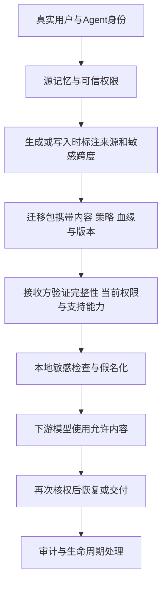

# Agent记忆安全迁移与权限保持：阶段收尾与结果总结

日期：2026-10-28。持续研究目标当前为暂停，后续待办保留。本次仅整理已完成工作，没有启动新实验。**工程原型和受控验证继续保留，但敏感识别效果、完整端到端验收和论文创新均尚未达标。**

## 1. 我们做的仍是什么

研究主线仍是：不同Agent交接记忆时，保留来源与权限，防止越权读取、转交和恢复敏感原值，并尽量保留合法任务可用性。近期的实体识别、脱敏和采样实验是这条链上的组件诊断，不是将课题改成普通NER。

完整设计流程为：

这是整体设计，不代表每个环节已在所有Agent上完成。最近几轮实际运行的是**本地检测→同一受控迁移准备→实际假名化载荷检查**，并非新的Qoder/Harness原生互传或完整云端问答实验。签名和哈希能够检查绑定与完整性，不能证明模型的敏感判断一定正确。

## 2. 本阶段实际完成的工作

| 工作 | 实际交付与结论 |
|---|---|
| 请求往返稳定性 | 新增显式v2请求构建，修复JSON对象键顺序影响提示和请求哈希的问题；保留数组、Unicode和原文位置，旧冻结版本不改 |
| 生成时源标注 | 已实现来源绑定与标注接口并做真实对照。源端模型也会漏标或标错；与得到同样检测信息的接收侧并集等价，没有协议独有收益证据 |
| 更换检测模型 | 已核验和运行Qwen3.5 4B现有资产；它没有解决“苔藓”及关系语义问题，未超过条件位置强基线 |
| 原文受限标签 | 独立实现逐字复制与插标签语法，受限输出8/8保持原文；识别P33.3%、R50%，仍有漏遮，不属于效果通过 |
| 采样参数隔离 | 发现并实际验证旧模型继承presence1.5；完成同后端只改变1.5/0的配对测试，证明格式收益不能替代隐私效果 |
| 来源字段资格 | 限定核查10份说明/清单，未找到合格的真实业务工具字段与授权联合来源；没有从评分答案补造源信息 |
| WebUI四空值 | 核实原四格身份与SQL读取符合预期，失败在向量HTTP200/null；历史具体异常仍未知，没有将旧失败改成通过 |
| 新强基线核查 | 确认本机早已使用GLiNER2.5 multi；尚未测的是原生JointIE。已发现其编译遗漏关系描述的接口缺口，适配资格尚待实现与实测 |

## 3. 最新配对实验最重要的结果

固定10条已暴露困难材料，8条关系确定、2条未知；两个实际条件共用模型、提示、JSON schema、原修复流程和预算，只改变presence惩罚。

| 指标 | 惩罚1.5 | 惩罚0 |
|---|---:|---:|
| 最终格式/位置合格 | 6/10 | 8/10 |
| 确定材料可进入迁移准备 | 3/8 | 6/8 |
| 确定材料整条精确正确且可准备 | 0/8 | 2/8 |
| 精确率／召回率 | 0%／0% | 40%／33.3% |
| 准备成功后的漏遮跨度 | 1 | 2 |
| 未知关系正确语义待审 | 0/2 | 0/2 |

惩罚0新增的2条整条正确均为明确非客户案例；6条真正含敏感客户名的案例，没有一条完整精确正确。“苔藓”仍漏检，另有一条中文材料从格式阻断变为错误空结果放行，导致漏遮增加。

因此，**更少阻断不等于更高安全成功率**。这些是选取的开发诊断材料，不能将百分比推广到所有用户，也不能与24条或8条的其他实验直接比较。默认方案没有因这项局部格式收益而切换。

该轮完成27次本地生成、40次版本/身份读取，新增付费和云端生成均为0；19项直接工程测试通过。独立审计复核全部40格、27份原响应、实际采样日志及遮蔽足迹，52项错误主体反例均拒绝。它们不是52个独立任务，也不代表全仓CI或完整论文验收通过。

## 4. 当前主要问题怎样划分

- **算法问题是近期主要瓶颈。** 包括漏掉不常见机构名、把普通词或整段当实体、误判采购方向和否定/历史关系、把未知关系当成确定结果。
- **表示和配置问题已有实证进展。** 原文绑定能修复制；显式采样参数能提高可复查性。但它们没有使敏感语义正确。
- **协议能力不能替代检测能力。** 当前受控绑定、授权和错误主体检查有效；错误标签即使完整迁移，仍是错误标签。通用异构互通与生命周期的完整验收尚不能据此推定。
- **环境问题单列。** WebUI四次null的具体异常现场缺失；当前读取链已把异常与授权拒绝、合法空结果区分，但历史根因仍未闭环。

## 5. 保留待办与研究边界

恢复研究后，优先做GLiNER原生JointIE的输入合同资格：证明关系定义实际进入编码、不截断原文、位置映射正确；随后才按冻结方案检验端点救援是否改善候选漏检。它是已有强基线，不能直接认领为新算法。

仍需完成原验收：独立自然语言检测P≥90%、R≥95%；新独立64题至少63题联合成功且未授权动作/注册敏感非法外发为0；真实Agent下游及原生环境；历史WebUI四次null根因闭环；充分强基线、消融和可复现创新证据。

本阶段不继续扫采样参数，不把追加源检测、换模型或受限复制自动包装为创新。当前尚未建立足够的论文贡献证据；下游拒答率和独立验收指标保持未测，不填成0或通过。

## 6. 收尾状态与报告入口

- 已核对最新实验为终态完成，原始失败和独立审计修订均保留。
- 本阶段启动的Ollama、llama运行器及相应隐藏控制台已经按所有权核验关闭。
- 最新代码和报告保存在本地工作区；本次没有执行GitHub提交或推送，没有声称远端已更新。
- 用户已有的其他未跟踪文件保留，没有清理或覆盖。

详细依据：

- [最新配对实测](Qwen35重复惩罚_配对实测与下一路线_2026-10-28.md)与[公开聚合](../benchmarks/qwen35_sampling_probe_20261028_summary.json)
- [原文受限标签实测](原文受限标签_真实对照与语义瓶颈_2026-10-28.md)
- [Qwen3.5全文对照](Qwen35全文检测_真实结果与路线裁决_2026-10-28.md)
- [源端标注对照](源端上下文标注_实现与真实对照结果_2026-10-28.md)
- [来源资格核查](源工具字段资格核查_2026-10-28.md)
- [WebUI四空值归因](历史WebUI四空值_身份与接口归因复核_2026-10-28.md)
- [JointIE接口与待验资格](GLiNER原生联合抽取_接口缺口与适配资格_2026-10-28.md)
