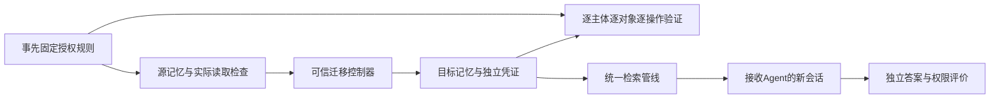

# 从两个 Agent 交接记忆，到可检验的研究问题

日期：2026-10-21。基于用户提供的《最新研究方案：导师指导整合版》。本文给出执行路线；程序字段、未知状态和验收口径见[实现契约](具体实验方案与实现契约_2026-10-21.md)。实际运行结果另行记录，不用设计目标充当实验结果。

## 1. 这一篇先研究什么

建议暂定题目：**异构 Agent 记忆迁移中的授权保持与任务损失：一种可复查的评测方法**。

第一阶段的重点是测量：记忆从一个系统交给另一个系统后，是否有人多读了不该读的内容，是否有人少读了本来有权使用的内容，这种变化又会不会影响任务。暂时不把“新安全协议”或“新优化算法”写进贡献标题。

具体研究问题只有三个，按顺序回答：

1. 原来约定的读取权限，经过身份和对象映射后是否实际执行？
2. 正确分组与按读者复制这两种简单方法，能否完整保持这些权限？
3. 权限保持后，接收 Agent 完成同一任务的表现是否保持；如果没有，差距出在内容、检索还是回答环节？

如果简单方法全部解决，当前实验可以验证工具与形成阴性记录，不能据此宣称新算法必要。若要形成论文贡献，还需要真实产品中的新测量发现或有依据的限制。

## 2. Agent 怎样搭建

先使用同一份 Agent 程序建立三个独立身份：

| 身份 | 用户 | 用途 |
|---|---|---|
| A | Alice | 发送端工作助手 |
| B | Alice | 接收端排期助手 |
| C | Bob | 另一个用户的助手，作为隔离检查对象 |

“独立”指服务端分别绑定用户、Agent 和凭证，并为每个任务创建新的上下文。A、B使用同一个模型也可以成立；不必为了模拟两个Agent而换两个模型。是否允许B读取，由策略明确批准，不能仅凭B与A属于同一个用户。

第一层使用真实执行访问控制的本地参考服务和固定回答器，检查程序；第二层接入已部署产品的实际身份接口；第三层才接入真实模型做任务实验。固定回答器只是测试替身，不是生成式Agent实证。

## 3. 一个能够讲清楚的小故事

下面是理解规则的示例，不声称来自自然数据，也不预先规定程序最终样例计数：

| 记忆 | 事先制定的规则 | 应检查的现象 |
|---|---|---|
| 项目交付日期 | 允许A、B读取并交接，C无权 | B迁移后仍能回答日期，C不能通过任何已登记入口读到 |
| Alice私人预约 | 仅A可读，不批准给B | 同一用户的B仍不能继承 |
| 团队公共会议时间 | 明确允许A、B、C，批准迁出 | 不能为了安全把合法公共内容全部封闭 |
| 客户联系方式 | 源端允许B，但目标既有规则禁止 | 共同参照应禁止，不能把这项本地限制算成错误损失 |
| 仅限源端使用的备注 | A可读，但迁移控制器无导出资格 | 不迁出，单列准入排除原因 |
| 授权资料缺失的记录 | 接收范围未确定 | 保留unknown，不自动开放，也不宣称已证明安全 |

这里的ACL就是“谁可以读这条记忆”的名单。共同授权参照就是事先写清楚的标准答案，综合源规则、接收范围和固定目标本地规则。程序先检查迁出和复制资格，再按共同参照建立配置。候选方法不能用自己删掉了哪些对象来修改这份标准答案。

## 4. 实验如何比较

### 4.1 先检查底层访问

同一批数据至少比较三种配置：

- **exact_groups**：允许读者完全相同的记忆放在同一容器。容器可以理解成带访问名单的文件夹。
- **reader_copies**：在允许复制时，为每个合法读者保存独立副本；登记每个副本对应哪条源记忆。
- **reject_all**：整包拒绝迁移，作为“安全但可能完全不可用”的诊断。

默认不人为设置容器数量上限。只有从真实产品能力或实际部署条件取得限制证据，才能讨论有限资源下怎样选择配置。不能为了让新算法赢而删掉已有能力。

直接检查覆盖源端保持、源端回导、目标等效配置与实际迁移。每条结果保留真实HTTP响应、来源映射和操作。参考服务的这些分支仍然是参考系统实验，不能标成Cognee或Open WebUI原生验证。

核心指标：W+表示“明确无权却拿到内容”；W−表示“明确有权但有效完整探测确认拿不到”；unknown表示“目前证据不能判断”。read和list分别计分。一个副本泄漏就足以证明存在问题，但没测到某个副本时不能宣布所有副本都安全。

### 4.2 再检查任务表现

接收Agent B面对同一道问题，分别运行三组：

| 组别 | 输入记忆 | 作用 |
|---|---|---|
| authorized_reference | 按共同授权本来可以使用的内容 | 参照条件 |
| migrated | 实际迁移后用该身份取得的内容 | 被测条件 |
| no_memory | 不提供外部记忆 | 检查模型是否本来就能答、是否依赖记忆 |

三组保持同一程序、模型、提示词、检索规则、排序与长度预算。副本按登记的源ID去重，不让“多复制几份”改变排名。每组使用新上下文，组别运行顺序按固定随机种子打乱。

首轮只做有明确原文依据的事实问题。任务差距等于参照得分减迁移得分，允许负数，同时展示两组原分数。参照组回答错误的任务不能因此被删除。语义改写泄漏、推断泄漏等没有可靠参照的内容暂不评分。

## 5. 如何使用已有数据

先用随程序分发的虚构故事验证仪器，再准备GateMem Office/Household的少量开发候选。只读取首检查点前可见对话，保留episode、turn及截止点。现有加载器可复用。

公开对话内容不等于现成的访问权限。研究控制者另行指定、并在源端实际执行的权限，称“受控策略”；不能写成原数据真实授权。候选没有任务事实依据或复核记录时保持needs_review，不自动进入论文主评分。

一个episode及其任务、改写、副本、策略变化都归同一个场景，不能拆到开发和检查两边。100次接口请求不是100个独立案例。当前不预承诺筛出50或100个合格场景，也不重复下载数据。

## 6. 接下来每一步的继续条件

| 顺序 | 实际交付 | 什么时候继续 |
|---|---|---|
| 本轮 | 可运行参考闭环、故障测试、JSON与HTML、公开数据候选准备器 | 正确基线0新增越权且0合法关系损失；人为故障被检出；未知不冒充通过 |
| 原生接入 | 将已有Cognee/Open WebUI工程的响应转为统一证据格式 | 新工程已经补充；先核查归档，再准备独立环境，核实版本、普通身份、映射和原生能力 |
| 小型任务冒烟 | 有事实依据的开发任务，真实模型三组配对 | 接口与标签隔离合格，模型价格、累计费用与本轮上限已核对 |
| 研究冻结 | 场景资格、策略、方法、预算、评分与分组清单 | 至少有明确可检验的问题；如主张优化，还需简单方法不足的真实依据 |
| 独立检查 | 按场景配对、保留失败与阴性结果 | 不根据检查集答案重新选择配置；样本过少只描述，不夸大统计结论 |

可继续发展的两种结果：一是完整简单方法在原生环境下出现可解释的新不兼容现象，可以考虑互操作性测量论文；二是存在真实限制且简单方法明显不足，才研究安全约束下的配置优化。若两者都没有，先收缩问题，避免在仪器验证上继续堆叠算法和模型调用。

目前最合理的投入是把这条证据链做扎实。本轮程序实现不会自动证明论文创新。用户已补充149项测试工程，位于memory_migration_permission_149tests_20261021/memory_migration_permission_pilot；其历史记录、当前机器的离线复核、新增程序结果将分别报告。
