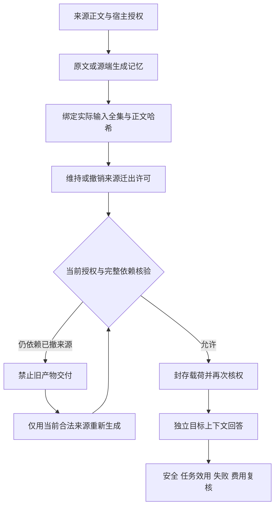

# 阶段收尾：记忆撤权安全交付

日期：2026-11-04。项目保持聚焦：来源的迁出许可变化后，阻止旧派生记忆越权交付，尽可能保留仍合法信息完成任务。

## 本轮成果

已完成两个自编合成故事的正式对照：四种基线、三种权限状态，共24个计划位置。实际发生16次源生成、20次目标回答，4个B0位置因撤权在模型调用前阻断。另完成Flash源到Flash目标的独立资格2源1目标，以及WorkBuddy HY3到Harness SDK的独立资格2源1目标。

本轮合计40个成功Harness SDK请求、2个真实HY3原生任务。各阶段分母独立，不以模型请求数充当独立样本数。两次早期故障分别是SDK账户服务加载屏障缺失和WorkBuddy未运行；修复后使用新执行记录，旧失败保留在本机。

| 方法 | 处理 | 正式源/目标请求 | 应可答合法题完成数 |
|---|---|---:|---:|
| B0 | 四源混合M，任一依赖失去许可即整包阻断 | 2 / 2 | 6/16 |
| B1 | 直接交付当前合法完整原文 | 0 / 6 | 16/16 |
| B2 | 每状态仅用当前合法来源重新生成R | 6 / 6 | 16/16 |
| B3 | 预生成四张单源卡，交付时选择仍合法的卡 | 8 / 6 | 16/16，含一项措辞待审 |

AI语义复核：实际送达的54道合法题均正确，6道缺证题均UNKNOWN。B0的4次系统阻断导致10道仍合法问题没有交付，不能把这些位置补造成模型拒答或正确UNKNOWN。B3一题开头残缺、最终结论正确，保留人工争议；暂不计通过时为B3 15/16，实际合法总体53/54。

两故事是AI编写并复核后冻结的开发材料，人工gold尚未建立。60个逐题回答重复使用故事和问题，不能按60个独立病例计算一般成功率。

## 统一流程

授权由可信宿主与原有NativeAgentBroker执行，模型文字和来源标签不能产生许可。黑盒记忆看过哪些来源，就保守继承哪些实际业务输入依赖，不能凭改写文字解除依赖。

## 跨客户端实际结果

WorkBuddy HY3在两个不同的原生会话生成M与R。M看过四来源，包含S01的合成预算。宿主撤销S01迁出许可后，旧M及重新导出M均拒绝；R只用S02—S04生成。Harness Flash通过官方SDK实际收到R，回答联系人“戚晴”、内容物“书册与阅读记录卡”，预算题返回UNKNOWN。

原生模型读回、输入输出绑定及可见无工具调用检查通过。独立后验核查核对了35份文件与12行宿主事件。此资格不计入两故事正式效果分母。WorkBuddy有真实原生会话；Harness使用SDK记录，不等同于桌面聊天新增对话。

## 安全核查与费用

正式20次实际交付的完整依赖集合均与冻结当前许可一致，实际SDK记忆正文与准备载荷逐字匹配。4个B0阻断位置没有目标请求。旧制品检查保留8条受影响拒绝、22条未受影响允许记录。

这些结论限可信单写者、显式业务输入和存档的一致性核验。密钥销毁后未重新执行HMAC核权；不证明产品原生在线ACL、并发原子性、供应商隐藏状态或模型遗忘。

| 范围 | SDK费用上界，元 |
|---|---:|
| 正式两故事，36请求 | 0.096232 |
| 独立SDK资格，3请求 | 0.011368 |
| 跨客户端SDK目标，1请求 | 0.001490 |
| 合计40成功SDK请求 | 0.109090 |

峰价上界包含实际源端和目标端用量，缓存读入也按保守输入率计算。这是费用估算，不是供应商账单。HY3费用与供应商物理请求总数未知。账户余额、认证、原生对话日志与机器运行配置不在公开包中。

## 代码和复核

- [公开核心与27项离线检查](../experiments/revocation_rebuild_controlled_20261104/README.md)：宿主、依赖闭包、四基线调度、HTTP适配器及受控合成数据。HTTP适配器经过离线测试，本轮真实请求走官方SDK。
- [公开证据与离线复算](../benchmarks/revocation_rebuild_controlled_20261104/README.md)：白名单导出的来源、实际记忆、回答与usage，不是完整原生日志或密码学重放包。
- [当前研究计划](新算法优势停滞原因与七天验证计划_2026-11-04.md)：收窄到权限变化与语义关联共同决定的初始分组。

本轮27项定向工程测试通过，主实验28项冻结依赖和跨客户端59项依赖未变。公开包的复算和本次发布CI结果以实际执行记录为准。

## 当前裁决和保留待办

本轮没有实施D1。B1、B2、B3在这两个故事上均已达到高合法效用，B1费用最低，尚无新算法优势证据。计划从一次交接扩展到连续权限事件与多次使用，比较完整生命周期成本；分组、缓存或增量重建本身不直接当作原创。

后续待办：两位真实复核人独立完成本批评分；冻结候选与公平分组/检索强基线；运行有上限的真实方法小试；若有可解释差异，再扩大独立检查故事并报告不确定性。七天目标是对候选作出可复核裁决，不承诺论文正结果。

本次按用户要求收尾、清理并发布既有成果。后续实验未作为本次发布过程自动启动。

发布CI补充：Windows runner的临时目录别名曾触发严格路径拒绝，已将公共测试入口的夹具临时根规范化，并验证恢复原缓存、异常恢复和显式别名仍拒绝；生产核权和冻结实验文件未变。修复后本地31项受影响检查通过，远端最终结果按提交CI核对。
