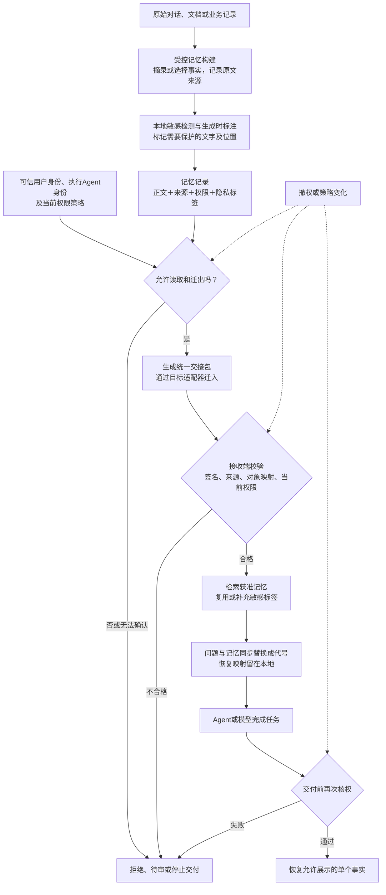

# Agent记忆安全迁移与权限保持：项目框架、流程与当前进度

更新日期：2026-10-29。

## 1. 当前处于什么阶段

**项目目前处于“可运行研究原型＋小规模真实验证”阶段。**

记忆标注、权限检查、迁移适配、脱敏恢复都有代码和实验；完整的通用跨Agent系统、独立效果验收和论文创新证据仍未完成。

项目主线是：**Agent A把记忆交给Agent B后，内容能继续使用，原有权限也能继续生效。**

这里的“记忆”主要是外部记录、事实卡和上下文文件，例如客户信息、任务进展、用户偏好，不是迁移模型权重。

## 2. 整体框架与流程图



这张图是**组件的总体组织方式**。目前有多条链路分别跑通，尚未在所有平台上形成一条统一验收通过的流水线。

流程中的拒绝、待审、认证失败和执行错误需要分别记录，不能全部当成“安全拒绝”，也不能将没有输出当作安全成功。

## 3. 每一步具体在做什么

### 3.1 构建记忆

从原文选择事实，记录“来自哪个文件、哪一段、具体哪些字符”。

目前支持受控摘录和事实选择，任意长摘要的自动构建与权限继承还没有通用实现。宿主提供事实和授权，不能仅因为存在记忆签名接口，就声称任意Agent都能自主产生可靠的长期记忆。

### 3.2 标注隐私

用规则、实体识别模型和本地大模型找敏感片段。生成记忆时可以提前标注，迁移时再验证或补检。

例如，程序要区分“苔藓是一种植物”和“苔藓是一家公司”。实体识别负责找候选，业务策略负责定义哪些内容需要保护，两者不能混为一谈。

**签名只能保证标签没有被改动，不能保证模型标对了。** 源端模型漏标时，将标签完整迁移也不会自动补回遗漏。

### 3.3 检查权限

分别核对真实用户、执行Agent和具体操作。

**能读取，不自动意味着能迁出、复制、分享或继续转授权。** 这些许可由可信程序和策略决定，不能由记忆文本中的“我是管理员”决定。

用户身份、Agent身份和存储后端是三个不同维度。同一个Agent可以服务不同用户，不同Agent也可以共用一个记忆后端。

### 3.4 打包迁移

用统一交接格式携带内容、来源、权限和版本信息。不同客户端或后端通过各自的适配器接入。

可以理解为“统一交接单＋不同平台的接线头”。统一交接格式不等于所有平台原生支持同一权限协议。

### 3.5 接收端验证

检查对象、正文、来源、签名和接收者是否匹配，并复查当前权限。

旧交接包不能凭借过期授权恢复访问。目标不支持或无法验证的约束，不能因为换了格式就自动变成允许。

### 3.6 脱敏后使用

在隐私模式下，模型看到的是代号。例如：

```text
原文：Maple 的客户是 Granite Mutual
模型输入：[PROJECT_A] 的客户是 [CUSTOMER_B]
模型回答：[CUSTOMER_B]
本地核权后展示：Granite Mutual
```

问题中的敏感值也要同步替换。迁移包中的受控内容，与发送给模型的脱敏视图，是两个不同层次。

这种处理称为“假名化”：本地保留代号与原值的对应关系，因此能够恢复。它不等于完全匿名化，代号之间的业务关系仍可能提供推断线索。

### 3.7 再次核权并恢复

本地主机确认当前用户仍有权读取、代号确实来自本次记忆，才恢复为原值。

目前主要支持单个事实或`UNKNOWN`。`UNKNOWN`表示现有获准记忆不足以提供答案。复杂摘要、计算和自由文本恢复尚未通用化。

未知代号、跨请求代号、仅由问题提供而无记忆证据的值，以及已失效授权，都不能直接恢复。

### 3.8 处理撤权

撤权后阻止新的读取、交接和恢复，并检查旧包重放。

已经被其他程序读走的明文，无法靠事后撤权让它自动遗忘。受控撤权验证也不能直接推成跨机器、并发系统中的即时撤权保证。

## 4. 各部分做到什么程度

| 部分 | 当前程度 | 主要边界 |
|---|---|---|
| 记忆来源、位置、哈希与签名绑定 | 已实现并验证 | 不证明事实或隐私标签语义正确 |
| 用户与Agent分别授权 | 已实现受控验证 | 尚非通用企业身份与权限系统 |
| 统一记忆交接格式 | 已实现 | 不同平台仍需各自适配器 |
| Qoder ↔ Harness交接 | 做过真实双向客户端实验 | 使用宿主预置记忆；权限主要由本地主机执行 |
| 原生后端迁移 | 做过WebUI→Cognee有限实验 | 同机真实接口，主要验证读取权限；不是完整跨机策略迁移 |
| 生成时隐私标注、迁移时验证 | 接口已接通并做过对照 | 源端模型仍会漏标，未证明优于同信息的简单双检测 |
| 假名化与本地恢复 | 已实现并接过真实客户端 | 主要是受控单事实任务 |
| 撤权、旧包与错误主体检查 | 已有多组受控验证 | 分布式并发撤权、所有副本和复杂派生物尚未完整覆盖 |
| 敏感检测效果 | **仍未达标** | 存在机构名遗漏、关系误判和漏遮 |
| 通用业务工具权限 | **尚未完整实现** | 记忆读取/传播权限代码不能替代任意业务工具的参数、资源和接收方门控 |
| 完整端到端与论文验收 | **尚未通过** | 新独立任务、联合安全效用和创新优势证据不足 |

## 5. 已有结果应该怎样理解

### 5.1 真实客户端确实运行过

Qoder/Harness一批24次调用全部符合参考答案，但只有一个已暴露故事、三道不同问题；两端均选择DeepSeek Flash，不能推成通用成功率100%。

被交接的是宿主预置的事实和上下文，不是让两个产品自主导出全部长期记忆。静态`AGENTS.md`提供上下文，本身不是逐次访问控制机制。

### 5.2 工程可靠性已有大量检查

最近一次完整隔离回归记录为2186项：2172项通过、14项可选检查跳过，0失败、0错误。

这是相应修复快照的工程验证，证明代码合同通过，不代表模型不会漏检，也不代表后续所有新增模块已经执行过同一轮完整回归。最新算法另有40项定向测试，不能将不同测试批次合成业务成功率。

### 5.3 模型检测仍有明显取舍

10月29日“保护所有具体机构名”的核验中：

| 方法 | 精确率 | 召回率 | 拟载荷漏遮字符 | 可准备文本 | 允许事实原样保留 |
|---|---:|---:|---:|---:|---:|
| 原NER检测 | 65.4% | 89.5% | 13 | 24/24 | 47/48 |
| NER＋始终全文复查 | 78.9% | 78.9% | 4 | 19/24 | 37/48 |

- **NER**：命名实体识别，用来找机构名、人名等文字候选。
- **精确率**：标出的内容有多少确实敏感。
- **召回率**：真正敏感的内容找回了多少。
- **拟载荷**：本地准备出来、尚未实际发给外部模型的输入。

增加全文复查后漏遮减少，但可处理文本和合法事实保留也下降，仍未达到“安全且可用”的联合目标。这批保护定义为所有具体机构名，不能与此前“只保护客户名”的关系判定实验混为同一任务。

检测成绩、允许事实原样保留和模型问答正确率是不同指标。该轮没有启动新的Qoder/Harness客户端调用，不能把它与另一批24/24客户端成绩拼成完整验收结果。

## 6. 最近移植的三个算法处在什么位置

它们是独立实验模块，尚未替换主流程默认方法。

| 算法 | 服务于哪个环节 | 当前结论 |
|---|---|---|
| LTT | 离线检验并选择检索配置 | 选中了简单top1；未证明比固定top1更准确 |
| B/F | 维护明确来源依赖，处理失效传播 | 29个状态正确，但当前比带索引的重算更慢 |
| ACORN | 带过滤条件的向量检索 | 固定版本的小规模实验出现15个掩码外候选，停止扩大测试；具体原因待定位 |

**检索算法负责提供候选，最终授权仍应由独立的权限检查完成。**

ACORN的15个候选指合成向量ID不符合传入掩码，不是15条真实隐私泄露，也不能据此断定其论文算法或所有版本存在漏洞。另一个4条记忆的受控撤权接口实验通过3个阶段，不替代上面的256条向量实验。

LTT的检查集两种配置均为8/8，其中合法题各4道；top1输入内容字节少20%。B/F中图本次约251ms，对照索引队列重算约124ms。不同实验的题数、图状态、检索候选和工程检查不能合并成整体成功率。

## 7. 当前最关键的缺口

需要把以下环节放到**同一组新的独立任务**中：

```text
实际敏感检测
    ↓
记忆交接与当前权限保持
    ↓
真实Agent使用迁移后记忆
    ↓
再次核权并恢复
    ↓
同时评价安全性、合法任务效果与成本
```

要证明没有越权或漏遮，也没有大量损失合法回答。同时，需要证明新增方法优于完整、合理的简单基线，才能形成有说服力的论文贡献。

仍未完成的主要验收包括：

1. 独立自然语言材料上的检测精确率≥90%、召回率≥95%。
2. 新独立64题至少63题联合成功，同时满足约定的授权、敏感外发和任务正确性检查。
3. 最新实际检测方案与真实Agent下游任务的完整联合验证。
4. 历史WebUI四次向量空结果的具体根因闭环。
5. 复杂派生记忆、通用工具和跨系统生命周期的充分验证。
6. 充分强基线、消融和可复现的论文创新证据。

这些是后续里程碑，不表示本说明已启动新的研究执行。

## 8. 主要代码分工

| 模块 | 作用 |
|---|---|
| `memory_builder.py`、`source_annotation.py` | 受控事实构建、源端上下文标注与原文位置投影 |
| `memory_labels.py` | 记忆记录、隐私标签、来源绑定、签名和标签准备/恢复接口 |
| `current_authority.py` | 当前读取授权、确切用户/Agent绑定和生命周期检查 |
| `native_agent_protocol.py` | 受控交接包导出、验证和本地主体注册 |
| `privacy.py`、`privacy_egress.py` | 敏感检测、代号化、外发检查和单事实恢复 |
| `sensitivity_contract.py` | 明确敏感类别定义，避免不同任务口径混用 |
| `scripts/` | 客户端、后端和各类实验运行入口 |
| `experiments/algorithm_ports_20261029/` | LTT、B/F、ACORN的隔离移植与对照 |
| `tests/`、`docs/`、`results/` | 工程检查、说明文档和本地实验原件 |

表中的Python文件均属于项目的`memory_migration_study/`目录。当前工作区为`F:/项目/agent安全`。

## 9. 依据与进一步阅读

- [项目总说明](F:/项目/agent安全/README.md)
- [项目阶段收尾与任务汇报](F:/项目/agent安全/docs/项目阶段收尾与任务汇报_2026-10-25.md)
- [Qoder/Harness真实客户端结果](F:/项目/agent安全/docs/DeepSeek_Harness与Qoder_当前代码验证结果_2026-10-27.md)
- [WebUI到Cognee原生接口迁移](F:/项目/agent安全/docs/原生API导出迁移_WebUI到Cognee实测_2026-10-26.md)
- [源端标注实现与真实对照](F:/项目/agent安全/docs/源端上下文标注_实现与真实对照结果_2026-10-28.md)
- [10月29日检测计划执行报告](F:/项目/agent安全/results/qoder_harness_plan_20261029/两计划执行报告_2026-10-29.md)
- [工程逻辑修复与验证](F:/项目/agent安全/docs/两项逻辑问题修复与验证_2026-10-29.md)
- [最新算法移植与效果评估](F:/项目/agent安全/docs/算法逐项移植与效果评估_2026-10-29.md)
- [最新算法图文报告](F:/项目/agent安全/results/algorithm_ports_20261029/final/index.html)

本文汇总截至所列证据记录时点的项目状态，区分实现、受控验证与未完成验收，不将局部通过扩大为通用安全或论文验收通过。
