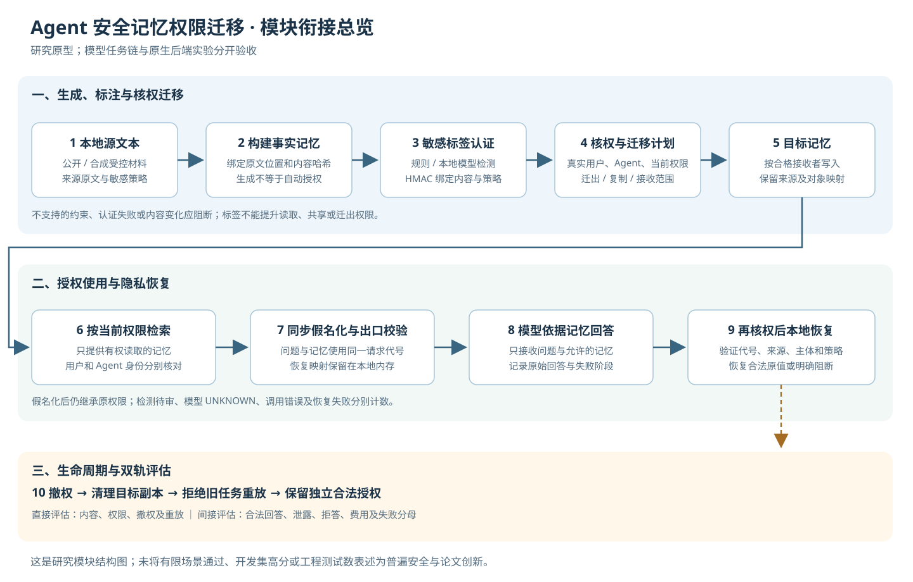
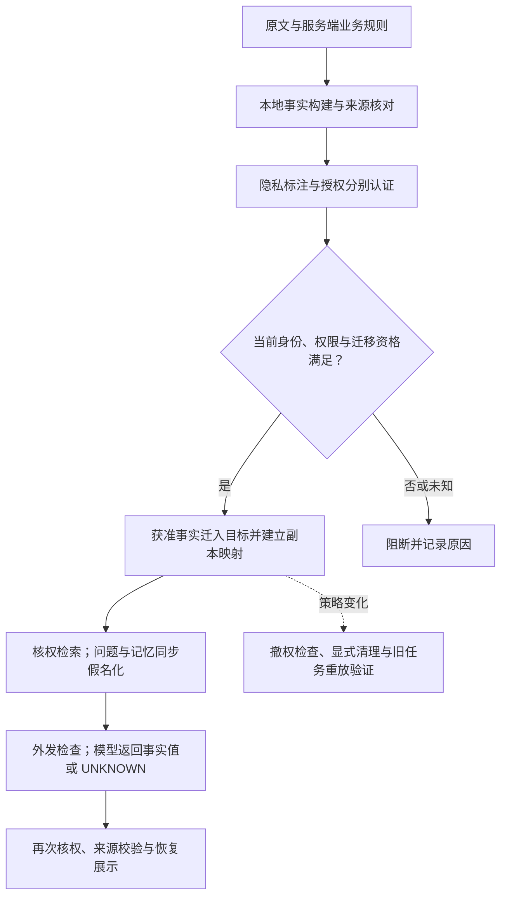

# Agent 安全记忆迁移：阶段收尾与任务汇报

日期：2026-10-25。汇报对象：项目负责人、导师及后续接手者。

本次按用户要求结束当前一轮开发与实验，整理交付物、证据和未完成项。**本阶段完成了研究原型和多轮可复查实验；整体效果验收、稳定性验收与论文创新论证尚未通过。** 收尾后不自动继续调参、建立新测试集或调用收费模型。以下结论以本机留存的实际工件为依据。

另见 [项目流程与 DeepSeek 分工图文汇报](DeepSeek使用与日志清理_图文汇报_2026-10-25.md)。历史 DeepSeek 已有 21＋64＝85 次真实问答请求，迁移与授权仍由程序执行。

## 1. 项目究竟在做什么

项目主线仍是 **Agent 记忆的安全交接与权限保持**。Agent 可以理解为能读取信息并执行任务的智能助手；记忆是供其后续使用的外部记录，不是模型参数。

我们研究：助手 A 将记忆交给助手 B，或将记忆从一种后端迁移到另一种后端时，怎样保留“谁能读、能否转交、何时失效”等约束，同时让合法用户仍能完成任务。敏感检测、生成时标注和脱敏，是服务于这条主线的内容保护措施。

例如，同一条客户记忆允许项目所有者及其助手读取，其他用户无权读取。迁移后应同时满足三个条件：允许的人仍能使用；不允许的人拿不到；获准提交给外部模型的输入也应按业务策略保护敏感原值。读取、迁出、复制和对外传播是分别判断的操作。

| 名称 | 通俗解释 | 本项目中的作用 |
|---|---|---|
| 权限 / ACL | 一张“谁可以对哪些对象做什么”的规则表 | 决定读、列举、迁出和复制是否获准 |
| 来源与血缘 | 记忆来自哪份原文、具体哪一段 | 防止把别处的信息冒充获准记忆 |
| 隐私标注 | 标出需要保护的文字及其类别 | 为后续脱敏提供可核对的位置 |
| HMAC | 使用本地密钥认证数据是否被改过的校验方式 | 绑定授权、事实和标签；不等于加密，也不证明检测没有漏项 |
| 假名化 | 将真实内容换成代号，本地保留恢复表 | 模型处理代号，合法用户在核权后看原值 |
| NER | 命名实体识别，找出文本中的人名、组织等 | 提供敏感实体候选；找到实体不自动代表敏感 |
| 强基线 | 已有、完整且合理的简单方法 | 判断新增算法是否真的有收益 |
| 独立保留集 | 方法冻结后才用于验收的新材料 | 检验是否只对反复看过的例子有效 |

## 2. 整个任务的结构

当前是由多个入口组成的研究工程：主流程组件可以组合，受控模型实验和原生后端实验分别执行、分别验收。它还不是任意 Agent 平台都能直接安装使用的通用产品。

| 层次 | 做了什么 | 主要实现 |
|---|---|---|
| 原始原型 | 在参考后端检查迁移前后的读与列举权限 | [`memory_migration_pilot`](../memory_migration_pilot/)、[`run_pilot.py`](../run_pilot.py) |
| 统一授权与规划 | 区分源读者、接收者、目标限制、迁出和复制资格；计算目标容器及副本 | [`policy.py`](../memory_migration_study/policy.py)、[`role_cover.py`](../memory_migration_study/role_cover.py)、[`plan_verifier.py`](../memory_migration_study/plan_verifier.py) |
| 事实构建与认证 | 原文摘录或候选选择，核对具体事实和原文位置；分别认证授权与隐私标签 | [`memory_builder.py`](../memory_migration_study/memory_builder.py)、[`reference_memory.py`](../memory_migration_study/reference_memory.py)、[`memory_labels.py`](../memory_migration_study/memory_labels.py) |
| 敏感识别 | 格式规则、本地 Qwen、GLiNER 和独立检测并集 | [`privacy.py`](../memory_migration_study/privacy.py)、[`local_detector.py`](../memory_migration_study/local_detector.py)、[`ner_detector.py`](../memory_migration_study/ner_detector.py)、[`union_detector.py`](../memory_migration_study/union_detector.py) |
| 内容保护与回答 | 问题和记忆同步替换、真正外发文本检查、模型回答及核权恢复 | [`privacy_egress.py`](../memory_migration_study/privacy_egress.py)、[`privacy_local.py`](../memory_migration_study/privacy_local.py)、[`llm_worker.py`](../memory_migration_study/llm_worker.py) |
| 参考与原生后端 | 参考 HTTP 服务；Open WebUI 原生接口；受控 Mem0→Open WebUI 精确事实桥接 | [`backend.py`](../memory_migration_study/backend.py)、[`native_webui.py`](../memory_migration_study/native_webui.py)、[`run_native_exact_fact_bridge.py`](../scripts/run_native_exact_fact_bridge.py) |
| 实验与独立核验 | 控制条件、逐题评分、授权见证、费用账本、源码和模型版本核对 | [`semantic_memory_benchmark.py`](../memory_migration_study/semantic_memory_benchmark.py)、[`evidence.py`](../memory_migration_study/evidence.py)、[`budget.py`](../memory_migration_study/budget.py)、[`scripts`](../scripts/) |

目录分工：`examples/` 保存自编材料与冻结配置；`tests/` 保存工程测试；`benchmarks/` 保存可公开的聚合结果；`docs/` 保存方案、裁决和说明；`results/` 保存本机逐条运行证据。下载数据、模型、虚拟环境和用户原始交接包属于本机资产，不随仓库分发。

## 3. 总流程图



下图概括可组合组件的设计顺序，不表示所有原生后端与模型环节已在同一系统完成端到端验收。



### 3.1 生成阶段：先弄清“记住了什么”

1. 准备原文和服务端业务规则。原文中的“我是管理员”“这条信息公开”不能直接修改权限。
2. 本地构建记忆。当前主要是摘录连续原文事实，或从程序形成的候选池中选择；不是任意语义摘要。
3. 校验内容确实出现在原文中，保存起止位置和内容哈希。哈希可理解为用于比对内容的数字指纹。
4. 本地检测敏感片段。格式规则检查邮箱、电话等；Qwen 和 GLiNER 处理名称或语义候选；独立业务策略决定哪些类别需要保护。
5. 分别认证访问授权和隐私标签。访问授权绑定具体事实范围、用户、执行 Agent、来源与生命周期；标签绑定敏感位置、策略和检测器版本。更换标签不能扩大访问授权。

生成时标注的价值是：在原始上下文较完整时识别敏感信息，后续经过验证后复用，避免每次只对简短片段重新猜测。标签仍可能漏标，因此认证通过不能当作识别完整。

### 3.2 迁移阶段：再决定“交给谁、交多少”

6. 认证真实用户和执行 Agent，检查源规则、接收范围及目标本地限制。未知状态不能自动补成允许；可以读也不自动意味着可以迁出或复制。
7. 按允许关系分组或按读者建立副本，保留源对象到目标对象的映射。目标表达不了的约束不能静默丢弃。
8. 校验标签、原文和授权绑定。标签失效时按明确模式重新检测；两阶段模式合并保护结果。原生精确事实桥接只向目标提交获准事实，不把整份原文当作对不可信接收者的交接包。

### 3.3 使用阶段：最后控制“怎样给模型、怎样给用户”

9. 检索当前有权使用的记忆，同时处理问题和记忆中的敏感值。例如问题和记忆里的同一公司名，在本次请求中使用同一代号。恢复表留在本机内存，不跨用户或会话复用。
10. 检查真正准备外发的文本，再请求模型。检测失败、片段定位错误或待审都保留记录，不默认为安全。首版主要处理单个事实值或 `UNKNOWN`。
11. 模型回答后再次核权，并检查代号、来源、请求和策略版本，再恢复用户有权读取的原值。用户在问题中自己提供的信息，不能因此变成有记忆证据支持的答案。
12. 分别记录底层访问结果和回答效果。撤权后使用新上下文进行后续任务；已经进入旧对话的明文不能靠事后撤权让接收方“遗忘”。

## 4. 评测怎样组织

| 评测轨道 | 要回答的问题 | 计什么 |
|---|---|---|
| 直接安全评测 | 后端实际返回了什么，迁移后权限是否保持 | 未授权披露、合法关系保留、迁出/复制资格、撤权后可见性、旧任务重放、失败及成本 |
| 间接任务评测 | Agent 使用记忆后是否正确且安全地完成任务 | 合法回答、事实缺失时的反应、有事实仍拒答、注册敏感值的外发、恢复失败及联合成功 |

联合成功要求同时满足正确回答、合法授权和所定义的内容保护条件。全部拒绝不能算好方案；模型没有复述秘密也不能掩盖底层已经披露。

本机实验还区分：真实模型调用、无需模型的工程测试、历史工件重放、真实后端接口运行。下面不同实验使用不同材料与分母，不能简单相加成一个总成功率。

## 5. 已取得的成果与结果

### 5.1 可交付的工程成果

- 建立了授权、构建、标注、迁移、假名化、恢复及双轨评测组件，保留无需模型和密钥的可运行演示。
- 发现并修复了本项目自身的同源事实授权绑定缺口：授权增加精确内容哈希与原文位置绑定，不能把同一来源的另一段文字替换进来。这是工程修复，不是第三方新漏洞。
- 完成 21 项受控生命周期见证：G1/G2 在撤权前均存在；撤销 G1 后旧请求拒绝，经当前权限筛选的新上下文保留原有 G2。完整标准基线同样通过，未证明新算法优势。
- 接入固定版本的本地 Qwen、GLiNER 与真实记忆后端；保存模型和依赖摘要、实际输入输出、调用量与独立核验记录。
- 保留负结果与原始分母，没有通过删除失败、调整真值或只报告阻断后的安全子集提高成绩。

证据：[授权修复](../results/access_binding_fix_20261025/before_after.json)、[生命周期见证](../results/transfer_lifecycle_existing_grants_20261025/report.json)、[整体主线裁决](论文目标_主线验收与竞品核验_2026-10-25.md)。

### 5.2 核心真实实验

| 实验 | 实际结果 | 可以支持的判断 |
|---|---|---|
| 原 120 条检测材料与 64 次云端对照 | 初版组合检测保留集精确率 81.25%、召回率 76.47%；修正提示＋脱敏条件合法题 7/8，但仍有注册项目名未遮蔽 | 调用链已实现；原隐私检测验收未通过，不能据此声称所有原值均留在本机 |
| 后续 40 条九类检测保留材料 | GLiNER 组合精确率 90%、召回率 90% | 仍未达到召回率至少 95% 的原目标；已查看的材料后来只作开发/回归 |
| 引用式事实构建，8 个开发故事 | 分离事实选择与敏感标注后构建 8/8、所需事实保留 32/32；原联合构建 3/8、6/32 | 支持解耦构建的工程价值；编号选择没有优于同候选池的简单原文选择 |
| 生成阶段强标注，160 格真实对照 | 18/18 事实并集标注成功；生成复用 G / 两阶段 T 均 32/32 可准备，本批注册字符漏遮 0；主联合为 23/32、25/32 | 修复本批 4 道任务的名称漏遮；尚未达到整体效用目标，G/T 输入同构不支持额外复检收益 |
| 回答机制三条件，144 格真实对照 | 自由回答严格 26/32；同一输出做保守格式兼容后 30/32；索引自由回答 27/32，但缺失题仅 7/8；位置指针 6/32 | 位置指针为负结果，不启用为默认；格式兼容成绩不能替代主指标 |
| 问题实体模式两条件，96 格真实对照 | 默认 A 严格 26/32、次要 30/32；新模式 B 严格 24/32、次要 28/32 | B 修复一题却引入两题角色词误遮；没有总体提升，未改默认 |
| 源端业务角色预验证 v1 | 结构分支 0/20 命中、8 条全部待审；弱 NER 投影 19/20 | API/输出合同尚需资格核对，真实神经 forward 数未记录；不能只凭此判定模型无能力 |
| 已存 Union 标签的角色投影重放 | 8 故事、18 事实、13 个组织候选，source-only 与可投影角色均 20/20；本次新增模型 0 | 说明完整现有基线已覆盖这 20 项；不是下游问答 100%，也不使历史标注成本变为零 |

对应可公开聚合记录：[生成强标注](../benchmarks/generation_union_transfer_development_20261025_summary.json)、[144 格回答对照](../benchmarks/span_answer_transfer_development_20261025_summary.json)、[96 格问题模式对照](../benchmarks/query_schema_transfer_development_20261025_summary.json)、[先前检测与任务交付](../benchmarks/semantic_memory_delivery_20261025_summary.json)。角色证据见本机 [v1](../results/source_role_probe_development_20261025_v1/) 与 [Union 重放](../results/union_role_baseline_replay_20261025_v1/replay.json)。

“严格 26/32”为 81.25%；“次要 30/32”为 93.75%。后者属于同一批已暴露开发题的格式兼容分析，**不是新独立测试的接近百分百成功率**。新 64 题联合成功至少 63/64 的目标尚未运行验收。上述 8 个故事也不能因重复运行变成更多独立样本。

### 5.3 原生跨后端成果与失败

受控桥接使用 Mem0 本地 SDK 2.2.1、Open WebUI 0.12.3、Chroma 1.5.9 和本地 MiniLM 向量模型。源权限由研究网关执行；目标使用真实 JWT 用户及原生记忆接口。执行 Agent 为固定应用工作者。

v3 完整运行 25/29 通过，4 个向量查询实际返回 HTTP 200、JSON `null`，因此整体失败。后来完成纯 Chroma、目标端及完整同序 trace-only 三步有界诊断；同序运行 29/29 且独立核验通过，但没有取得原四次错误的底层异常，根因未知，未证明稳定修复。旧失败工件继续保留。

这些运行没有调用生成式模型。因此它们与前面的本地问答实验，**尚未共同构成原生跨平台 Agent 端到端效果通过的证据**。

证据：[原生聚合](../benchmarks/native_exact_fact_bridge_20261025_summary.json)、[v3 失败](新exact_fact原生桥接_v3真实失败与向量接口诊断_2026-10-25.md)、[有界诊断及独立核验](原生向量null_三步有界诊断结果_2026-10-25.md)。

## 6. 收尾验收与冻结决定

| 项目 | 收尾状态 |
|---|---|
| 当前离线工程回归 | 见下方本次实测记录；工程通过不替代效果验收 |
| 研究原型、实验与证据整理 | 本阶段交付 |
| 原 95% 召回 / 90% 精确检测目标 | 未通过 |
| 新独立 64 题至少 63/64 联合成功 | 尚未执行验收 |
| 原生异构后端稳定性 | 部分受控通过，保留 v3 失败，未完成稳定性验收 |
| 多源语义摘要的完整权限继承 | 未实现通用方案 |
| 通用业务工具授权与任意 Agent 互通 | 未完成 |
| 超过完整强基线的算法优势与论文创新 | 未成立 |

收尾时离线回归：**1,028 项测试通过，0 项失败**；测试框架耗时 228.391 秒，外层执行记录耗时 234.750 秒。两个无需模型的参考迁移与假名化演示均实际运行通过。结构化结果保存在 [收尾目录](../results/project_closeout_20261025/)。上一轮 989 项回归是历史证据，不作为当前新增文件的完整通过证明。HTML 渲染器另行做本地烟测，不算进 1,028 项测试数；本次文档整理没有追加这轮全工程回归。

冻结决定：保留默认行为；不把问题模式 B、位置指针、未证明收益的语义模块切为默认。源角色 v2 目前只有代码调整，未冻结 v2 计划，也没有 v2 实测结果，列为未完成研究草稿。当前不新增模型运行来补齐它。

本次收尾新增收费模型调用为 0、API 费用为 0。历史 64 次云端实验估算约 0.02922408 元，加此前 21 次约合 0.03714944 元；这是按记录 usage 和当时价格计算的估算，不是账户实时余额或精确账单。后续各本地实验分别计费为零，并不意味着本地时间、显存和编码成本为零。

## 7. 论文目标的结论

现阶段可以向导师汇报：已形成一个有来源认证、隐私标注、核权假名化、迁移与撤权见证的研究原型，并完成多轮实际模型与后端测量；也明确了若干无效优化及失效环节。

暂时不能将其表述为“成功率接近百分百的通用安全迁移系统”“全面防泄漏方法”或“已经具备确定创新的论文成果”。双层访问、写入时分类、来源追踪、动态授权和假名化已有近邻；参见已核验的 [共享记忆与可撤销委托资料](新增近邻_共享记忆与可撤销委托_2026-10-25.md) 以及 [竞品与验收说明](论文目标_主线验收与竞品核验_2026-10-25.md)。有限检索没有定位代码，不等于竞品没有实现。

若后续恢复论文研究，最有价值的收敛问题仍是：异构后端不能表达同一约束时，能否做出可检查的投影；撤权后怎样同时失效旧副本并保留已有独立合法依据；这些机制对合法任务和成本造成怎样的变化。该问题仍须与完整标准基线比较，不能以再加入一个模型或更多组件代替创新。

## 8. 如何查看和复查交付

本机工作目录为 `F:\项目\agent安全`。

```powershell
# 无需模型或收费凭证的受控演示；输出目录须尚未存在
python -B -X utf8 -m memory_migration_study demo --output results/my_closeout_demo

# 无需模型的假名化与核权恢复演示
python -B -X utf8 examples/privacy_roundtrip_demo.py

# 全工程离线测试；不等于模型效果测试
python -B -X utf8 -m unittest discover -s tests -q

# 由本报告生成可离线阅读、打印的 HTML
python -B -X utf8 scripts/render_project_closeout.py
```

真实模型与原生后端入口需要固定本地资产及独立环境，不能用上述零依赖演示替代。`results/` 中可能包含材料原文和逐条输入输出，按现有 `.gitignore` 留在本机；公开仓库主要分发代码、自编示例、说明与去原文的聚合指标。报告中指向本机结果的链接在仅克隆仓库时可能不可用。

本阶段交付清单：本报告、总流程图、离线 HTML 阅读版、工程回归结构化结果、去原文收尾摘要及当前代码快照。研究结果与失败结论保留。

## 9. 后续工作交接单

以下为收尾后保留的待办，不在本轮自动执行：

1. 先确定一个小范围研究主张与完整强基线，再决定是否继续源端角色方案。现有角色重放已 20/20，新增模型仅达到相同分数没有优势。
2. 为原生 `null` 建立有新证据的复现假设，取得实际异常后再修；不得重复运行直到偶然全绿。
3. 冻结检测和回答方法，再建立真正未见过的检测保留材料及 64 道合法任务；保留全部失败、待审与阻断分母。
4. 将原生迁移与真实下游模型任务放进同一条受控链路，分别测底层授权、内容保护与联合效用。
5. 只有在强基线比较、独立效果和稳定性证据成立后，才组织论文主张与投稿材料；若没有差异，应调整研究问题而不是包装工程组合。

**本次收尾的准确定位：完成现阶段工程和研究记录的交付，保留未达标结论；没有宣告整体科研目标完成。**
