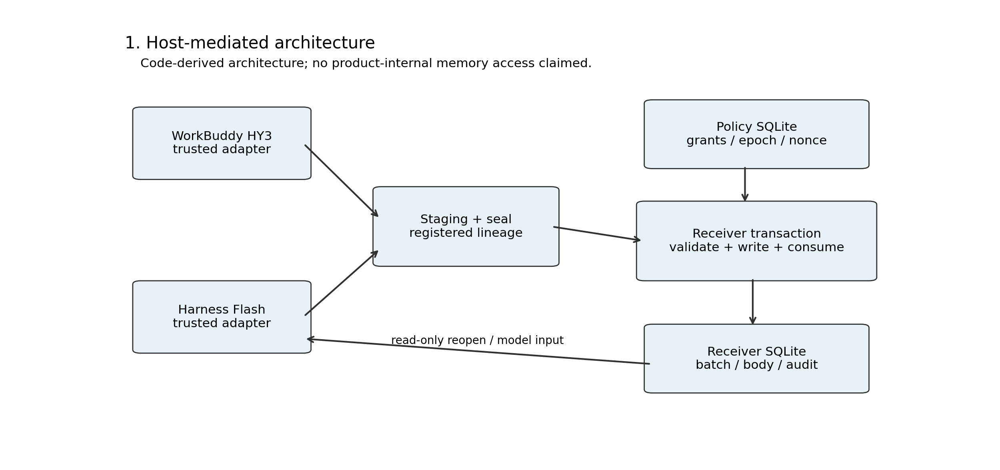
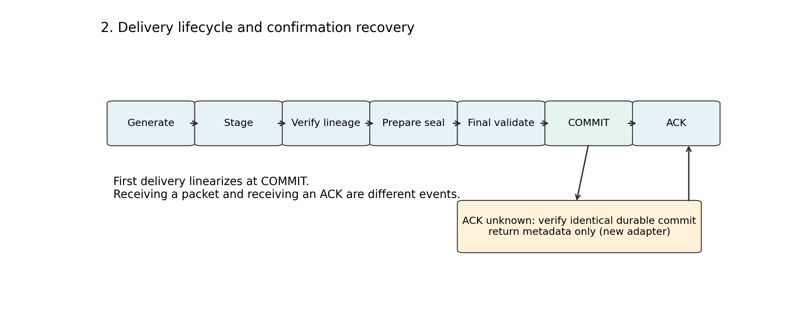
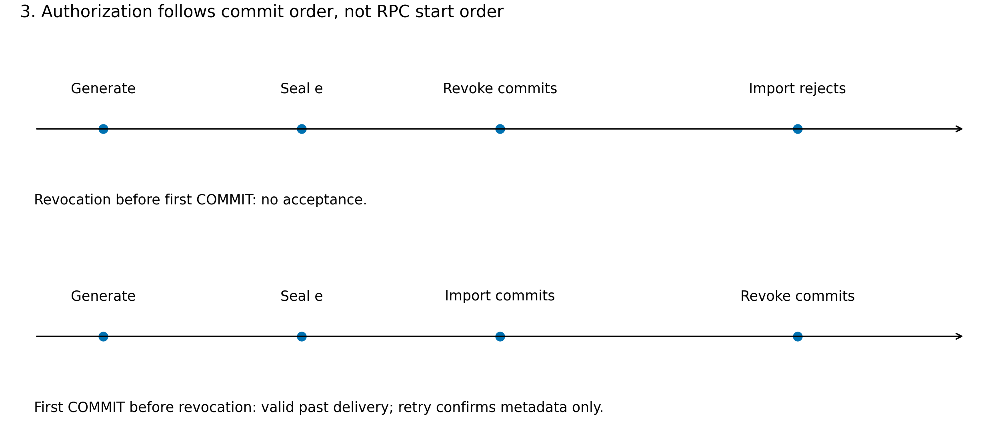
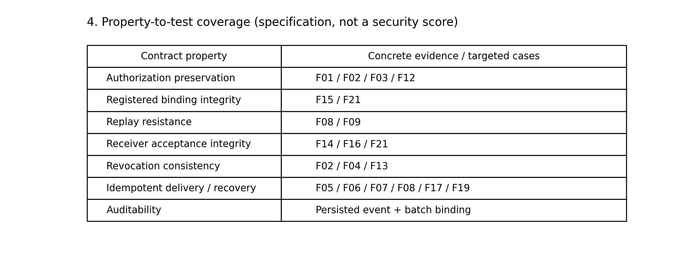
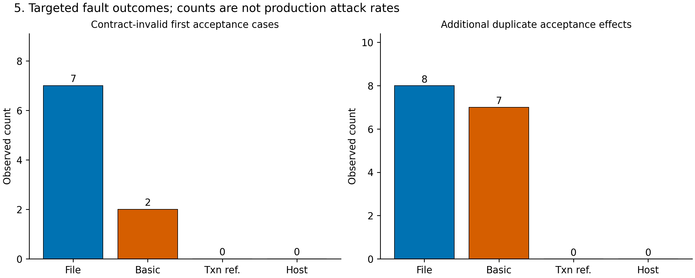
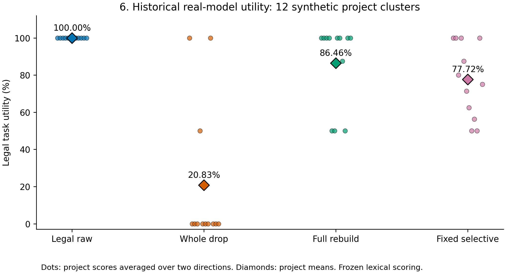
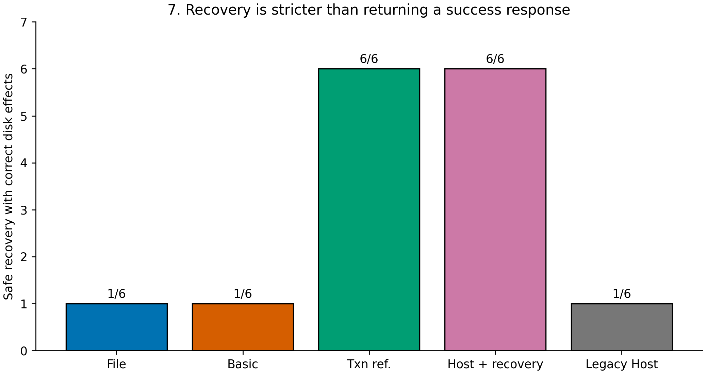
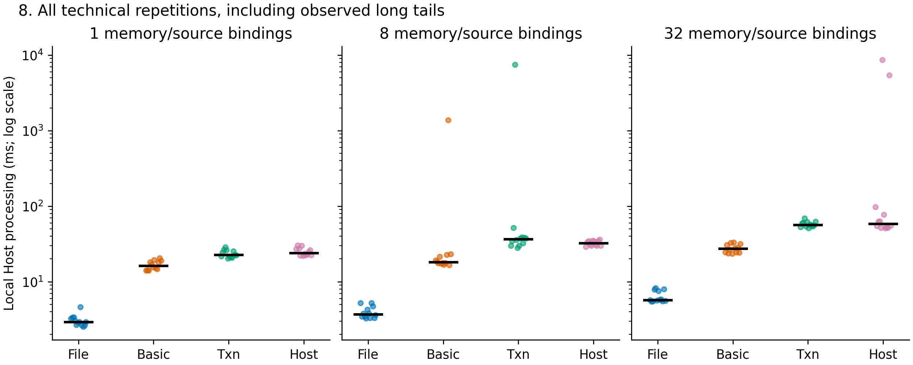

# Authorization-Preserving First Delivery of Persistent Memory Across Heterogeneous AI Agents: System Design and Empirical Evaluation

> 发布范围（2026-11-06）：本分支公开报告、代码、聚合统计和科研图表。新增商业模型的逐条输入/输出、来源记忆及运行记录尚未纳入发布，等待具体公开授权。报告中的完成数量指本地实际实验，不表示原始材料已全部公开。

Working manuscript, 6 November 2026. Authors and affiliations remain to be supplied by the researchers. This version combines archived real-client evidence with the current model-free extension. AI-assisted answer evaluation is reported separately from any human validation. Submission readiness is tracked in submission_checklist.md.

## Abstract

Persistent memories produced by one AI agent can be reused by another after the permissions governing their sources have changed. Authorization at generation or package preparation does not establish that the eventual receiver may accept the memory. We study first persistent delivery at a trusted Host that mediates WorkBuddy HY3 and DeepSeek Harness Flash. The system binds registered source versions, derived content, receiver identity and a transfer operation, and revalidates authorization within the transaction that commits the receiver batch and consumes the transfer seal. We distinguish at-most-once acceptance from confirmation recovery: the archived importer rejects replay, whereas a lightweight extension confirms an identical durable commit using metadata without repeating the disclosure. Historical bidirectional experiments contain 12 synthetic project clusters, 96 conditions and 768 question-level responses. Source-authorized raw text achieves 100% project-weighted legal utility, compared with 86.46% for full rebuilding and 77.72% for fixed selective rebuilding under the archived lexical scorer. A controlled fault suite compares file handoff, basic validation, a complete transactional reference and the Host, with the same inputs and independent effect expectations. The evaluation examines authorization, duplicate effects, recoverability and local processing cost separately. The contribution is a bounded delivery contract and auditable system evaluation, rather than a new cryptographic or transaction primitive. Guarantees stop at the Host-owned receiver commit; hidden commercial context and erasure of previously disclosed plaintext are outside the model.

Keywords: agent memory; access control; provenance; persistent delivery; revocation; recovery.

## 1. Introduction

Agents increasingly produce summaries and other persistent artifacts for later tasks and collaborators. An artifact can outlive the permission state under which it was generated. In a cross-agent workflow, the sender may finish generation, stage the memory, prepare a package, experience a failure, and deliver the package only after the receiver's sharing permission has changed. The security-relevant event is therefore not the existence of the artifact, but its acceptance at a particular execution boundary.

Memory governance already uses derivation labels, audience restrictions and controlled retrieval. LAMG checks registered sensitive dependencies before serving cached results; Audience-Bound Persistent Memory studies authorization across stored and assembled contexts [@Sangaraju2026LAMG; @Liu2026Audience]. CONTINUITY, MemTX and PlanFence connect current evidence or policy to an effect or action boundary [@Zheng2026Continuity; @Li2026MemTX; @Chen2026PlanFence]. These studies rule out claiming provenance, persistence, runtime checks or recovery as individually new features. They also motivate a narrower engineering question: what exactly must be committed together when a previously generated memory is first accepted into another Host-owned persistent store?

This boundary exposes three distinct outcomes. A request can be unauthorized before acceptance. An authorized request can commit once but lose its acknowledgment. A retried request can return success while producing a duplicate effect. Treating all three as either successful delivery or replay rejection obscures both safety and useful recovery. Conversely, a system can correctly reject an old package yet unnecessarily reject a still-authorized memory after an unrelated policy update. These cases require separate ground truth and denominators.

We address this question using the existing bidirectional WorkBuddy–Harness experimental system and a limited extension for durable confirmation. Both clients use experiment-owned SQLite stores and a trusted local policy authority. Their internal commercial memory databases are not migrated. The final import transaction checks the registered source versions, receiver permission, package seal and unused operation identity, then commits the receiver content, batch, audit binding and seal consumption together. An additional metadata-only path resolves the case in which this commit succeeded but the caller did not observe its receipt.

The paper makes three bounded contributions. First, it specifies a first-persistent-delivery contract that separates generation, preparation, receiver verification, commit, acknowledgment and recovery. Second, it maps that contract to an implemented control chain, preserving mature mechanisms and adding an identity-bound confirmation path without modifying the archived importer. Third, it evaluates the control chain through real-client task evidence and controlled fault, ablation and processing-cost experiments. The complete transactional reference is retained even when its outcomes equal those of the Host. Task utility is also evaluated against legal raw text, rather than assuming that memory rebuilding must improve it.

## 2. Related Work

**Lineage and authorization.** LAMG attaches derivation information to analytical memories and gates registered sensitive-column dependencies. Its Structured Query Language (SQL) lineage extraction and conditional completeness assumptions are directly relevant to trusted capture [@Sangaraju2026LAMG]. Audience-Bound Persistent Memory includes independently persisted architectures, native runtime evidence, restart and concurrency; Collaborative Memory provides provenance-bearing shared fragments and time-varying access graphs [@Liu2026Audience; @Rezazadeh2025Collaborative]. Our evaluation does not present the existence of persistent or shared memory as a new capability. Its object is the joint acceptance of an identity-bound transfer into a receiver database under the current sharing policy.

**Revision and rebuilding.** MemoRepair studies withdrawal and validated republication of derived artifacts. When Evidence Changes compares repair and rebuilding with source-filtered rereading and full-pipeline accounting [@Zhao2026MemoRepair; @Chu2026Evidence]. These results motivate the strong raw-source comparator and the separation between safety and task utility. Our fixed selective partition is one implementation, not a representative of every repair strategy. Its negative result is retained rather than recast as a method advantage.

**Effect-bound enforcement.** CONTINUITY explicitly specifies security-context contracts and idempotent outcome receipts; its reference finality ledger is an in-memory simulation [@Zheng2026Continuity]. MemTX uses transactional belief admission and action gating; PlanFence validates derivation currency before protected actions; FORGE applies event-graph runtime policies [@Li2026MemTX; @Chen2026PlanFence; @Palumbo2026Forge]. We inherit the need to validate at the effect boundary. The present implementation and experiments concern disk-persisted, single-Host receiver imports, including the distinction between a durable effect and a caller-visible acknowledgment. This is an adaptation and measurement claim, not a replacement for those general frameworks.

**Mature security and database mechanisms.** Ongoing authorization, authorization/content consistency and commit validation have established antecedents in usage control, Zanzibar and optimistic concurrency control [@Park2004UCON; @Pang2019Zanzibar; @Kung1981OCC]. SQLite documents the conditions under which attached-database transactions are atomic [@SQLiteAttach; @SQLiteAtomicCommit]. The protocol applies these mechanisms within that local storage boundary. It does not claim a distributed commit protocol for independent commercial services. The accompanying comparison matrix records what each paper explicitly reports and distinguishes different enforcement objects from absent capabilities.

## 3. System Model and Threat Model

The system contains two agent adapters, sender and receiver memory stores, and a trusted policy store. A source reference records its identifier, owner, version and content digest. A derived artifact records content, direct sources, parent memories and the transitive registered source set. Sharing permission is expressed as a grant from a source to a particular receiver. An agent's ability to read a source while generating an artifact does not itself grant permission to transfer that artifact.

The trusted computing base comprises the Host controller and input recorder, adapters used for identity binding, policy store, receiver verifier, SQLite, operating system and local filesystem. The controller records the business inputs actually supplied by the controlled workflow. Those records may conservatively overapproximate causal support; they do not identify a minimal causal explanation for each generated sentence. Commercial hidden context and unobserved internal retrieval are outside this capture guarantee.

An adversary may modify a package and recompute its public hashes, submit it to another receiver, replay it, delay a result, resume an old task or interleave delivery with legitimate permission changes. It cannot rewrite the trusted policy database, replace the verifier or mutate the receiver database directly. Administrative compromise and storage destruction are outside the claim. Legitimate service failures, timeouts and truncated outputs remain in execution accounting even when no attacker causes them.

## 4. Security Requirements

Let a transfer package P bind an operation identity, batch, nonce, sender, receiver r, registered source-version set D(P), content and policy epoch. First persistent delivery occurs when the local receiver/authority transaction successfully commits the corresponding batch, artifact bindings, import event and seal consumption. Receiving bytes, beginning verification or receiving a success response is not that linearization point.

Authorization preservation requires every registered source in D(P) to have its current owner/version/digest and a valid sharing grant to r at first commit. Provenance integrity requires consistency between the registered dependency closure, artifact body and trusted package seal. Replay resistance requires that one sealed operation cause at most one new acceptance. Receiver acceptance integrity binds the accepted bytes to the intended receiver and checked operation.

Revocation consistency orders permission changes and imports by their commits. Revocation committed before a first import must prevent that import. If the import commits first, later revocation does not invalidate the historical delivery or erase its plaintext. Concurrent invocation order is insufficient to determine this outcome.

Idempotent confirmation requires an identical retried operation to recover the already committed result without another acceptance or plaintext response. This is stronger than the archived importer's replay rejection and is evaluated as the current extension. Auditability requires that a trusted observer can associate the batch, content bindings, import event and source-attempt records. A hash chain checks consistency relative to a trusted anchor; it does not establish complete observation of every possible source channel.

The implementation also requires equality with a global policy epoch. An unrelated update can therefore invalidate a still-authorized package. We report this as a conservative refusal under the current-source policy oracle, separately from compliance with the stricter package-epoch contract.

## 5. Proposed Architecture and Protocol

Figure 1 shows the code-derived architecture. The source adapter fixes a business input and execution attempt. A successful, attributable output is staged with the controller's source references. Outputs without adequate execution evidence are closed and accounted for; a later continuation does not silently replace the selected result.

Preparation loads the selected artifacts, validates their registered parent closure and checks their current source permissions. The policy authority records a seal binding the canonical package digest, identities, nonce and epoch. A hash supplied only inside the package is insufficient: the receiver must match the independently stored trusted seal.

The receiver first checks the exact package schema, receiver identity, content digest and registered lineage. It attaches the policy database, starts an immediate transaction and rereads the current epoch, source references, sharing grants and unused seal. It then inserts the artifact and lineage records, creates the import event and batch, consumes the seal, and commits. The archived implementation uses separate disk files with DELETE journals and FULL synchronization. This is a single local multi-file transaction, not a transaction across the two commercial providers.

The receiver is closed and reopened through a read-only path before its content is presented to the receiving model. This validates the persisted batch and its audit bindings. The receiver model's later answer is a task outcome, not evidence that an earlier commit was authorized.

**Confirmation recovery.** In the archived workflow, the import can commit before the outer delivery-result file is written. A crash or missing response therefore leaves an ambiguous caller state. Blindly creating another operation is inappropriate; treating the absence of that file as proof of no delivery is incorrect. The new adapter queries the durable receiver state for the same import or batch and checks the entire identity and digest against the persisted event and artifact bindings. If they match, it returns the original commit metadata only. If there is no commit, it invokes the unchanged import gate. If a concurrent duplicate importer wins between lookup and import, the adapter checks for that same committed result again. A conflicting package cannot obtain a successful confirmation merely by reusing a batch identifier.

After revocation, confirming an earlier valid commit is not a new authorization. The adapter returns no memory body, and a previously uncommitted operation must still satisfy current policy. Acknowledgment recovery and the source-side status update are not jointly atomic; the receiver commit is the authoritative recovery fact. The two exchange directions likewise have independent commit points.

## 6. Security Analysis

Under the stated storage and trust assumptions, the receiver and policy writers are serialized at the relevant transaction boundary. The importer holds its transaction while checking the authority and writing the receiver effects. A revocation that commits first changes the state checked by the importer; a revocation that follows the import cannot alter the past ordering. Any failed predicate rolls the import back.

The batch, artifacts, event and seal consumption are committed together. Thus a successful stable state contains both the receiver effect and its consumed operation identity. Unique batch/import constraints and conditional consumption prevent two concurrent requests from independently accepting the same operation. These are properties of mature transaction and uniqueness mechanisms, not a new concurrency algorithm.

The package digest is checked against a seal held in the trusted policy database. An attacker can recompute internal hashes but cannot change that seal. The registered lineage validator additionally checks artifact identity, parent completeness and the declared source union. These checks prove consistency of registered information. They do not prove that a malicious recorder omitted no actual input, so the input recorder remains in the trusted base.

The confirmation path introduces no second acceptance. It accepts only an identity matching an already verified durable commit and returns metadata, with no memory content. The current policy need not reauthorize a historical acknowledgment because no new memory is transferred by this branch. A request without a matching durable commit still enters the original final authorization gate. These arguments are implementation-level conditional reasoning. Finite crash and interleaving tests exercise specified traces; they are not an unbounded machine-checked security proof.

## 7. Experimental Setup

**Historical real-client study.** The archived study uses 12 synthetic project clusters: three source sizes (20, 50 and 100 per owner) crossed with four revocation ratios (0%, 10%, 30% and 50%). Each cell has one project. Two directions and four transfer strategies yield 96 conditions, each with eight question-level outputs, for 768 scored fields. The dataset contains 1,360 distinct source identifiers. These quantities describe different levels and are not added as independent samples.

The four task strategies are currently legal complete raw text, whole-memory deletion, complete rebuilding from legal sources, and fixed two-block selective rebuilding. Real WorkBuddy HY3 and DeepSeek Harness Flash calls produced the archived generation and answering evidence. The present extension makes no new paid model calls. Host-owned receive stores are closed and reopened before downstream use. The experiment does not transfer the products' private native memory databases.

**Controlled lifecycle study.** New deterministic fixtures have independent source, permission and expected-effect records. Four principal configurations compare plain file handoff, basic integrity plus access control list (ACL) checks, complete versioned authorization with transactional idempotency, and the full Host delivery core. The complete transactional reference reuses the mature verifier core and is not represented as an independent reimplementation. A separate scenario oracle specifies the expected durable effects. Legacy and isolated module ablations explain which behavior comes from the added confirmation adapter and which safeguards remain redundant under other checks.

Faults include post-generation and post-preparation revocation, revocation before or after first commit, lost acknowledgment, a missing source status update, process termination before or after commit, repeat and concurrent requests, stale source versions, late outputs, revoke–regrant epochs, wrong receivers, modified packages, identity conflicts and independent bidirectional operations. New databases contain only controlled fixtures. Historical stores and code remain unchanged.

**Evaluation and statistics.** Archived task comparisons use project-level paired differences; directions and questions are repeated observations within each project. Existing 95% project bootstrap intervals are retained with their exploratory scope. The targeted fault cases are specifications, not random draws from production attacks; their counts do not receive a pooled production-risk interval or an artificial significance test. Technical timing repetitions describe the local measurement distribution, not independent business projects. Central processing unit (CPU) time, memory, storage and stage timing are distinguished from provider latency and unobservable commercial charges.

The revised answer-evaluation procedure uses AI-assisted A/B/C triage. A-level decisions use explicit independently checkable facts; B-level decisions receive a second contextual check; unresolved C-level cases are presented to researchers as judgment cards. Original two-rater materials remain blank and distinct. Any human validation subset and inter-rater agreement are reported only after actual researchers supply labels. AI judgments and agreement between automated rules are not reported as human agreement.

## 8. Experimental Results

### 8.1 Historical authorization and persistence checks

The archived mechanisms reject old whole memories in all 18 nonzero-revocation views; the other six permission views have no revocation. Three attack types—replay, content modification with recomputed internal hashes, and wrong receiver—are each exercised on 24 approved packet copies, producing 72 rejections. These are repeated mechanism checks over related artifacts, not 72 independent attack families. The historical readback evidence verifies closing, reopening and retrieving receiver batches. The current audit additionally opened 132 historical SQLite files in read-only mode: every quick check returned `ok`, and the database byte hashes were unchanged.

### 8.2 Legal task utility

|Transfer strategy|Project-weighted legal utility|
|---|---:|
|Legal complete raw text|100.00%|
|Whole-memory deletion|20.83%|
|Full legal-source rebuilding|86.46%|
|Fixed selective rebuilding|77.72%|

Under the frozen lexical scorer, fixed selective rebuilding is 22.28 percentage points below raw text, with an archived exploratory 95% project bootstrap interval of −33.02 to −11.67 points. Its difference from full rebuilding is −8.74 points, with an interval spanning −22.40 to +4.70 points. The latter does not establish a reliable ordering. These findings favor legal raw text for the tested extraction-oriented tasks. They do not show that all repair methods are inferior, and the fixed partition is not MemoRepair. Figure 6 shows every project score rather than treating 768 fields as independent trials.

### 8.3 Execution failures and attribution

The source ledger retains 132 result attempts, of which 106 succeeded and 26 were closed. Closures include protocol failures, unavailable candidates, truncation and unresolved execution. There are 125 logical source cells and seven effective recoveries; a separate late continuation was not used to replace selected outputs. The receiver ledger retains 98 outer attempts for 96 main conditions. These records show why a successful-response-only analysis would be incomplete. They do not establish production failure probabilities or prove that every closed source attempt is repairable by additional evidence.

Visible tool-scope auditing and artifact selection are distinct from semantic answer correctness. An excluded source artifact may reduce available legal information without making the later receiver import violate its protocol. The AI-assisted evaluation therefore does not automatically map `source_protocol_clean=false` to a question-level protocol-failure label. Uncertain attribution is retained explicitly.

We then traced the 51 initially ambiguous question-level records against locally retained source results, staged-memory bindings, explicit failure summaries and actual receiver readback. In 42 records, the required value existed in an identity-matched source artifact that the Host filtered out; the corresponding value was absent after delivery. Five further records had the needed value in a retained partial source output, but the output-budget closure prevented that artifact from being delivered. One value existed in an artifact written to a different directory spelling, so a path-contract mismatch prevented acceptance. These 48 records localize a loss of available evidence within the delivery chain. They do not prove the counterfactual claim that the receiver would necessarily answer correctly if that evidence had been admitted.

One additional record already contained the needed fact in receiver memory but omitted it in the answer, locating the observed omission after readback. Only two records remain ambiguous: the required location and date are absent from the retained partial output, so generation omission and truncation before those facts were emitted cannot be uniquely distinguished. All trace inputs retain file hashes and explicit paths, without inspecting credentials or unobserved provider sessions. Question-level records share conditions and source artifacts; 48 traced fields are not 48 independent failure events. This decomposition qualifies interpretations of rebuilding quality: answer loss can reflect source conformance closure or receiver omission as well as the content of a summary.

### 8.4 Controlled first-commit, recovery and ablation results

The fixed suite contains 22 targeted cases and ten configurations, producing 220 configuration–case records. The four principal configurations have the following outcomes; counts are observations over the fixed cases, not estimates of production attack rates.

|Configuration|Contract-invalid first-acceptance cases|Additional duplicate effects|Safe recoveries in six cases|Current-policy conservative refusal cases|
|---|---:|---:|---:|---:|
|Plain file handoff|7|8|1/6|0|
|Basic integrity and ACL|2|7|1/6|0|
|Complete transactional reference|0|0|6/6|2|
|Complete Host delivery core plus confirmation|0|0|6/6|2|

The joint first-acceptance metric covers revoked permissions, stale source versions, wrong receivers and modified artifacts. It must not be interpreted as a sensitive-disclosure count alone. In particular, the two basic-check failures are the stale-source and recomputed-hash artifact cases; its current ACL check prevents the tested revoked-ACL handoffs. The complete reference and Host match all 22 strict package-contract expectations. Both also reject two memories that are legal under the current-source policy: an unrelated epoch update and a revoke–regrant sequence. Strict epoch compliance and a conservative availability refusal can therefore coexist.

The archived importer retains zero invalid or duplicate effects but safely recovers only one of the six cases. Five involve an existing commit whose metadata must be confirmed; the adapter confirms all five, whereas the legacy interface confirms none. The sixth is a crash before commit followed by a valid fresh retry, which both handle. Thus safe recovery is 6/6 for the adapted Host and 1/6 for the legacy interface. This is an engineering recovery improvement, not an advantage over the equally equipped mature transactional reference. The extension is tested in the isolated Host harness; it has not been retroactively inserted into the archived commercial-client run.

Removing final authorization causes three invalid-acceptance cases: two post-preparation revocations and one stale-source case. Removing only epoch equality admits two old-epoch packages while current grants remain valid; this is a strict-token-contract deviation, not necessarily unauthorized source sharing. Removing the explicit nonce check or registered-lineage check alone produces no additional failures in these cases because remaining unique keys, conditional consumption and trusted seal bindings can mask the removed guard. These null ablations are retained. They do not establish that the omitted checks are unnecessary for untested attacks. Figures 4, 5 and 7 link the contract coverage, effects and confirmation outcomes.

### 8.5 Local processing cost

The performance run contains 144 first-operation measurements and their corresponding retries: three sizes (1, 8 and 32 memory/source bindings), four configurations and 12 technical repetitions per cell. Connections are already open and packages prepared; the measured interval is receiver-side Host processing, not generation-to-delivery time. Stage timings, process CPU time, Python allocation peaks, working-set snapshots and storage deltas are retained in the raw records. A phase absent from a configuration is encoded as zero in the raw probe and treated as not applicable, rather than as a zero-cost implementation of that phase.

Complete Host median first-operation times are 24.064, 32.526 and 58.746 ms at the three sizes; metadata confirmation medians are 1.238, 1.731 and 2.650 ms. The mature reference medians are 22.650, 36.600 and 56.713 ms. These measurements do not support a speed-superiority claim. Long tails remain visible: the 32-binding Host sample has an interpolated p95 of approximately 6,881.5 ms, and the eight-binding reference sample approximately 3,412.1 ms. Causes are not independently attributed on the shared Windows laptop. Figure 8 shows every repetition on a logarithmic time axis. The model providers' latency, hidden calls and WorkBuddy fees are not inferred from local measurements.

### 8.6 AI-assisted answer evaluation

Every question-level record received an AI-assisted assessment. The first pass identified 670 deterministic-rule candidates and 98 contextual-review candidates; all 98 received an actual contextual check. Reviewers were two same-family Codex roles covering disjoint halves, not two independent human raters or two independent model families. A second typed-fact checker supplements the rule pass; agreement between these rules is not semantic inter-rater validity. Local artifact tracing resolved 49 of 51 initial causal ambiguities. Final triage contains 670 A-level records, 96 B-level records and two C-level records, covering all 768 fields. The two remaining records are grouped into one targeted researcher card rather than asking researchers to relabel the entire dataset.

The 48 traced source-stage losses receive a protocol-failure-stage annotation for source nonconformance, incomplete-output closure or a path-contract mismatch; they are not receiver authorization failures. The receiver-omission case and the two unresolved causal cases remain distinguishable. Labels are nonexclusive, and the shared source-condition events are not recounted as 48 independent protocol failures.

Three contextual decisions accept answer forms rejected by the archived exact scorer: a location value without a prefix, another explicitly introduced location with the prefix omitted, and an English `Location` prefix for the same source identifier. Two additional legal joins provide one of two required facts. Partial answers improve the secondary fact-coverage score but do not count as fully completed answers.

|Strategy|Archived lexical full-completion utility|AI-assisted semantic full completion|
|---|---:|---:|
|Legal raw text|100.00%|100.00%|
|Whole deletion|20.83%|20.83%|
|Full rebuilding|86.46%|87.50%|
|Fixed selective rebuilding|77.72%|79.81%|

For the AI-assisted binary endpoint, full rebuilding differs from raw text by −12.50 percentage points (95% project bootstrap interval −25.00 to 0.00); selective rebuilding differs by −20.19 points (−31.65 to −8.96). Exploratory paired exact sign-flip P values are 0.25 and 0.015625, with two-comparison Holm values of 0.25 and 0.03125. The secondary partial-credit fact coverage is 87.50% and 80.59% for full and selective rebuilding. Neither endpoint replaces the archived lexical results. The bootstrap uses 5,000 project resamples, seed 2026110605; its uncertainty describes this synthetic design and does not establish human validity of AI labels or production generality.

No contradicted asserted fact or disclosure of a forbidden fact was identified within the frozen fact-set assessment. This is a bounded AI judgment, not a guarantee against arbitrary semantic inference. Protocol filtering is reported separately at the source-condition level; uncertainty about whether it caused a particular omission does not erase an observable missing legal answer. The current triage counts and targeted-review status are reported in the evaluation report. Human confirmations and completed human-validation ratings remain zero in this draft; the prepared 48-item stratified subset is available if a human-agreement assessment is undertaken. No human kappa or human confidence interval is imputed.

## 9. Discussion and Limitations

The main system distinction is between a valid first commit, a caller-visible result, and a safe confirmation of an earlier commit. A replay rejection can protect at-most-once effects while leaving a legitimate caller unable to establish success. Conversely, a returned success can hide a duplicate write. Evaluating authorization and confirmation together prevents these outcomes from being collapsed into one success metric.

The complete transactional reference is an essential control. Equal behavior would confirm that mature mechanisms meet this bounded contract; it would not establish an algorithmic advantage for the Host. The system contribution depends on the explicit adapter-to-commit binding and reproducible measurements of its operation and limits. Likewise, task utility does not improve merely because the transfer is safe. The archived result supports retaining raw authorized information as a strong default comparator.

The global epoch deliberately rejects some otherwise legal packages after unrelated updates or revoke–regrant transitions. This cost must remain visible next to safety results. More selective read-set validation is established prior work and is not proposed here as a new algorithm. Whether it is worth adding depends on the measured workload, not on a need to add another contribution.

External validity is limited by one Host, two client/model families and a common synthetic project generator. There is one project per size–revocation cell, so the study cannot reliably estimate their full interaction or general business-task effects. The threat model trusts source registration and local storage. It does not establish complete commercial context capture, open-world inference safety, erasure after disclosure, or atomicity across independent providers. Process termination tests do not replace power-loss or faulty-storage testing. AI-assisted labels require representative human validation before they support claims of human-level semantic assessment. Unknown commercial costs remain unknown.

## 10. Conclusion

Authorization-preserving memory transfer requires a precisely located acceptance boundary and explicit handling of uncertain acknowledgments. The implemented Host places current source authorization, receiver acceptance and operation consumption within one local persistent commit. A lightweight, identity-bound metadata path supports confirmation of an already committed operation without repeating its content. Archived real-client results and the controlled extension provide complementary evidence: the former measures task behavior and execution failures, while the latter tests specified commit and recovery traces. This bounded system study uses mature security mechanisms and reports their costs and limitations without claiming a new foundational algorithm.

## Data, Code and AI-Assistance Notes

Public archived evidence and reproducibility scripts are available in the project repository. The new model-free configuration, raw outcomes, code hashes and figure sources are recorded under `paper_final/evidence/` and independent experiment directories. Commercial private native sessions and account materials are not part of the public package. No new license grant is inferred from repository visibility. Final publication of the new artifacts requires the authors' review of code, data and third-party licenses.

AI tools assisted code inspection, experiment implementation, evaluation triage, source checking and English drafting. They are not authors or human raters. Human authors must verify all submitted conclusions and disclose the use according to the selected journal's current policy. The procedural skill library is recorded as software/method support [@Kassis2026Skills].

References are supplied in `references.bib`; the citation keys preserve formal journal versus preprint status and pending DOI registration.
