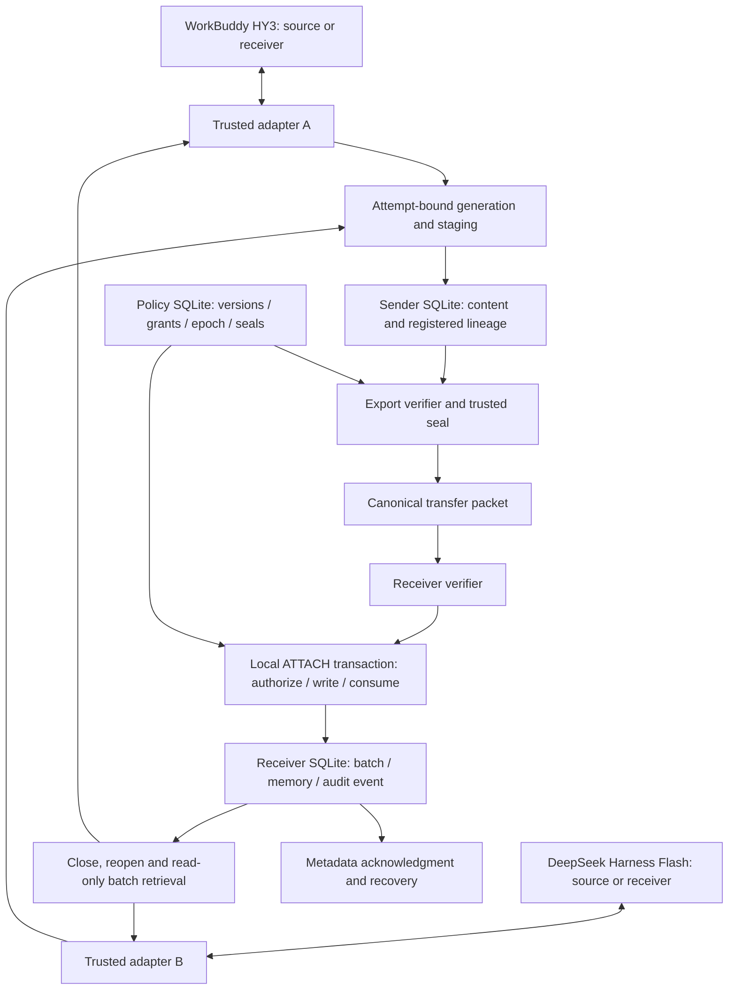
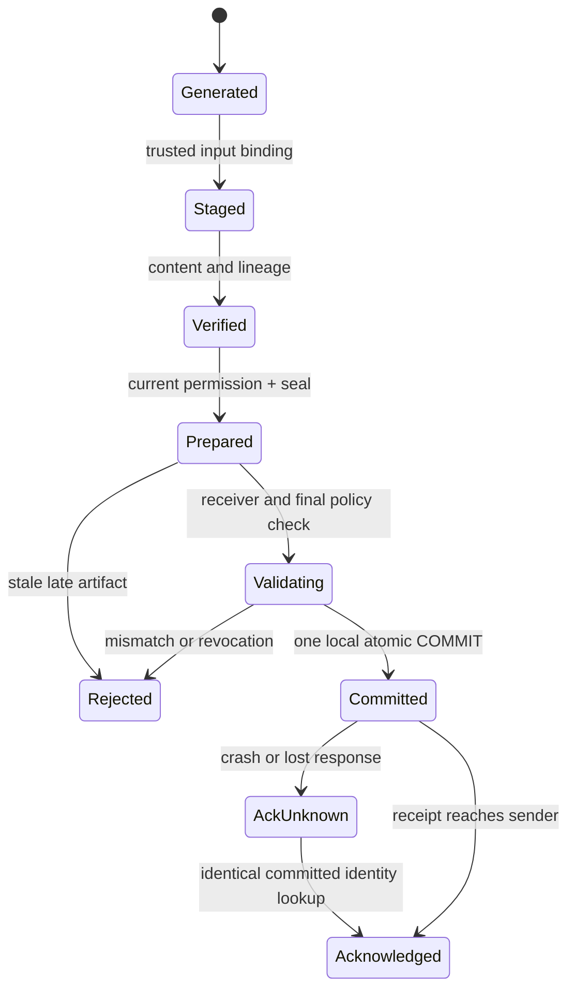

# 系统架构与实际执行路径

> 发布范围（2026-11-06）：本分支公开报告、代码、聚合统计和科研图表。新增商业模型的逐条输入/输出、来源记忆及运行记录尚未纳入发布，等待具体公开授权。报告中的完成数量指本地实际实验，不表示原始材料已全部公开。


日期2026-11-06。代码版本以[evidence/core_asset_audit.json](evidence/core_asset_audit.json)所列SHA和函数行号为准。132个历史SQLite文件通过只读quick_check，旧文件哈希不变。该检查不重新运行真实商业任务。



图中数据库与适配器由本项目控制；品牌框表示实际生成/回答服务，不能推导产品内部库互通。原生工具可见动作核验、SDK输入摘要及付费零工具receiver有不同观测层级。`receiver_runtime._control_command`是命令范围检查，不是OS沙箱；Harness付费适配器的本地读取不等于远端模型直接查询SQLite。

## 生命周期



Metadata恢复边为本轮扩展；原实现重放报错，不自动提供这条边。原源任务恢复规则仍由`source_registry.py`约束；不能重新生成一个更有利结果替换已封存成功产物。

## 动态权限时序

```mermaid
sequenceDiagram
    participant A as Source adapter
    participant H as Trusted Host
    participant P as Policy DB
    participant R as Receiver DB
    A->>H: staged memory with registered dependencies
    H->>P: validate and seal at epoch e
    P-->>H: prepared packet
    P->>P: revocation COMMIT (e+1)
    H->>R: request first import
    R->>P: ATTACH transaction; compare current epoch/grants
    P-->>R: stale / revoked
    R-->>H: reject; no new batch
    Note over P,R: If import commits before revocation, that first delivery was valid.
```

## 代码、章节与证据映射

|模块|实际职责|论文章节|证据|
|---|---|---|---|
|`store.py`|来源/父依赖、封装、事务导入、读取|模型、方法、安全分析|源码SHA、实际DB、旧安全探针与新故障测试|
|`source_registry*.py`|任务尝试选择、恢复与迟到产物单列|方法、执行可靠性|132尝试/125逻辑cell、7恢复、1迟到事件|
|`model_runtime.py`|真实源生成输入和模型身份回执|实验设置、可观测性|HY3/Flash分开计量，未知成本不估填|
|`receiver*.py`、`read_receiver.py`|从接收库重开读取、输入/回答回执|实验设置、持久接纳|96条件readback与原模型输出|
|`evaluate.py`、`finalize.py`|题级/项目级评分、失败与来源合规账本|结果、统计|旧评分/区间保持，人工新标签单列|
|本轮CPU独立目录|基线、故障、消融、ACK恢复和性能|实验结果|固定配置、raw、代码哈希与运行日志|

旧24项目补证优化与Stage3A/C仅作设计选择/边界补充，不加入本稿主实验分母。
